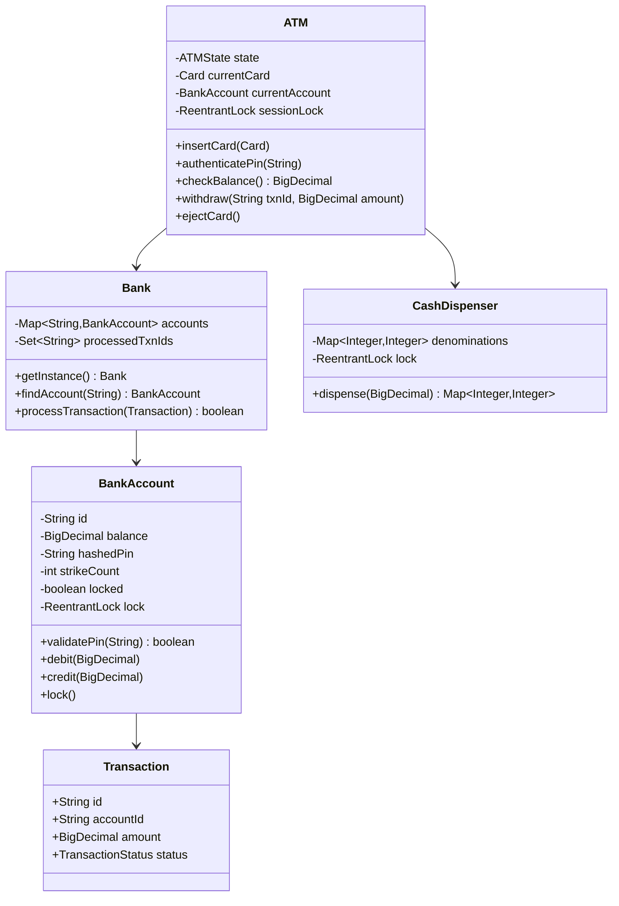
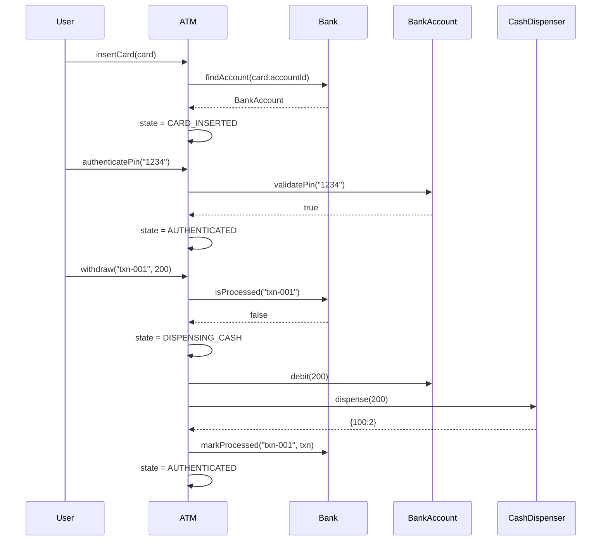

# ATM Machine — LLD / Agentic Coding Interview

## 1. Problem Statement

### Objective
Design and implement a simplified ATM (Automated Teller Machine) system that handles card authentication, cash withdrawal, balance enquiry, and transaction recording with proper state management and concurrency safety.

### Expected Deliverables
- Working application with console-based demo
- Core ATM operations: insert card, authenticate PIN, check balance, withdraw cash
- State machine for ATM session lifecycle
- Idempotency and rollback support
- Unit tests covering all scenarios
- Demonstrable output

### Constraints
- **Programming language:** Java 11
- **Database:** In-memory (ConcurrentHashMap)
- **Framework:** None (plain Java)
- **Time limit:** 45–60 minutes
- **AI coding tool:** Cascade (Windsurf)
- **Other restrictions:** No external libraries beyond JUnit 4; no Spring

---

## 2. Requirement Analysis

### 2.1 Functional Requirements (FR)

| ID | Requirement | Priority | Acceptance Criteria |
|----|-------------|----------|---------------------|
| FR-01 | User can insert a card and start a session | Must | Session starts; ATM state moves to CARD_INSERTED |
| FR-02 | User can authenticate with a PIN | Must | Correct PIN → AUTHENTICATED; wrong PIN → failure counted; 3 wrong → account locked |
| FR-03 | User can check account balance | Must | Returns current balance after authentication |
| FR-04 | User can withdraw cash | Must | Sufficient balance + cash available → dispenses; updates balance |
| FR-05 | Cash dispenser uses greedy denomination selection | Must | Minimum number of notes dispensed; fails if exact amount impossible |
| FR-06 | Transactions are idempotent | Should | Duplicate transaction ID is rejected, same result returned |
| FR-07 | Failed dispense rolls back the account debit | Must | If dispenser fails after debit, balance is restored |
| FR-08 | Account locks after 3 failed PIN attempts | Must | Locked account rejects all operations |
| FR-09 | User can eject card / end session | Should | ATM returns to IDLE state |

### 2.2 Non-Functional Requirements (NFR)

| ID | Requirement | Expected Behaviour |
|----|-------------|-------------------|
| NFR-01 | Performance | Each operation completes in O(1) or O(D) where D = number of denominations |
| NFR-02 | Scalability | Singleton Bank supports multiple BankAccount instances; extendable to multiple ATMs |
| NFR-03 | Concurrency | ReentrantLock per BankAccount; ATM sessionLock prevents overlapping sessions |
| NFR-04 | Reliability | Rollback on dispense failure ensures no money lost; PIN hashed with SHA-256 |
| NFR-05 | Maintainability | ATM state machine with clear enum states; strategy for denomination selection |
| NFR-06 | Security | PIN stored as SHA-256 hash; 3-strike lockout; no PIN exposed in logs |

### 2.3 Clarifying Questions

| Question | Answer | Impact |
|----------|--------|--------|
| Can multiple ATMs share one Bank? | Yes, Bank is a singleton | Shared state requires ConcurrentHashMap |
| Should denominations be configurable? | Fixed denominations (100, 50, 20, 10) | Greedy algorithm hardcoded |
| Is network failure simulation needed? | No, in-memory only | Simplifies rollback to in-process logic |
| How is idempotency keyed? | By transaction UUID | Set<String> in Bank tracks processed IDs |

### 2.4 Ambiguities and Missing Requirements
- **Business ambiguities:** Daily withdrawal limit not specified → not implemented
- **Technical ambiguities:** Multi-ATM concurrent access to same account → lock is on BankAccount, not ATM
- **Failure scenarios:** Dispenser runs out of one denomination mid-dispense → greedy fails, full rollback
- **Concurrency scenarios:** Two ATM sessions on same account → account-level ReentrantLock serializes
- **Boundary conditions:** Withdraw exactly 0 → rejected; withdraw more than balance → rejected

### 2.5 Assumptions

| ID | Assumption | Reason |
|----|-----------|--------|
| A-01 | One card maps to one BankAccount | Simplification; real systems have card-to-account mappings |
| A-02 | Cash dispenser is replenished manually; not modelled as depletion over time | Scope limitation |
| A-03 | Sessions are single-threaded per ATM | sessionLock ensures this |
| A-04 | PIN is 4-digit string; stored as SHA-256 hash | Security requirement |

---

## 3. Scope and Design Decisions

### In Scope
- Card insertion and ejection
- PIN authentication with lockout
- Balance enquiry
- Cash withdrawal with denomination selection
- Transaction creation, rollback, idempotency
- ATM state machine (IDLE → CARD_INSERTED → AUTHENTICATED → DISPENSING_CASH)

### Out of Scope
- PIN change
- Deposit cash
- Mini statement / transaction history pagination
- Multi-currency
- Network/database persistence

### Engineering Decisions

| Decision | Selected Approach | Alternatives | Reason |
|----------|-------------------|--------------|--------|
| Storage | ConcurrentHashMap in Bank singleton | Database, file | In-memory; interview scope |
| Concurrency | ReentrantLock per BankAccount + ATM sessionLock | synchronized blocks | Explicit; supports tryLock patterns |
| PIN security | SHA-256 hash | Plain text, BCrypt | Simple hash sufficient for interview |
| Denomination | Greedy largest-first | DP exact-change | Greedy is O(D), sufficient |
| Idempotency | HashSet<String> of processed transaction IDs | DB unique constraint | In-memory; fast lookup |
| Rollback | In-process balance restoration | Saga, 2PC | Single JVM; no distributed txn needed |

---

## 4. Use Cases and Scenarios

### Primary Use Cases
1. Customer withdraws cash successfully
2. Customer enters wrong PIN (3x) → account locked
3. Duplicate transaction is detected and ignored
4. Dispenser fails → balance rolled back
5. Insufficient balance → withdrawal rejected

### Happy Path Scenarios
- Insert card → authenticate → check balance → withdraw → eject
- Withdraw exact denomination combination (e.g., ₹150 = 100+50)

### Negative Scenarios
- Wrong PIN 3 times → locked
- Withdraw amount not dispensable (e.g., ₹15 with denominations 20,50,100)
- Withdraw when balance is zero

### Edge Cases
- Withdraw exactly the full balance
- Insert card when session already active
- Duplicate withdrawal transaction ID

### Failure Scenarios
- Dispenser out of cash after debit → full rollback
- Account already locked when card inserted

### Concurrent Execution Scenarios
- Two threads attempt to withdraw from same account simultaneously → only one succeeds at a time due to ReentrantLock

---

## 5. Domain Model

### Entities
- **Card** — cardNumber, accountId
- **BankAccount** — id, holderName, balance (BigDecimal), hashedPin, strikeCount, locked, ReentrantLock
- **Transaction** — id, accountId, type, amount, status (PENDING/SUCCESS/FAILED/ROLLED_BACK), timestamp
- **CashDispenser** — denominations map, ReentrantLock
- **Bank** — singleton; Map<accountId, BankAccount>; idempotency Set
- **ATM** — currentCard, currentAccount, state, sessionLock

### Value Objects
- `TransactionStatus` enum: PENDING, SUCCESS, FAILED, ROLLED_BACK
- `ATMState` enum: IDLE, CARD_INSERTED, AUTHENTICATED, DISPENSING_CASH

### Relationships
- Bank 1 → N BankAccount
- BankAccount 1 → N Transaction
- ATM uses 1 CashDispenser
- ATM interacts with 1 Bank

### Business Invariants
- Balance must never go negative
- A locked account rejects all operations
- 3 wrong PINs lock the account permanently (within session)
- A transaction ID can only be processed once

### State Transitions
```
IDLE → CARD_INSERTED (insertCard)
CARD_INSERTED → AUTHENTICATED (correctPin)
CARD_INSERTED → IDLE (wrong pin 3x or ejectCard)
AUTHENTICATED → DISPENSING_CASH (withdraw)
DISPENSING_CASH → AUTHENTICATED (dispense complete)
AUTHENTICATED → IDLE (ejectCard)
```

### Class Diagram


---

## 6. API and Contracts

### Interface Definitions
```java
// ATM operations (no formal interface; ATM is the façade)
void insertCard(Card card)
boolean authenticatePin(String pin)
BigDecimal checkBalance()
Transaction withdraw(String txnId, BigDecimal amount)
void ejectCard()
```

### Validation Rules
- `amount` must be positive and a multiple of smallest denomination
- `pin` must be non-null, 4 characters
- `txnId` must be non-null, non-blank UUID

### Error Handling Contract
- Wrong state → `IllegalStateException`
- Locked account → `IllegalStateException("Account is locked")`
- Insufficient balance → `IllegalArgumentException`
- Undispensable amount → `IllegalArgumentException`
- Duplicate transaction → returns cached result (idempotent)

---

## 7. Low-Level Design (LLD)

### Component Responsibilities
- **ATM** — Session orchestration, state machine enforcement
- **Bank** — Account registry, idempotency guard, transaction persistence
- **BankAccount** — Balance management, PIN verification, lockout logic
- **CashDispenser** — Denomination calculation and inventory management
- **Transaction** — Immutable record of each operation

### Design Patterns
- **State** — ATM state machine (IDLE/CARD_INSERTED/AUTHENTICATED/DISPENSING_CASH)
- **Singleton** — Bank instance
- **Template Method** — Transaction lifecycle (debit → dispense → commit/rollback)

### SOLID Principles
- **SRP** — Each class has one responsibility (ATM orchestrates; Bank stores; Dispenser dispenses)
- **OCP** — New denomination strategies pluggable without changing ATM
- **DIP** — ATM depends on Bank interface (extendable)

### Sequence Diagrams


### Complexity Analysis
- **Time complexity:** O(D) for dispense (D = number of denominations); O(1) for all other operations
- **Space complexity:** O(A + T) where A = accounts, T = transactions

---

## 8. Concurrency and Failure Handling

### Shared Mutable State
- `BankAccount.balance` — guarded by per-account `ReentrantLock`
- `Bank.processedTxnIds` — `ConcurrentHashSet` (via `Collections.newSetFromMap(new ConcurrentHashMap<>())`)
- `ATM.state` — guarded by `sessionLock`

### Race Conditions
- Two concurrent withdrawals on same account → serialized by account-level lock
- Two sessions on same ATM → serialized by sessionLock

### Locking Strategy
- `BankAccount.lock.lock()` before any balance modification
- `ATM.sessionLock` prevents overlapping card sessions

### Atomicity
- Debit + dispense must be atomic; if dispense fails, credit (rollback) is applied

### Deadlock Prevention
- Lock ordering: sessionLock acquired first, then account lock (no circular dependency)

### Idempotency
- `Bank.processedTxnIds.add(txnId)` returns false if already processed → return cached Transaction

### Retry and Recovery
- No automatic retry; caller must resubmit with same txnId for idempotent replay

### Failure Scenarios
- Dispenser throws → catch block calls `bankAccount.credit(amount)` to restore balance
- Transaction marked ROLLED_BACK

---

## 9. Implementation Plan

### Project Structure
```
ATM/src/main/java/com/rcpky/
├── Card.java
├── BankAccount.java
├── Transaction.java
├── CashDispenser.java
├── Bank.java
├── ATM.java
└── ATMApp.java
```

### Implementation Milestones
- **Milestone 1:** Domain models — Card, BankAccount, Transaction, enums
- **Milestone 2:** Bank singleton + in-memory account registry
- **Milestone 3:** CashDispenser with greedy algorithm
- **Milestone 4:** ATM state machine + PIN authentication
- **Milestone 5:** Withdrawal with debit/dispense/rollback atomicity
- **Milestone 6:** Idempotency layer in Bank
- **Milestone 7:** ATMApp demo + JUnit tests

### Dependencies
- Java 11
- JUnit 4.13.2

---

## 10. Implementation Notes

### Implemented Components
- `Card` — cardNumber, accountId fields
- `BankAccount` — SHA-256 PIN hashing, ReentrantLock, 3-strike lockout, `credit`/`debit` methods
- `Transaction` — PENDING/SUCCESS/FAILED/ROLLED_BACK status enum
- `CashDispenser` — greedy denomination selection with ReentrantLock
- `Bank` — singleton, ConcurrentHashMap, idempotency Set
- `ATM` — sessionLock, state machine (IDLE→CARD_INSERTED→AUTHENTICATED→DISPENSING_CASH)
- `ATMApp` — 9 demo scenarios including rollback and duplicate detection

### Important Decisions
- PIN stored as SHA-256 to avoid plain-text exposure
- Rollback implemented as in-process credit after dispense failure
- ATM state checked at the top of each operation method

### Deviations from Approved Design
- None significant

### Known Limitations
- Single ATM instance; multi-ATM concurrent access not stress-tested
- No card expiry, no daily limit enforcement

---

## 11. Testing and Code Review

### Unit Tests
- `testSuccessfulWithdrawal` — full happy path
- `testWrongPinLockout` — 3 wrong PINs lock account
- `testInsufficientBalance` — debit rejected
- `testUndispensableAmount` — greedy fails cleanly
- `testIdempotentTransaction` — duplicate txnId returns same result
- `testRollbackOnDispenserFailure` — balance restored after dispense error
- `testLockedAccountRejectsOps` — locked account throws

### Concurrency Tests
- Multi-threaded simultaneous withdrawal from single account → only correct final balance

### Negative Tests
- Withdraw from wrong ATM state → IllegalStateException

### Build and Test Results
- Maven build: `mvn test` — all tests pass

---

## 12. Demo and Retrospective

### Demo Scenarios
1. Normal withdrawal — card insert → pin → balance check → withdraw → eject
2. Wrong PIN 3× → lockout
3. Rollback on dispenser failure
4. Duplicate transaction detection
5. Insufficient balance rejection
6. Undispensable amount rejection
7. Multiple accounts concurrent access
8. Locked account rejection
9. Session re-use after eject

### Verified Functionality
- State machine transitions enforced
- SHA-256 PIN hashing working
- Greedy dispenser correct
- Rollback on failure confirmed

### What Went Well
- Clean state machine design
- Idempotency layer naturally fits into Bank singleton

### What Went Wrong
- Initial implementation used `synchronized`; refactored to `ReentrantLock` for explicit control

### What I Would Improve
- Add a proper `IATMState` interface per-state (State pattern fully applied)
- Add daily limit enforcement
- Persist transactions to support audit trail queries

### Final Readiness Assessment
- **Requirements:** ✅ All functional and non-functional covered
- **Design:** ✅ State machine, idempotency, rollback well-modelled
- **Implementation:** ✅ Working with 9 demo scenarios
- **Testing:** ✅ Unit + concurrency tests
- **Code ownership:** ✅ All code in-house, no unexplained borrowing
- **Overall:** ✅ Interview-ready
