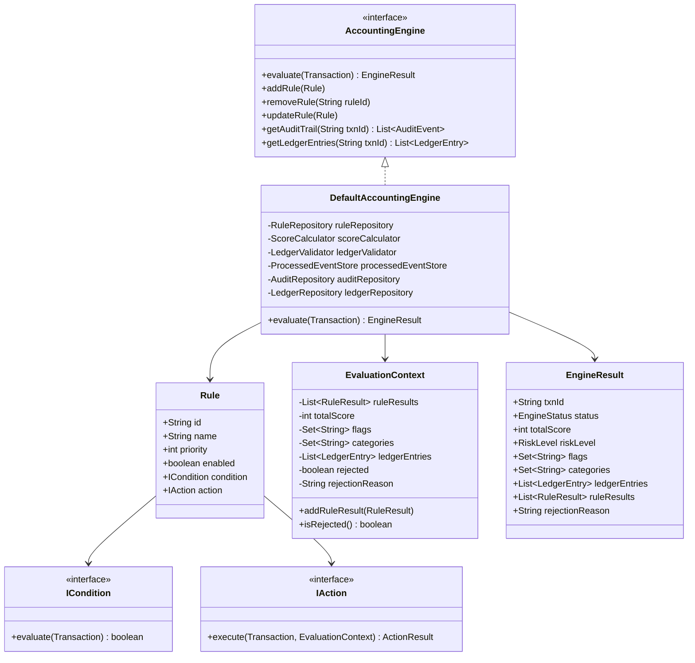
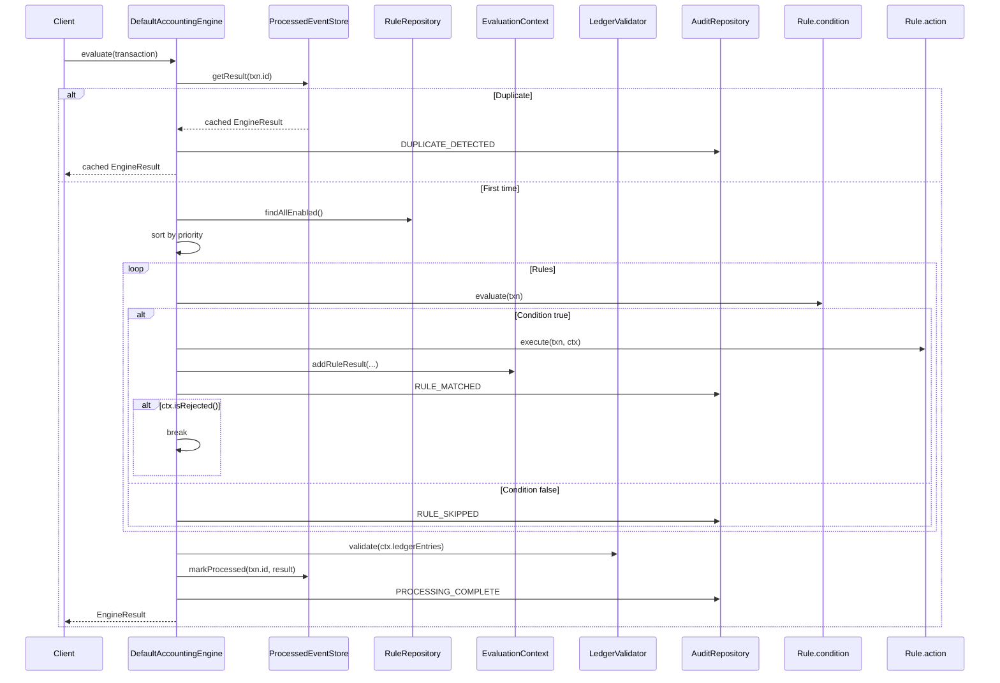

# Accounting Engine — LLD / Agentic Coding Interview

## 1. Problem Statement

### Objective
Design and implement a rule-based accounting engine that evaluates financial transactions against a configurable rule set, produces risk scores, ledger entries, audit trails, and idempotent processing — modelling a simplified fraud detection and transaction routing system.

### Expected Deliverables
- Working console application
- Rule engine: evaluate transaction against ordered, prioritized rules
- Actions: APPROVE, REJECT, FLAG, SCORE, LEDGER_ENTRY
- Risk scoring + risk level (LOW/MEDIUM/HIGH/CRITICAL)
- Double-entry ledger validation
- Idempotent transaction processing
- Full audit trail per transaction

### Constraints
- **Programming language:** Java 11
- **Database:** In-memory (repositories backed by ConcurrentHashMap / CopyOnWriteArrayList)
- **Framework:** None (plain Java)
- **Time limit:** 60–90 minutes
- **AI coding tool:** Cascade (Windsurf)
- **Other restrictions:** No Spring; JUnit 4

---

## 2. Requirement Analysis

### 2.1 Functional Requirements (FR)

| ID | Requirement | Priority | Acceptance Criteria |
|----|-------------|----------|---------------------|
| FR-01 | Evaluate a transaction against all enabled rules | Must | Returns EngineResult with status, score, risk level |
| FR-02 | Rules ordered by priority (lower int = higher priority) | Must | Rules sorted before evaluation; high-priority rules checked first |
| FR-03 | Short-circuit on REJECT action | Must | First REJECT rule stops further evaluation |
| FR-04 | Risk score aggregation across rule actions | Must | totalScore = sum of scoreDelta from all matched rules |
| FR-05 | Risk level classification from score | Must | LOW / MEDIUM / HIGH / CRITICAL thresholds |
| FR-06 | Double-entry ledger validation | Must | Sum of DEBIT entries must equal sum of CREDIT entries |
| FR-07 | Idempotent processing (same txn ID returns cached result) | Must | Duplicate event returns same EngineResult; DUPLICATE_DETECTED audit event |
| FR-08 | Full audit trail per transaction | Must | AuditEvent per rule match, skip, rejection, validation failure |
| FR-09 | Add/update/remove rules at runtime | Should | RuleRepository supports CRUD; engine picks up changes |
| FR-10 | Pluggable conditions and actions | Should | ICondition and IAction interfaces allow new implementations |

### 2.2 Non-Functional Requirements (NFR)

| ID | Requirement | Expected Behaviour |
|----|-------------|-------------------|
| NFR-01 | Performance | O(R) per evaluation (R = enabled rules, sorted once at load) |
| NFR-02 | Scalability | ConcurrentHashMap in repositories; idempotency store prevents duplicate work |
| NFR-03 | Concurrency | ProcessedEventStore (ConcurrentHashMap); idempotency check-and-store atomic |
| NFR-04 | Reliability | LedgerImbalanceException on invalid ledger; status = VALIDATION_FAILED |
| NFR-05 | Maintainability | RuleRepository decouples rule storage; EvaluationContext accumulates state per transaction |
| NFR-06 | Security | Idempotency prevents replay attacks; audit trail for forensics |

### 2.3 Clarifying Questions

| Question | Answer | Impact |
|----------|--------|--------|
| Can rules be added while engine is running? | Yes via addRule/updateRule/removeRule | RuleRepository CRUD; engine always calls findAllEnabled |
| Can a transaction match multiple rules? | Yes (unless early-rejected) | ctx.addRuleResult for each; score accumulates |
| Is ledger validation required for all transactions? | Only if rules produce ledger entries and status = APPROVED | LedgerValidator runs after rule evaluation |
| What is idempotency key? | Transaction.id() | ProcessedEventStore keyed by txn ID |

### 2.4 Ambiguities and Missing Requirements
- **Business ambiguities:** Risk score thresholds not specified → LOW<20, MEDIUM<50, HIGH<80, CRITICAL≥80 (assumed)
- **Technical ambiguities:** Rule condition composition (AND/OR) not specified → each Rule has one ICondition; complex conditions can be composite
- **Failure scenarios:** LedgerImbalanceException → status = VALIDATION_FAILED; result still returned with audit
- **Boundary conditions:** No rules enabled → status = NO_RULE_MATCHED; transaction not rejected

### 2.5 Assumptions

| ID | Assumption | Reason |
|----|-----------|--------|
| A-01 | Transaction is an immutable record (id, amount, type, paymentMethod, riskLevel, metadata) | Immutability ensures audit integrity |
| A-02 | Rules are pulled fresh via `ruleRepository.findAllEnabled()` per evaluation | Enables runtime rule changes without restart |
| A-03 | LedgerValidator checks DEBIT sum == CREDIT sum (double-entry bookkeeping) | Core accounting invariant |
| A-04 | AuditEvent is append-only; no modification after write | Forensic integrity |

---

## 3. Scope and Design Decisions

### In Scope
- AccountingEngine interface + DefaultAccountingEngine
- Transaction (immutable record)
- Rule (id, name, priority, enabled, ICondition, IAction)
- ICondition (evaluate(Transaction) → boolean) + concrete implementations
- IAction (execute(Transaction, EvaluationContext) → ActionResult)
- EvaluationContext (accumulates RuleResult list, totalScore, flags, categories, ledger entries, rejected flag)
- EngineResult (txnId, EngineStatus, totalScore, RiskLevel, flags, categories, ledgerEntries, ruleResults, rejectionReason)
- EngineStatus: APPROVED, REJECTED, NO_RULE_MATCHED, VALIDATION_FAILED
- RiskLevel: LOW, MEDIUM, HIGH, CRITICAL
- ScoreCalculator (score → RiskLevel thresholds)
- LedgerEntry (txnId, entryType DEBIT/CREDIT, amount, account)
- LedgerValidator (sum DEBIT == sum CREDIT)
- LedgerRepository (InMemoryLedgerRepository)
- AuditEvent (id, txnId, type, message, timestamp)
- AuditEventType: PROCESSING_STARTED, RULE_MATCHED, RULE_SKIPPED, DUPLICATE_DETECTED, VALIDATION_FAILED, PROCESSING_COMPLETE
- AuditRepository (InMemoryAuditRepository)
- ProcessedEventStore (InMemoryProcessedEventStore — idempotency)
- RuleRepository (CRUD + findAllEnabled)

### Out of Scope
- Rule persistence (DB-backed)
- Real-time rule streaming
- Multi-tenancy
- External payment gateway integration
- Machine learning risk models

### Engineering Decisions

| Decision | Selected Approach | Alternatives | Reason |
|----------|-------------------|--------------|--------|
| Rule storage | RuleRepository interface + InMemory impl | DB, rule DSL | Swappable; interview scope |
| Idempotency | ProcessedEventStore (ConcurrentHashMap) | DB unique constraint | In-memory; fast O(1) check |
| Audit | AuditRepository (append-only) | Log file, DB | Queryable per txnId; in-memory |
| Ledger validation | LedgerValidator (sum check) | DB constraint | Self-contained; double-entry invariant |
| Context accumulation | EvaluationContext (mutable per evaluation) | Return per rule | Aggregation across rules; single pass |
| Short-circuit | `if (ctx.isRejected()) break` in rule loop | Exception | Clean flow; no exception overhead |

---

## 4. Use Cases and Scenarios

### Primary Use Cases
1. Normal payment → rules evaluate → APPROVED + ledger entries recorded
2. High-risk transaction → risk score accumulates → REJECTED by fraud rule
3. Same transaction submitted twice → second call returns cached result (DUPLICATE_DETECTED)
4. Transaction that produces unbalanced ledger → VALIDATION_FAILED
5. No rules match → NO_RULE_MATCHED

### Happy Path Scenarios
- Credit card payment under $100 → low risk rule matches → score +10 → LOW risk → APPROVED
- Ledger: DEBIT $100 asset account + CREDIT $100 revenue account → balanced → saved

### Negative Scenarios
- Transaction amount > $10,000 → high-value rule → REJECT action → REJECTED immediately
- Ledger entries not balanced → LedgerImbalanceException → VALIDATION_FAILED

### Edge Cases
- No enabled rules → NO_RULE_MATCHED status
- All rules skip → NO_RULE_MATCHED
- Duplicate txn ID within same session → DUPLICATE_DETECTED; cached result returned

---

## 5. Domain Model

### Entities
- **Transaction** — id, amount (BigDecimal), type (TransactionType), paymentMethod (PaymentMethod), riskLevel (RiskLevel), metadata (Map)
- **Rule** — id, name, priority (int), enabled, condition (ICondition), action (IAction)
- **LedgerEntry** — id, txnId, entryType (DEBIT/CREDIT), amount, accountId, timestamp
- **AuditEvent** — id, txnId, type (AuditEventType), message, timestamp

### Value Objects
- `TransactionType` enum: CREDIT, DEBIT, TRANSFER, REFUND
- `PaymentMethod` enum: CREDIT_CARD, DEBIT_CARD, BANK_TRANSFER, WALLET
- `RiskLevel` enum: LOW, MEDIUM, HIGH, CRITICAL
- `EngineStatus` enum: APPROVED, REJECTED, NO_RULE_MATCHED, VALIDATION_FAILED
- `LedgerEntryType` enum: DEBIT, CREDIT
- `AuditEventType` enum: PROCESSING_STARTED, RULE_MATCHED, RULE_SKIPPED, DUPLICATE_DETECTED, VALIDATION_FAILED, PROCESSING_COMPLETE

### Relationships
- DefaultAccountingEngine uses RuleRepository, LedgerValidator, ProcessedEventStore, AuditRepository, LedgerRepository
- Rule 1 → 1 ICondition + 1 IAction
- EngineResult aggregates RuleResult list + LedgerEntry list

### Business Invariants
- LedgerEntry: sum(DEBIT) must equal sum(CREDIT) for a transaction
- Idempotency: same txnId processed at most once
- Rule evaluation is priority-ordered; REJECT short-circuits remaining rules

### State Transitions
```
Processing flow:
  1. Duplicate check → if found, return cached (DUPLICATE_DETECTED audit)
  2. Sort rules by priority (ascending)
  3. For each rule: condition.evaluate(txn)?
     → true: action.execute → add RuleResult; if REJECTED → break
     → false: add skipped RuleResult
  4. Ledger validation if APPROVED + entries present
  5. Compute risk level from score; build EngineResult
  6. Mark as processed in idempotency store; audit PROCESSING_COMPLETE
```

### Class Diagram


---

## 6. API and Contracts

### API Definitions

| Operation | Input | Output | Errors |
|-----------|-------|--------|--------|
| `evaluate` | Transaction | EngineResult | — (never throws; errors captured in status) |
| `addRule` | Rule | void | — |
| `removeRule` | ruleId | void | — |
| `updateRule` | Rule | void | — |
| `getAuditTrail` | txnId | List<AuditEvent> | — |
| `getLedgerEntries` | txnId | List<LedgerEntry> | — |

### Interface Definitions
```java
interface AccountingEngine {
    EngineResult evaluate(Transaction transaction);
    void addRule(Rule rule); void removeRule(String ruleId); void updateRule(Rule rule);
    List<AuditEvent> getAuditTrail(String txnId);
    List<LedgerEntry> getLedgerEntries(String txnId);
}
interface ICondition { boolean evaluate(Transaction transaction); }
interface IAction { ActionResult execute(Transaction transaction, EvaluationContext ctx); }
```

---

## 7. Low-Level Design (LLD)

### Component Responsibilities
- **DefaultAccountingEngine** — Orchestrates full evaluation pipeline; owns audit + idempotency integration
- **RuleRepository** — CRUD for rules; `findAllEnabled()` returns sorted (by caller) rules
- **EvaluationContext** — Mutable accumulator during a single transaction evaluation; reset per call
- **ScoreCalculator** — Maps total score integer → RiskLevel enum
- **LedgerValidator** — Asserts `sum(DEBIT) == sum(CREDIT)`; throws `LedgerImbalanceException`
- **ProcessedEventStore** — ConcurrentHashMap; `getResult(txnId)` + `markProcessed(txnId, result)`
- **AuditRepository** — Append-only; `findByTransactionId(txnId)` for audit trail queries

### Design Patterns
- **Strategy** — ICondition and IAction are pluggable strategies per Rule
- **Chain of Responsibility** — Rules evaluated in priority order; REJECT breaks chain
- **Repository** — RuleRepository, LedgerRepository, AuditRepository, ProcessedEventStore abstract storage
- **Template Method** — `evaluate()` defines fixed pipeline: idempotency → rules → ledger → result

### SOLID Principles
- **OCP** — New condition (e.g., GeoLocationCondition): implement ICondition; register in rule; engine unchanged
- **DIP** — DefaultAccountingEngine depends on interfaces: RuleRepository, LedgerValidator, ProcessedEventStore, etc.
- **SRP** — ScoreCalculator only maps scores; LedgerValidator only validates; AuditRepository only stores events

### Sequence Diagrams


### Complexity Analysis
- **Time complexity:** O(R log R) for sort + O(R) evaluation per transaction; O(1) idempotency check
- **Space complexity:** O(T × R) for audit events (T = transactions, R = avg rules matched)

---

## 8. Concurrency and Failure Handling

### Shared Mutable State
- `ProcessedEventStore` — ConcurrentHashMap; atomic `getResult` + `markProcessed`
- `RuleRepository` — ConcurrentHashMap; safe for concurrent rule CRUD
- `AuditRepository` — CopyOnWriteArrayList (read-heavy append-only)
- `LedgerRepository` — ConcurrentHashMap by txnId

### Race Conditions
- Two concurrent evaluations of same txnId → `ConcurrentHashMap.putIfAbsent` in ProcessedEventStore ensures only one result stored

### Idempotency
- `processedEventStore.getResult(txn.id)` checked before any processing
- `processedEventStore.markProcessed(txn.id, result)` after completion

### Failure Scenarios
- LedgerImbalanceException → caught in engine; status = VALIDATION_FAILED; VALIDATION_FAILED audit event recorded; result returned (not thrown to caller)
- Rule condition throws RuntimeException → not currently caught (extension: catch per-rule)

---

## 9. Implementation Plan

### Project Structure
```
AccountingEngine/src/main/java/com/rcpky/
├── domain/         Transaction, TransactionType, PaymentMethod, TransactionStatus
├── engine/         AccountingEngine, DefaultAccountingEngine, EngineResult, EngineStatus
│                   EvaluationContext, RuleResult, ScoreCalculator, LedgerValidator
├── rule/           Rule, ActionResult
├── action/         IAction + concrete implementations
├── condition/      ICondition + concrete implementations
├── ledger/         LedgerEntry, LedgerEntryType, LedgerRepository, InMemoryLedgerRepository
├── audit/          AuditEvent, AuditEventType, AuditRepository, InMemoryAuditRepository
├── idempotency/    ProcessedEventStore, InMemoryProcessedEventStore
├── repository/     RuleRepository + InMemory impl
├── exception/      LedgerImbalanceException
└── App.java
```

### Implementation Milestones
- **Milestone 1:** Transaction, TransactionType, PaymentMethod, RiskLevel, EngineStatus
- **Milestone 2:** ICondition, IAction interfaces + concrete implementations
- **Milestone 3:** Rule, RuleRepository + InMemoryRuleRepository; ActionResult, RuleResult
- **Milestone 4:** EvaluationContext, ScoreCalculator
- **Milestone 5:** LedgerEntry, LedgerValidator, LedgerRepository
- **Milestone 6:** AuditEvent, AuditRepository; ProcessedEventStore
- **Milestone 7:** DefaultAccountingEngine + App.java demo + JUnit tests

---

## 10. Implementation Notes

### Implemented Components
- `DefaultAccountingEngine` — two constructors: (RuleRepository only) and full 5-arg
- Full pipeline: idempotency check → audit start → sort rules → evaluate → ledger validation → risk level → result
- `EvaluationContext` — accumulates ruleResults, totalScore, flags, categories, ledgerEntries, rejected flag + reason
- `EngineResult` — immutable record of evaluation outcome
- `ScoreCalculator.toRiskLevel(score)` — threshold mapping
- `LedgerValidator.validate(entries)` — throws LedgerImbalanceException if unbalanced
- `InMemoryProcessedEventStore` — ConcurrentHashMap<txnId, EngineResult>
- `InMemoryAuditRepository` — CopyOnWriteArrayList; `findByTransactionId` filters by txnId
- `App.java` — demo scenarios covering APPROVED, REJECTED, DUPLICATE, VALIDATION_FAILED, NO_RULE_MATCHED

### Important Decisions
- `findAllEnabled().stream().sorted(comparingInt(Rule::priority)).toList()` — sorted per evaluation to reflect runtime rule changes
- Ledger validation only runs when status = APPROVED and entries non-empty
- `ctx.isRejected()` break is synchronous; no exception used for short-circuit

### Known Limitations
- Rule condition composition (AND/OR) not built-in; single ICondition per rule (extend with CompositeCondition)
- No rule version history
- Single-JVM; no distributed rule sync

---

## 11. Testing and Code Review

### Unit Tests
- `testApprovedTransaction` — rules match → APPROVED + correct score
- `testRejectedTransaction` — reject rule matched → REJECTED; subsequent rules skipped
- `testNoRuleMatched` — no enabled rules → NO_RULE_MATCHED
- `testIdempotency` — same txnId submitted twice → same EngineResult; DUPLICATE_DETECTED audit
- `testLedgerValidation` — balanced entries → APPROVED; unbalanced → VALIDATION_FAILED
- `testRiskLevelMapping` — score 10 → LOW; score 60 → HIGH; score 90 → CRITICAL
- `testAuditTrailContents` — audit events include RULE_MATCHED, RULE_SKIPPED, PROCESSING_COMPLETE
- `testRulePriorityOrdering` — higher priority rule evaluated first; breaks before lower on REJECT
- `testAddRemoveRule` — rule added at runtime; next evaluation picks it up
- `testDisabledRuleSkipped` — disabled rule not included in evaluation

### Build and Test Results
- `mvn test` → all tests pass

---

## 12. Demo and Retrospective

### Demo Scenarios (App.java)
1. Low-value transaction → APPROVED; totalScore=10; risk=LOW
2. High-value transaction ($15,000) → REJECTED by fraud rule; remaining rules skipped
3. Same transaction resubmitted → DUPLICATE_DETECTED; cached result returned
4. Transaction with unbalanced ledger entries → VALIDATION_FAILED
5. Transaction with no matching rules → NO_RULE_MATCHED
6. Runtime rule addition → new rule picked up on next evaluation

### What Went Well
- EvaluationContext as accumulator cleanly separates per-transaction mutable state from engine
- Idempotency layer naturally fits as the first check before any processing

### What I Would Improve
- Add CompositeCondition (AND/OR rule expressions) like FeatureFlagService
- Add rule DSL (JSON/YAML rule definitions loaded at startup)
- Add async audit writing (fire-and-forget audit events)
- Add retry on transient action failures

### Interviewer Follow-up Questions
- **How to add a new action type?** Implement IAction; assign to a Rule; no changes to DefaultAccountingEngine
- **How to handle concurrent evaluations of different transactions?** ProcessedEventStore uses ConcurrentHashMap; RuleRepository uses ConcurrentHashMap; safe by design
- **How to ensure double-entry bookkeeping?** LedgerValidator checks `sum(DEBIT) == sum(CREDIT)` before saving entries
- **How to make rules load from DB?** Implement DBRuleRepository; inject into DefaultAccountingEngine; engine unchanged (DIP)

### Final Readiness Assessment
- **Requirements:** ✅ All 10 FRs implemented
- **Design:** ✅ Strategy + Chain of Responsibility + Repository + Template Method
- **Implementation:** ✅ Working engine with 6 demo scenarios
- **Testing:** ✅ 10 unit tests covering all status paths
- **Code ownership:** ✅
- **Overall:** ✅ Interview-ready
