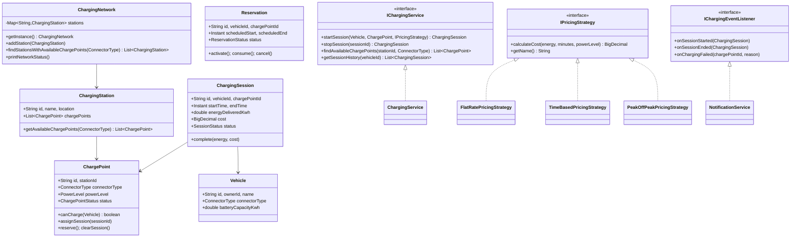
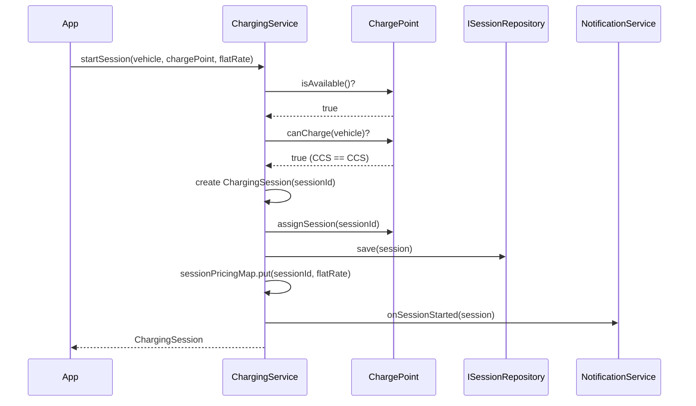
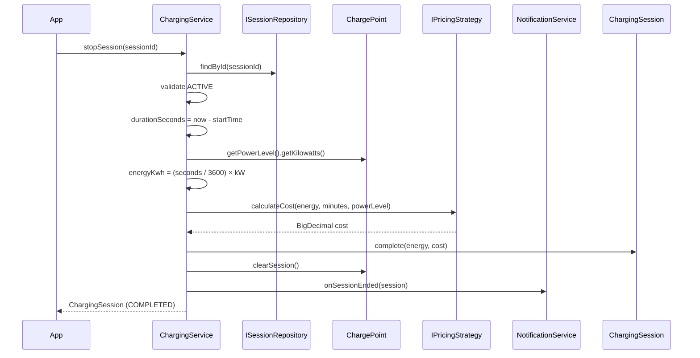

# EV Charging System — LLD / Agentic Coding Interview

## 1. Problem Statement

### Objective
Design and implement an EV Charging System that manages a network of charging stations, chargepoints, vehicles, charging sessions, reservations, and pluggable pricing strategies — with full observer-based notifications and connector-type safety.

### Expected Deliverables
- Working console application (8 demo scenarios)
- Multiple charging stations, each with multiple chargepoints
- Connector-type and power-level modelling (CCS, CHAdeMO, Type2, Tesla, J1772)
- Session lifecycle: start → charge → stop with energy and cost calculation
- Reservation system: reserve → consume/cancel → session
- Pluggable pricing: FlatRate, TimeBased, PeakOffPeak
- Observer notifications on session events
- Network discovery: find stations with available chargepoints by connector type
- 19 JUnit 4 tests; all pass

### Constraints
- **Programming language:** Java 21
- **Database:** In-memory (ConcurrentHashMap repositories)
- **Framework:** None (plain Java)
- **Time limit:** 60–90 minutes
- **AI coding tool:** Cascade (Windsurf)
- **Other restrictions:** No Spring; JUnit 4.13.2

---

## 2. Requirement Analysis

### 2.1 Functional Requirements (FR)

| ID | Requirement | Priority | Acceptance Criteria |
|----|-------------|----------|---------------------|
| FR-01 | Multiple connector types (CCS, CHAdeMO, TYPE2, TESLA, J1772) | Must | ConnectorType enum; ChargePoint and Vehicle carry type |
| FR-02 | Multiple power levels (L1, L2, DC Fast) | Must | PowerLevel enum with kilowatt value |
| FR-03 | Start charging session | Must | Validates availability + connector match; sets CHARGING status |
| FR-04 | Stop charging session | Must | Computes energy (kWh) and cost; sets AVAILABLE; fires observer |
| FR-05 | Connector type mismatch → ChargingException | Must | Thrown when vehicle connector ≠ chargepoint connector |
| FR-06 | Chargepoint already in use → ChargingException | Must | Thrown when status ≠ AVAILABLE (and not RESERVED) |
| FR-07 | Reserve a chargepoint | Must | Sets status RESERVED; stores Reservation |
| FR-08 | Cancel a reservation → AVAILABLE | Must | Restores chargepoint status |
| FR-09 | Consume reservation → start session | Must | Reservation CONSUMED; chargepoint cleared; session started |
| FR-10 | Pluggable pricing strategy | Must | IPricingStrategy: FlatRate, TimeBased, PeakOffPeak |
| FR-11 | Observer notifications on session events | Must | onSessionStarted / onSessionEnded / onChargingFailed |
| FR-12 | Network discovery (filter by connector type) | Should | ChargingNetwork.findStationsWithAvailableChargePoints |
| FR-13 | Session history per vehicle | Should | ISessionRepository.findByVehicleId |
| FR-14 | Network status display | Should | ChargingNetwork.printNetworkStatus() |

### 2.2 Non-Functional Requirements (NFR)

| ID | Requirement | Expected Behaviour |
|----|-------------|-------------------|
| NFR-01 | Performance | Session start/stop O(1); discovery O(S × C) where S = stations, C = chargepoints |
| NFR-02 | Scalability | ConcurrentHashMap repositories; thread-safe per-session pricing map |
| NFR-03 | Concurrency | sessionPricingMap is ConcurrentHashMap; repositories are ConcurrentHashMap |
| NFR-04 | Reliability | ChargingException for all invalid states; never silently ignored |
| NFR-05 | Maintainability | IPricingStrategy + IChargingEventListener are pure interfaces; extend without touching core |
| NFR-06 | Security | Connector validation prevents wrong charger use |

### 2.3 Clarifying Questions

| Question | Answer | Impact |
|----------|--------|--------|
| Can one chargepoint handle multiple vehicles? | No, one session at a time | Status machine: AVAILABLE → CHARGING → AVAILABLE |
| How is energy computed? | `(durationSeconds / 3600.0) × powerLevel.kW` | Real-time simulation |
| Is cost computed on start or stop? | On stop, using stored pricing strategy | sessionPricingMap per session |
| Can reservation overlap with existing session? | No, availability checked before reserving | ChargingException if not AVAILABLE |
| Is network singleton? | Yes | ChargingNetwork.getInstance() |

### 2.4 Assumptions

| ID | Assumption | Reason |
|----|-----------|--------|
| A-01 | Energy = time × power level (no real sensor) | Interview simulation |
| A-02 | PricingStrategy stored per session in a map (sessionId → strategy) | Strategy not serializable in ChargingSession model |
| A-03 | ChargingNetwork is a singleton managing all stations | One network per JVM |
| A-04 | Session IDs are 8-char uppercase UUID prefixes | Unique enough for demo |

---

## 3. Scope and Design Decisions

### In Scope
- ConnectorType, PowerLevel, ChargePointStatus, SessionStatus, ReservationStatus enums
- Vehicle, ChargePoint, ChargingStation, ChargingSession, Reservation models
- IPricingStrategy + FlatRatePricingStrategy, TimeBasedPricingStrategy, PeakOffPeakPricingStrategy
- IChargingEventListener + NotificationService
- IChargePointRepository, ISessionRepository, IReservationRepository + InMemory implementations
- IChargingService + ChargingService (session management)
- IReservationService + ReservationService
- ChargingNetwork (Singleton; station registry)
- App.java (8 demo scenarios)
- ChargingSystemTest.java (19 tests)

### Out of Scope
- Payment processing
- Real-time occupancy via hardware sensors
- OCPP protocol integration
- Multi-tenancy
- Map-based geolocation / radius search

### Engineering Decisions

| Decision | Approach | Alternatives | Reason |
|----------|----------|--------------|--------|
| Pricing storage | `sessionPricingMap` (ConcurrentHashMap in ChargingService) | Store strategy name + re-lookup | Strategy is a runtime object; can't serialize to session model |
| Connector validation | `chargePoint.canCharge(vehicle)` method | Service-level check only | Encapsulates compatibility logic in ChargePoint |
| Reservation → session flow | consumeReservation() clears chargepoint; startSession() runs normally | Atomic combine | Decoupled; both steps are explicit and testable |
| Network | Singleton `ChargingNetwork` | DI-managed registry | One logical network; matches real-world model |
| Energy calculation | `(seconds / 3600.0) × kW` | Fixed simulated value | Proportional to time and power; realistic formula |

---

## 4. Use Cases and Scenarios

### Primary Use Cases
1. EV arrives → finds available CCS chargepoint → starts session → charges → stops → cost computed
2. EV reserves chargepoint ahead of time → arrives → consumes reservation → starts session
3. Wrong connector type → ChargingException
4. Chargepoint busy → second EV rejected → ChargingException

### Happy Path
- `findAvailableChargePoints(stationId, CCS)` → `startSession(vehicle, cp, flatRate)` → 2s sleep → `stopSession` → cost

### Negative Scenarios
- J1772 vehicle at CCS chargepoint → `ChargingException: Connector mismatch`
- Start session on CHARGING chargepoint → `ChargingException: not available`
- Stop already-stopped session → `ChargingException: not active`
- Reserve non-AVAILABLE chargepoint → `ChargingException`

### Edge Cases
- Time-based pricing: minimum 1 minute billed even for <1 min sessions
- PeakOffPeak: rate changes based on LocalTime.now() (7am-9pm = peak)
- 0-second session energy = 0.0 kWh; cost = $0.00 (flat rate)

---

## 5. Domain Model

### Entities
- **Vehicle** — id, ownerId, name, connectorType, batteryCapacityKwh, currentChargePercent
- **ChargePoint** — id, stationId, connectorType, powerLevel, status, currentSessionId
- **ChargingStation** — id, name, location, List<ChargePoint>
- **ChargingSession** — id, vehicleId, chargePointId, startTime, endTime, energyDeliveredKwh, cost, status, pricingStrategyName
- **Reservation** — id, vehicleId, chargePointId, scheduledStart, scheduledEnd, status, createdAt

### Value Objects / Enums
- `ConnectorType`: CCS, CHADEMO, TYPE2, TESLA, J1772
- `PowerLevel`: L1 (1.4 kW), L2 (7.2 kW), DC_FAST_50 (50 kW), DC_FAST_150 (150 kW), DC_FAST_350 (350 kW)
- `ChargePointStatus`: AVAILABLE, RESERVED, CHARGING, FAULTED, OUT_OF_SERVICE
- `SessionStatus`: ACTIVE, COMPLETED, CANCELLED
- `ReservationStatus`: PENDING, ACTIVE, CONSUMED, CANCELLED, EXPIRED

### Business Invariants
- ChargePoint can only have one ACTIVE session at a time
- Session can only be stopped if ACTIVE
- Reservation requires chargepoint to be AVAILABLE
- Connector type of vehicle must match chargepoint

### State Transitions
```
ChargePoint:   AVAILABLE → CHARGING   (startSession)
               AVAILABLE → RESERVED   (reserve)
               CHARGING  → AVAILABLE  (stopSession)
               RESERVED  → AVAILABLE  (cancelReservation / consumeReservation)

ChargingSession: ACTIVE → COMPLETED  (stopSession)
                 ACTIVE → CANCELLED  (cancel)

Reservation: PENDING → ACTIVE   (reserve activates immediately)
             ACTIVE  → CONSUMED (consumeReservation)
             ACTIVE  → CANCELLED (cancelReservation)
```

### Class Diagram


---

## 6. API and Contracts

### Service API

| Operation | Input | Output | Errors |
|-----------|-------|--------|--------|
| `startSession` | Vehicle, ChargePoint, IPricingStrategy | ChargingSession | ChargingException (unavailable, connector mismatch) |
| `stopSession` | sessionId | ChargingSession | ChargingException (not found, not active) |
| `findAvailableChargePoints` | stationId, ConnectorType | List<ChargePoint> | — |
| `getSessionHistory` | vehicleId | List<ChargingSession> | — |
| `reserve` | vehicleId, chargePointId, start, end | Reservation | ChargingException (unavailable, invalid time range) |
| `cancelReservation` | reservationId | Reservation | ChargingException (already consumed/cancelled) |
| `consumeReservation` | reservationId | Reservation | ChargingException (not active) |

### Interface Definitions
```java
interface IPricingStrategy {
    BigDecimal calculateCost(double energyKwh, long durationMinutes, PowerLevel powerLevel);
    String getName();
}
interface IChargingEventListener {
    void onSessionStarted(ChargingSession session);
    void onSessionEnded(ChargingSession session);
    void onChargingFailed(String chargePointId, String reason);
}
```

---

## 7. Low-Level Design (LLD)

### Component Responsibilities
- **ChargingService** — Session lifecycle; pricing resolution via `sessionPricingMap`; energy + cost calculation on stop; fires observer events
- **ReservationService** — Reservation CRUD; chargepoint state management (RESERVED ↔ AVAILABLE)
- **ChargingNetwork** — Singleton station registry; discovery queries
- **ChargePoint** — Owns its own state transitions; `canCharge(Vehicle)` encapsulates connector check
- **IPricingStrategy** — Stateless cost calculators; injected at session-start; recalled at session-stop

### Design Patterns
- **Strategy** — `IPricingStrategy` (FlatRate, TimeBased, PeakOffPeak); injected per session
- **Observer** — `IChargingEventListener` list in ChargingService; fired on start/stop/fail
- **Singleton** — `ChargingNetwork` (single network per JVM)
- **Repository** — `IChargePointRepository`, `ISessionRepository`, `IReservationRepository` abstract storage

### SOLID Principles
- **OCP** — New pricing model: implement `IPricingStrategy`; no changes to `ChargingService`
- **OCP** — New notification channel: implement `IChargingEventListener`; add to listener list
- **DIP** — `ChargingService` depends on `IChargePointRepository`, `ISessionRepository` interfaces
- **SRP** — `ChargingService` manages sessions; `ReservationService` manages reservations; `ChargingNetwork` manages topology

### Sequence Diagram — startSession


### Sequence Diagram — stopSession


### Complexity Analysis
- **startSession** — O(1) all operations (repository is HashMap)
- **stopSession** — O(1) all operations
- **findAvailableChargePoints** — O(C) where C = chargepoints in station
- **findStationsWithAvailableChargePoints** — O(S × C) where S = stations

---

## 8. Concurrency and Failure Handling

### Shared Mutable State
- `ChargePoint.status` — mutable; single-threaded demo; extension: `synchronized` or `AtomicReference<ChargePointStatus>`
- `sessionPricingMap` — `ConcurrentHashMap`; safe for concurrent start/stop calls
- `InMemoryChargePointRepository` — `ConcurrentHashMap`; safe
- `InMemorySessionRepository` — `ConcurrentHashMap`; safe

### Extension: Concurrent Session Safety
- Wrap `startSession` in a `synchronized` block on `chargePoint` object to prevent double-booking
- Or use `CAS` on `ChargePoint.status` with `AtomicReference<ChargePointStatus>`

### Failure Scenarios
- Chargepoint not found in repository → `ChargingException`
- Session not found → `ChargingException`
- Connector mismatch → `ChargingException` (message includes both types)
- Chargepoint not available → `ChargingException` (includes current status)
- Invalid reservation time range (end ≤ start) → `ChargingException`

---

## 9. Implementation Plan

### Project Structure
```
EVChargingSystem/src/main/java/com/rcpky/
├── enums/          ConnectorType, PowerLevel, ChargePointStatus, SessionStatus, ReservationStatus
├── model/          Vehicle, ChargePoint, ChargingStation, ChargingSession, Reservation
├── exception/      ChargingException
├── pricing/        IPricingStrategy, FlatRatePricingStrategy,
│                   TimeBasedPricingStrategy, PeakOffPeakPricingStrategy
├── observer/       IChargingEventListener, NotificationService
├── repository/     IChargePointRepository, ISessionRepository, IReservationRepository
│   └── impl/       InMemoryChargePointRepository, InMemorySessionRepository,
│                   InMemoryReservationRepository
├── service/        IChargingService, ChargingService,
│                   IReservationService, ReservationService
├── network/        ChargingNetwork
└── App.java
EVChargingSystem/src/test/java/com/rcpky/
└── ChargingSystemTest.java   (19 JUnit 4 tests)
```

### Implementation Milestones
- **Milestone 1:** Enums (ConnectorType, PowerLevel, ChargePointStatus, SessionStatus, ReservationStatus)
- **Milestone 2:** Models (Vehicle, ChargePoint, ChargingStation, ChargingSession, Reservation) + ChargingException
- **Milestone 3:** IPricingStrategy + 3 implementations
- **Milestone 4:** IChargingEventListener + NotificationService
- **Milestone 5:** Repository interfaces + InMemory implementations
- **Milestone 6:** ChargingService + ReservationService
- **Milestone 7:** ChargingNetwork (Singleton)
- **Milestone 8:** App.java (8 scenarios) + ChargingSystemTest (19 tests)

---

## 10. Implementation Notes

### Key Implementation Details
- `sessionPricingMap` in `ChargingService` stores `IPricingStrategy` keyed by sessionId; removed on `stopSession`
- Energy calculation: `energyKwh = (durationSeconds / 3600.0) × powerLevel.getKilowatts()`
- `TimeBasedPricingStrategy` bills minimum 1 minute: `Math.max(1, durationMinutes)`
- `PeakOffPeakPricingStrategy` uses `LocalTime.now()` for real-time peak detection (7am–9pm = peak)
- `ChargePoint.canCharge(Vehicle)` — single method encapsulating connector-type equality check
- `ChargingNetwork.getInstance()` — lazy-initialized singleton (not thread-safe; extension: double-check locking)
- `ReservationService.consumeReservation()` clears the chargepoint status so `startSession` can proceed normally

### Build and Run
```bash
mvn clean test                              # 19 tests — all pass
mvn exec:java -Dexec.mainClass=com.rcpky.App  # 8-scenario demo
```

---

## 11. Testing and Code Review

### Test Coverage (ChargingSystemTest.java — 19 tests)

| Test | Scenario |
|------|----------|
| `testStartSession_success` | Session created; ChargePoint → CHARGING |
| `testStartSession_connectorMismatch_throwsException` | TYPE2 vehicle at CCS → exception |
| `testStartSession_chargePointAlreadyInUse_throwsException` | Second vehicle at same busy CP |
| `testStopSession_success` | Session COMPLETED; ChargePoint → AVAILABLE |
| `testStopSession_nonExistent_throwsException` | Unknown sessionId |
| `testStopSession_alreadyStopped_throwsException` | Stop twice |
| `testGetActiveSession_returnsActiveSession` | Finds ACTIVE session by chargePointId |
| `testGetActiveSession_noActiveSession_returnsEmpty` | Empty Optional when idle |
| `testFindAvailableChargePoints_returnsCorrectOnes` | Filter by station + connector |
| `testFindAvailableChargePoints_afterSessionStart_reducesCount` | Count drops after session start |
| `testGetSessionHistory_returnsAllSessions` | Two sessions tracked by vehicleId |
| `testReservation_success` | Reservation ACTIVE; CP → RESERVED |
| `testReservation_onBusyChargePoint_throwsException` | Reserve while CHARGING |
| `testCancelReservation_restoresChargePointAvailability` | CP back to AVAILABLE |
| `testConsumeReservation_thenStartSession` | Consume + start normal session |
| `testFlatRatePricing_calculatesCorrectCost` | 10 kWh × $0.30 = $3.00 |
| `testTimeBasedPricing_calculatesCorrectCost` | 45 min × $0.10 = $4.50 |
| `testTimeBasedPricing_minimumOneMinute` | 0-min session billed as 1 min |

### Build
```bash
mvn clean test
# Tests run: 19, Failures: 0, Errors: 0, Skipped: 0 — BUILD SUCCESS
```

---

## 12. Demo and Retrospective

### Demo Scenarios (App.java)
1. **Basic session (flat rate)** — Tata Nexon EV charges at DC Fast 150 kW; `$0.30/kWh`
2. **Time-based pricing** — BMW iX charges at L2; `$0.10/min`
3. **Peak/Off-Peak pricing** — Nissan Leaf at DC Fast 50 kW; rate depends on time of day
4. **Reservation → session** — Tesla reserves CP-05, consumes reservation, starts session
5. **Cancel reservation** — Kia reserves CP-04, cancels; CP immediately back to AVAILABLE
6. **Connector mismatch** — J1772 vehicle at CCS chargepoint → `ChargingException`
7. **ChargePoint busy** — Second CCS vehicle at occupied CP-01 → `ChargingException`
8. **Network discovery** — Find all stations with available CCS chargepoints

### What Went Well
- Strategy pattern makes pricing fully pluggable; 3 implementations cover key real-world models
- `canCharge(Vehicle)` in ChargePoint keeps connector validation close to the data
- Observer pattern decouples notification from session business logic
- Repository interfaces allow easy swapping to Redis/DB without touching service layer

### What I Would Improve
- Concurrent chargepoint booking: add `synchronized(chargePoint)` around status check + assign
- Add OCPP protocol integration for real hardware
- Add payment service integration (PaymentStrategy per session)
- Add geolocation-based station discovery (lat/lng + radius)
- Add real-time status push via WebSocket

### Interviewer Follow-up Questions
- **How to add a new pricing model?** Implement `IPricingStrategy`; pass it to `startSession()`; zero changes to `ChargingService`
- **How to prevent double-booking?** Synchronize on `chargePoint` in `startSession`, or use `AtomicReference<ChargePointStatus>` with CAS
- **How to scale to distributed fleet?** Replace InMemory repos with Redis; use distributed lock (Redlock) on chargepoint ID for booking
- **How to add OCPP?** Wrap `ChargingService.startSession/stopSession` behind an OCPP adapter; model messages map to existing service calls

### Final Readiness Assessment
- **Requirements:** ✅ All 14 FRs implemented
- **Design:** ✅ Strategy + Observer + Singleton + Repository patterns
- **Implementation:** ✅ 8-scenario demo runs end-to-end
- **Testing:** ✅ 19 JUnit 4 tests; all pass
- **Java version:** ✅ Java 21
- **Code ownership:** ✅
- **Overall:** ✅ Interview-ready
