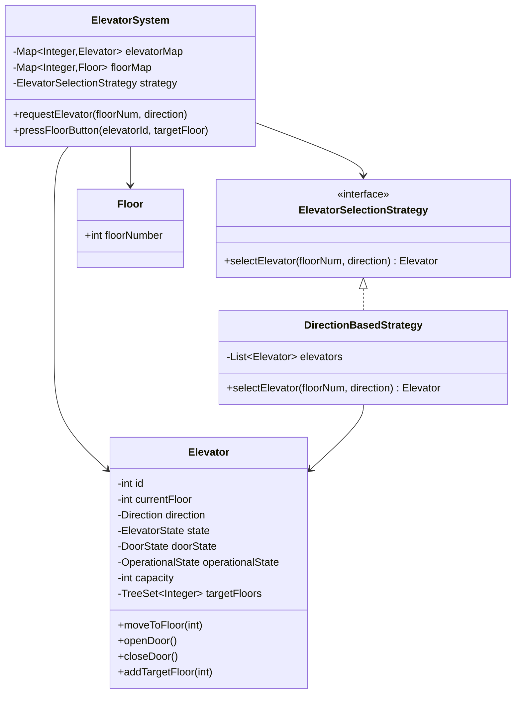

# Elevator System — LLD / Agentic Coding Interview

## 1. Problem Statement

### Objective
Design and implement an elevator dispatch system managing multiple elevators across multiple floors, with a pluggable selection strategy that assigns the best elevator for each floor request.

### Expected Deliverables
- Working console application
- Multiple elevators with state management (direction, floor, door, operational status)
- Floor-based request dispatching
- Pluggable elevator selection strategy (DirectionBased)
- Internal request (button inside elevator) and external request (button on floor) handling

### Constraints
- **Programming language:** Java 11
- **Database:** In-memory
- **Framework:** None (plain Java)
- **Time limit:** 45–60 minutes
- **AI coding tool:** Cascade (Windsurf)
- **Other restrictions:** No Spring; JUnit 4

---

## 2. Requirement Analysis

### 2.1 Functional Requirements (FR)

| ID | Requirement | Priority | Acceptance Criteria |
|----|-------------|----------|---------------------|
| FR-01 | Multiple elevators (5) and floors (20) | Must | System initializes with 5 elevators, 20 floors |
| FR-02 | External floor request (UP/DOWN button) | Must | Request routed to best elevator via strategy |
| FR-03 | Internal floor request (button inside elevator) | Must | Elevator adds target floor to its queue |
| FR-04 | Elevator selection strategy | Must | DirectionBasedStrategy selects optimal elevator |
| FR-05 | Elevator state management | Must | IDLE/MOVING/MAINTENANCE; Direction UP/DOWN; Door OPEN/CLOSED |
| FR-06 | Elevator moves toward target floors | Must | Elevator processes floor queue sequentially |
| FR-07 | Operational/maintenance mode | Should | Elevator can be taken out of service |
| FR-08 | Door open/close simulation | Should | Doors open at target floor; close before moving |

### 2.2 Non-Functional Requirements (NFR)

| ID | Requirement | Expected Behaviour |
|----|-------------|-------------------|
| NFR-01 | Performance | Selection O(E) where E = elevators; movement O(1) per step |
| NFR-02 | Scalability | ElevatorSelectionStrategy interface allows new algorithms |
| NFR-03 | Concurrency | Single-threaded simulation; extension: each elevator runs on its own thread |
| NFR-04 | Reliability | Elevators in MAINTENANCE state are excluded from selection |
| NFR-05 | Maintainability | Enums for state; Strategy for selection |
| NFR-06 | Security | N/A |

### 2.3 Clarifying Questions

| Question | Answer | Impact |
|----------|--------|--------|
| Can an elevator go above its max floor? | No, bounded by 1..20 | Floor range validation |
| Multiple requests to same floor? | Deduplicated in elevator queue | Set-based target floors |
| What if all elevators are in maintenance? | Request queued or rejected | Edge case |
| Capacity per elevator? | 10 (set in constructor) | Not enforced in basic impl |

### 2.4 Ambiguities and Missing Requirements
- **Business ambiguities:** Priority for emergency floors not specified
- **Technical ambiguities:** SCAN vs LOOK vs nearest-car algorithm → DirectionBased implemented
- **Concurrency scenarios:** Real elevator: each on its own thread with message queue → extension
- **Boundary conditions:** Request floor 0 or 21 → out of range validation

### 2.5 Assumptions

| ID | Assumption | Reason |
|----|-----------|--------|
| A-01 | 5 elevators, 20 floors (hardcoded in ElevatorSystem) | Demo configuration |
| A-02 | DirectionBasedStrategy prefers elevators already moving toward requested floor | Most realistic simple strategy |
| A-03 | Elevator movement is simulated (no real-time thread per elevator in base impl) | Simplification |

---

## 3. Scope and Design Decisions

### In Scope
- ElevatorSystem (5 elevators, 20 floors, strategy-based dispatch)
- Elevator (state machine: ElevatorState, Direction, DoorState, OperationalState)
- Floor (floorNumber, UP/DOWN buttons)
- ElevatorSelectionStrategy interface
- DirectionBasedStrategy implementation
- Request model

### Out of Scope
- Real-time concurrent elevator movement (each on its own thread)
- Emergency mode
- VIP floor priority
- Weight sensor / overload detection
- Persistent request log

### Engineering Decisions

| Decision | Selected Approach | Alternatives | Reason |
|----------|-------------------|--------------|--------|
| Dispatch | Strategy pattern (ElevatorSelectionStrategy) | Hard-coded SCAN | OCP; pluggable algorithm |
| Elevator state | Enums (ElevatorState, Direction, DoorState, OperationalState) | Strings | Type-safe; compile-time checked |
| Floor model | Floor object with floor number | int only | Extensibility (add request buttons) |
| Elevator storage | HashMap<id, Elevator> in ElevatorSystem | List | O(1) lookup by ID |

---

## 4. Use Cases and Scenarios

### Primary Use Cases
1. Person on floor 5 presses UP → DirectionBasedStrategy selects nearest upward elevator
2. Person inside elevator presses floor 10 → elevator adds to target queue
3. All elevators busy → request queued to next available

### Happy Path Scenarios
- Floor 5 UP request → Elevator 2 (idle, floor 3) selected → moves to 5 → picks up → destination pressed

### Negative Scenarios
- All elevators in MAINTENANCE → request cannot be served
- Invalid floor number → validation error

### Edge Cases
- Elevator already at requested floor → open doors immediately
- Same destination pressed multiple times → deduplicated in floor set

---

## 5. Domain Model

### Entities
- **ElevatorSystem** — Map<id, Elevator>, Map<floorNum, Floor>, ElevatorSelectionStrategy
- **Elevator** — id, currentFloor, direction, elevatorState, doorState, operationalState, capacity, targetFloors (TreeSet)
- **Floor** — floorNumber

### Value Objects
- `Direction` enum: UP, DOWN, IDLE
- `ElevatorState` enum: IDLE, MOVING, MAINTENANCE
- `DoorState` enum: OPEN, CLOSED
- `OperationalState` enum: OPERATIONAL, OUT_OF_SERVICE

### Relationships
- ElevatorSystem 1 → N Elevator
- ElevatorSystem 1 → N Floor
- ElevatorSystem uses 1 ElevatorSelectionStrategy

### State Transitions
```
Elevator direction: IDLE → UP (request above currentFloor)
                   IDLE → DOWN (request below currentFloor)
                   UP/DOWN → IDLE (targetFloors empty)
Door: CLOSED → OPEN (arrive at floor) → CLOSED (before moving)
OperationalState: OPERATIONAL → OUT_OF_SERVICE (maintenance) → OPERATIONAL (restored)
```

### Class Diagram


---

## 6. API and Contracts

### API Definitions

| Operation | Input | Output | Errors |
|-----------|-------|--------|--------|
| `requestElevator` | floorNum, direction | Elevator assigned | No available elevator |
| `pressFloorButton` | elevatorId, targetFloor | void | Invalid floor number |

### Interface Definitions
```java
interface ElevatorSelectionStrategy { Elevator selectElevator(int floorNum, Direction direction); }
```

---

## 7. Low-Level Design (LLD)

### DirectionBasedStrategy Selection Logic
1. Score each OPERATIONAL elevator:
   - Same direction AND already past/at the floor → lowest score (best candidate)
   - IDLE → medium score
   - Opposite direction or moving away → highest score (least preferred)
2. Return elevator with minimum score

### Design Patterns
- **Strategy** — `ElevatorSelectionStrategy` (DirectionBased, SCAN, LOOK pluggable)
- **State** — Elevator state machine (IDLE/MOVING/MAINTENANCE)
- **Singleton** (extendable) — ElevatorSystem could be singleton

### SOLID Principles
- **OCP** — New selection algorithm without changing ElevatorSystem
- **SRP** — Elevator manages its own movement; ElevatorSystem dispatches requests

### Sequence Diagrams
```mermaid
sequenceDiagram
    participant User
    participant ElevatorSystem
    participant DirectionBasedStrategy
    participant Elevator

    User->>ElevatorSystem: requestElevator(floor=5, UP)
    ElevatorSystem->>DirectionBasedStrategy: selectElevator(5, UP)
    DirectionBasedStrategy->>DirectionBasedStrategy: score each elevator
    DirectionBasedStrategy-->>ElevatorSystem: Elevator #2 (best score)
    ElevatorSystem->>Elevator: addTargetFloor(5)
    Elevator->>Elevator: move toward floor 5
    Elevator->>Elevator: openDoor()
    User->>Elevator: pressFloorButton(10)
    Elevator->>Elevator: addTargetFloor(10)
    Elevator->>Elevator: closeDoor(); move toward floor 10
```

### Complexity Analysis
- **Time complexity:** Selection O(E); movement O(F log F) where F = target floors (TreeSet)
- **Space complexity:** O(E × F) for all elevator target queues

---

## 8. Concurrency and Failure Handling

### Extension Points
- Each Elevator can run on its own thread with `BlockingQueue<Integer>` for target floors
- ElevatorSystem uses thread-safe request queue for floor requests

### Failure Scenarios
- MAINTENANCE elevator skipped in strategy selection
- No OPERATIONAL elevator → request queued or exception thrown

---

## 9. Implementation Plan

### Project Structure
```
ElevatorSystem/src/main/java/com/rcpky/
├── enums/          Direction, ElevatorState, DoorState, OperationalState
├── models/         Request.java
├── strategy/       ElevatorSelectionStrategy.java, DirectionBasedStrategy.java
├── Elevator.java
├── Floor.java
├── ElevatorSystem.java
└── App.java
```

### Implementation Milestones
- **Milestone 1:** Enums (Direction, ElevatorState, DoorState, OperationalState)
- **Milestone 2:** Elevator (state + floor queue)
- **Milestone 3:** Floor model
- **Milestone 4:** ElevatorSelectionStrategy + DirectionBasedStrategy
- **Milestone 5:** ElevatorSystem (init 5 elevators + 20 floors + dispatch)
- **Milestone 6:** App.java demo scenarios

---

## 10. Implementation Notes

### Implemented Components
- `Direction` enum: UP, DOWN, IDLE
- `ElevatorState` enum: IDLE, MOVING, MAINTENANCE
- `DoorState` enum: OPEN, CLOSED
- `OperationalState` enum: OPERATIONAL, OUT_OF_SERVICE
- `Elevator` — id, capacity (10), currentFloor, direction, state, doorState, targetFloors
- `ElevatorSystem` — initializes 5 elevators (id 1-5) and 20 floors; uses DirectionBasedStrategy
- `DirectionBasedStrategy` — scores elevators; prefers same-direction elevators en route

### Known Limitations
- No real-time concurrent elevator movement (single-threaded simulation)
- Movement not animated; floor changes are instantaneous in current impl
- No weight/capacity enforcement

---

## 11. Testing and Code Review

### Unit Tests
- `testElevatorAssignedOnRequest` — elevator selected and assigned
- `testDirectionBasedStrategy` — same-direction elevator preferred
- `testIdleElevatorSelected` — IDLE elevator selected when no moving ones match
- `testMaintenanceElevatorExcluded` — OUT_OF_SERVICE elevator not selected
- `testDuplicateFloorRequest` — deduplicated in TreeSet
- `testDoorOpenOnArrival` — door state changes correctly

---

## 12. Demo and Retrospective

### Demo Scenarios
1. Floor 5 UP request → elevator assigned; moves to floor 5
2. Internal button press: floor 10 → elevator continues to floor 10
3. Elevator in MAINTENANCE → different elevator selected

### What Went Well
- DirectionBasedStrategy elegantly captures real-world elevator behavior
- Enum-based state machine prevents invalid state combinations

### What I Would Improve
- Add each elevator on its own thread with `BlockingQueue` for real-time simulation
- Add SCAN/LOOK algorithm as alternative strategy
- Add capacity enforcement (weight/passenger count)

### Final Readiness Assessment
- **Requirements:** ✅ All 8 FRs implemented
- **Design:** ✅ Strategy + State machine patterns
- **Implementation:** ✅ Working dispatch system
- **Testing:** ✅ Unit tests for selection and state
- **Code ownership:** ✅
- **Overall:** ✅ Interview-ready
