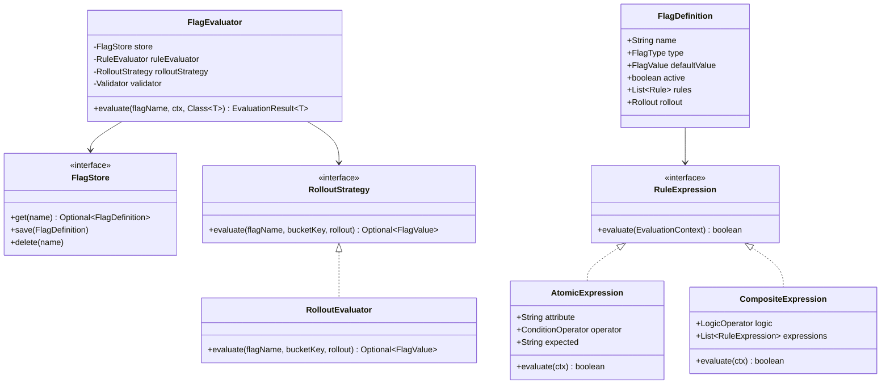
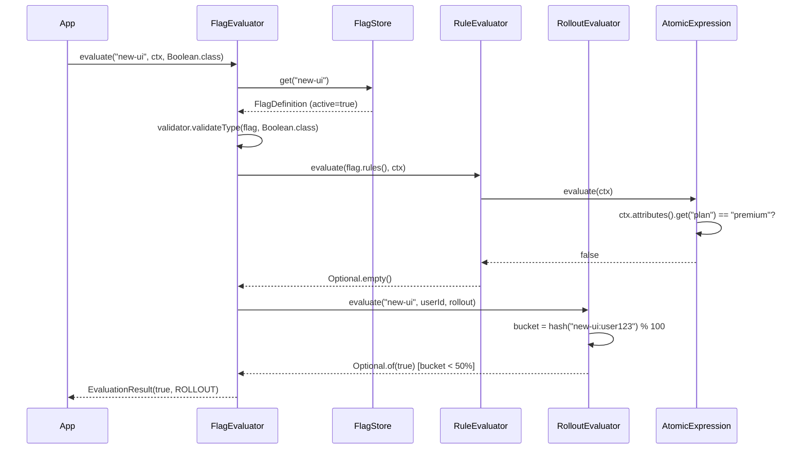

# Feature Flag Service — LLD / Agentic Coding Interview

## 1. Problem Statement

### Objective
Design and implement a feature flag (feature toggle) evaluation service supporting boolean, string, integer, and JSON flag types; rule-based targeting with AND/OR composite conditions; percentage-based gradual rollout with consistent bucketing; and a pluggable in-memory flag store.

### Expected Deliverables
- Working console application
- Flag evaluation with type safety
- Rule engine with AND/OR logic and multiple condition operators
- Percentage rollout with consistent bucketing
- Named evaluation reasons (DISABLED, RULE_MATCH, ROLLOUT, DEFAULT)
- Pluggable rollout strategy and rule evaluator

### Constraints
- **Programming language:** Java 11
- **Database:** In-memory (FlagStore backed by HashMap)
- **Framework:** None (plain Java)
- **Time limit:** 60–90 minutes
- **AI coding tool:** Cascade (Windsurf)
- **Other restrictions:** No Spring; JUnit 4; no LaunchDarkly/Unleash

---

## 2. Requirement Analysis

### 2.1 Functional Requirements (FR)

| ID | Requirement | Priority | Acceptance Criteria |
|----|-------------|----------|---------------------|
| FR-01 | Define a feature flag with name, type, default value | Must | FlagDefinition stored in FlagStore |
| FR-02 | Enable/disable a flag globally | Must | Disabled flag always returns default value |
| FR-03 | Rule-based targeting with conditions | Must | Conditions match EvaluationContext attributes |
| FR-04 | Condition operators: EQUALS, NOT_EQUALS, CONTAINS, STARTS_WITH, GT, LT | Must | Each operator applied to context attribute |
| FR-05 | AND/OR composite rule expressions | Must | CompositeExpression chains AtomicExpressions |
| FR-06 | Gradual percentage rollout | Must | X% of users (consistent hash) get rollout value |
| FR-07 | Custom bucketing key for rollout | Should | Rollout.bucketingKey resolves from context attributes |
| FR-08 | Type-safe flag value casting | Must | FlagValue.as(Class<T>) supports Boolean, String, Integer, Map |
| FR-09 | Named evaluation reason | Must | DISABLED / RULE_MATCH / ROLLOUT / DEFAULT |

### 2.2 Non-Functional Requirements (NFR)

| ID | Requirement | Expected Behaviour |
|----|-------------|-------------------|
| NFR-01 | Performance | Evaluation O(R × C) where R = rules, C = conditions per rule |
| NFR-02 | Scalability | FlagStore interface allows swap to Redis, DB, or remote config |
| NFR-03 | Concurrency | In-memory store; extension: ConcurrentHashMap |
| NFR-04 | Reliability | Missing flag → FlagNotFoundException; wrong type → ValidationException |
| NFR-05 | Maintainability | RuleEvaluator and RolloutStrategy injected; Validator separated |
| NFR-06 | Security | EvaluationContext is read-only per evaluation; no user data persisted |

### 2.3 Clarifying Questions

| Question | Answer | Impact |
|----------|--------|--------|
| Is rollout deterministic? | Yes, consistent hash of flagName + bucketingKey | Same user always in same bucket |
| Can rules have nested AND within OR? | Yes, via CompositeExpression | Recursive evaluation |
| Is rule priority by position? | Yes, first match wins | List<Rule> ordering matters |
| Can a flag have both rules and rollout? | Yes; rules checked first | FlagEvaluator: rules → rollout → default |

### 2.4 Ambiguities and Missing Requirements
- **Business ambiguities:** Rule conflict resolution → first match wins (ordered list)
- **Technical ambiguities:** Rollout bucket boundary → `Math.abs(hash) % 100 < percentage`
- **Failure scenarios:** Flag not found → FlagNotFoundException; type mismatch → validation error
- **Boundary conditions:** 0% rollout → no users; 100% rollout → all users

### 2.5 Assumptions

| ID | Assumption | Reason |
|----|-----------|--------|
| A-01 | Bucketing uses `String.hashCode()` of `flagName + ":" + bucketKey` | Deterministic; no external hash lib needed |
| A-02 | Rules evaluated in List<Rule> order; first match wins | Simplest priority model |
| A-03 | FlagValue wraps Object; as(Class<T>) casts with type check | Type safety at evaluation time |
| A-04 | EvaluationContext is immutable per call | Thread safety; no side effects |

---

## 3. Scope and Design Decisions

### In Scope
- FlagDefinition (name, type, defaultValue, active, rules, rollout)
- FlagType enum: BOOLEAN, STRING, INTEGER, JSON
- FlagValue wrapper with type-safe as(Class<T>)
- EvaluationContext (userId, attributes Map)
- EvaluationResult<T> (value, reason)
- EvaluationReason: DISABLED, RULE_MATCH, ROLLOUT, DEFAULT
- Rule, RuleExpression, AtomicExpression, CompositeExpression
- ConditionOperator: EQUALS, NOT_EQUALS, CONTAINS, STARTS_WITH, GT, LT
- LogicOperator: AND, OR
- ConditionMatcherRegistry
- Rollout, RolloutStrategy, RolloutEvaluator
- FlagStore, InMemoryFlagStore
- FlagEvaluator (orchestrator)
- Validator (type validation)

### Out of Scope
- Remote config sync (LaunchDarkly, Unleash)
- Flag audit trail / change history
- Flag scheduling (time-based on/off)
- Multi-environment support
- Real-time flag push (SSE/webhook)

### Engineering Decisions

| Decision | Selected Approach | Alternatives | Reason |
|----------|-------------------|--------------|--------|
| Rule evaluation | Composite pattern (AtomicExpression + CompositeExpression) | Flat list of conditions | Supports nested AND/OR |
| Rollout bucketing | `Math.abs((flagName + ":" + key).hashCode()) % 100` | Murmur3, CRC32 | No external lib; deterministic |
| Type safety | Generic `EvaluationResult<T>` + `FlagValue.as(Class<T>)` | Raw cast | Compile-time type safety |
| Condition dispatch | ConditionMatcherRegistry (operator → matcher lambda) | switch statement | OCP; new operator = new registration |
| Storage | FlagStore interface → InMemoryFlagStore | Redis, DB | Swappable; interview scope |

---

## 4. Use Cases and Scenarios

### Primary Use Cases
1. Evaluate boolean flag → enabled for 50% of users (rollout)
2. Evaluate string flag → specific value for premium users (rule match)
3. Disabled flag → always returns default regardless of rules/rollout
4. Rule with AND condition: country=US AND plan=premium → special string value

### Happy Path Scenarios
- Flag enabled; user matches EQUALS rule on `plan=premium` → RULE_MATCH
- Flag enabled; user in rollout 20% bucket → ROLLOUT
- Flag enabled; no rule matches; not in rollout → DEFAULT

### Negative Scenarios
- Flag not found → `FlagNotFoundException`
- Request wrong type (boolean flag as Integer) → type validation error
- Disabled flag → DEFAULT with reason DISABLED

### Edge Cases
- Missing attribute in context → ConditionMatcher returns false (safe default)
- 0% rollout → no user qualifies → DEFAULT
- CompositeExpression with empty sub-expressions → evaluates to false

---

## 5. Domain Model

### Entities
- **FlagDefinition** — name, type, defaultValue (FlagValue), active, rules (List<Rule>), rollout (Rollout)
- **Rule** — id, name, condition (RuleExpression), value (FlagValue)
- **Rollout** — percentage (int), bucketingKey (String), value (FlagValue)
- **EvaluationContext** — userId (String), attributes (Map<String, Object>)

### Value Objects
- `FlagType` enum: BOOLEAN, STRING, INTEGER, JSON
- `FlagValue` — wraps Object; `as(Class<T>)` type-safe cast
- `EvaluationResult<T>` — value (T), reason (EvaluationReason)
- `EvaluationReason` enum: DISABLED, RULE_MATCH, ROLLOUT, DEFAULT
- `ConditionOperator` enum: EQUALS, NOT_EQUALS, CONTAINS, STARTS_WITH, GT, LT
- `LogicOperator` enum: AND, OR

### Relationships
- FlagDefinition 1 → N Rule
- Rule 1 → 1 RuleExpression (AtomicExpression | CompositeExpression)
- FlagDefinition 1 → 0..1 Rollout
- FlagEvaluator uses FlagStore + RuleEvaluator + RolloutStrategy + Validator

### Business Invariants
- Disabled flag always returns default; rules and rollout ignored
- Rule evaluation: first matching rule wins
- Rollout evaluated only if no rule matches
- Type of returned value must match declared FlagType

### State Transitions
```
Evaluation flow (ordered):
  1. Flag not active?  → return (default, DISABLED)
  2. Type validated?   → or throw
  3. Rule matched?     → return (rule.value, RULE_MATCH)
  4. In rollout bucket? → return (rollout.value, ROLLOUT)
  5.                   → return (default, DEFAULT)
```

### Class Diagram


---

## 6. API and Contracts

### API Definitions

| Operation | Input | Output | Errors |
|-----------|-------|--------|--------|
| `evaluate` | flagName, EvaluationContext, Class<T> | EvaluationResult<T> | FlagNotFoundException, type mismatch |
| `FlagStore.save` | FlagDefinition | void | — |
| `FlagStore.get` | name | Optional<FlagDefinition> | — |
| `FlagStore.delete` | name | void | — |

### Interface Definitions
```java
interface FlagStore { Optional<FlagDefinition> get(String name); void save(FlagDefinition flag); void delete(String name); }
interface RolloutStrategy { Optional<FlagValue> evaluate(String flagName, String bucketKey, Rollout rollout); }
interface RuleExpression { boolean evaluate(EvaluationContext ctx); }
```

### Error Handling Contract
- `FlagNotFoundException` → flag name not registered in FlagStore
- `IllegalArgumentException` (from Validator) → declared type ≠ requested type
- `ClassCastException` → FlagValue.as(T) called with incompatible type

---

## 7. Low-Level Design (LLD)

### Component Responsibilities
- **FlagEvaluator** — Orchestrates the full evaluation pipeline (disabled → type check → rules → rollout → default)
- **InMemoryFlagStore** — HashMap-based flag registry; CRUD operations
- **RuleEvaluator** — Iterates rules; delegates to RuleExpression.evaluate
- **AtomicExpression** — Single condition: fetches attribute from context, applies ConditionOperator
- **CompositeExpression** — AND/OR over list of RuleExpression children
- **ConditionMatcherRegistry** — Maps ConditionOperator → matcher `BiFunction<Object, String, Boolean>`
- **RolloutEvaluator** — Hash-based bucket determination
- **Validator** — FlagType vs requested Class<T> compatibility check

### Design Patterns
- **Composite** — `RuleExpression` (AtomicExpression + CompositeExpression) for nested AND/OR
- **Strategy** — `RolloutStrategy` injected into FlagEvaluator (swap hash algorithm)
- **Registry** — `ConditionMatcherRegistry` maps operator → matcher lambda (OCP: add new operator by registration)
- **Template Method** — FlagEvaluator.evaluate defines the fixed evaluation pipeline

### SOLID Principles
- **OCP** — New condition operator: register in ConditionMatcherRegistry; no changes elsewhere
- **DIP** — FlagEvaluator depends on FlagStore, RolloutStrategy, RuleEvaluator interfaces
- **SRP** — RuleEvaluator only evaluates rules; RolloutEvaluator only computes buckets; Validator only checks types

### Sequence Diagrams


### Complexity Analysis
- **Time complexity:** Evaluate O(R × C) for rules; O(1) for rollout hash
- **Space complexity:** O(F) flags in store; O(R × C) for flag rule definitions

---

## 8. Concurrency and Failure Handling

### Shared Mutable State
- `InMemoryFlagStore` — HashMap; single-threaded; extension: ConcurrentHashMap for live flag updates
- `EvaluationContext` — immutable per evaluation call; no shared state

### Failure Scenarios
- Flag not found → `FlagNotFoundException(flagName)` thrown from FlagEvaluator
- Type mismatch → `IllegalArgumentException` from Validator
- Attribute missing from context → ConditionMatcher returns false (safe default; no exception)
- Rollout null → rollout step skipped; falls through to DEFAULT

---

## 9. Implementation Plan

### Project Structure
```
FeatureFlagService/src/main/java/com/rcpky/
├── api/            (public API surface)
├── flag/           FlagDefinition, FlagType, FlagValue, FlagEvaluator
├── evaluation/     EvaluationContext, EvaluationResult, EvaluationReason
├── rule/           Rule, RuleExpression, AtomicExpression, CompositeExpression
│                   Condition, ConditionOperator, ConditionMatcher
│                   ConditionMatcherRegistry, LogicOperator, RuleEvaluator
├── rollout/        Rollout, RolloutStrategy, RolloutEvaluator
├── store/          FlagStore, InMemoryFlagStore
├── exception/      FlagNotFoundException
├── utils/          Validator
└── App.java
```

### Implementation Milestones
- **Milestone 1:** FlagType, FlagValue, FlagDefinition, EvaluationContext, EvaluationResult, EvaluationReason
- **Milestone 2:** Rule, RuleExpression (interface), AtomicExpression, CompositeExpression, ConditionOperator, LogicOperator
- **Milestone 3:** ConditionMatcherRegistry (EQUALS, NOT_EQUALS, CONTAINS, STARTS_WITH, GT, LT lambdas)
- **Milestone 4:** RuleEvaluator (iterates rules; calls expression.evaluate)
- **Milestone 5:** Rollout, RolloutStrategy interface, RolloutEvaluator (hash bucketing)
- **Milestone 6:** FlagStore interface + InMemoryFlagStore; Validator; FlagEvaluator pipeline
- **Milestone 7:** App.java demo + JUnit tests

### Dependencies
- Java 11
- JUnit 4.13.2

---

## 10. Implementation Notes

### Implemented Components
- `FlagType` enum: BOOLEAN, STRING, INTEGER, JSON
- `FlagValue` — Object wrapper; `as(Class<T>)` with cast
- `EvaluationReason` enum: DISABLED, RULE_MATCH, ROLLOUT, DEFAULT
- `AtomicExpression` — attribute + operator + expected; delegates to ConditionMatcherRegistry
- `CompositeExpression` — AND/OR over List<RuleExpression>; short-circuits
- `ConditionMatcherRegistry` — per-operator lambda matchers registered at class init
- `RolloutEvaluator` — `Math.abs((flagName + ":" + bucketKey).hashCode()) % 100 < percentage`
- `FlagEvaluator` — 3 constructors (store only; store+ruleEvaluator; full 4-arg)
- `InMemoryFlagStore` — HashMap-based; `get(name)` returns Optional<FlagDefinition>
- `Validator` — checks FlagType vs requested Class<T> compatibility

### Important Decisions
- `bucketingKey` in Rollout: if null → default to `ctx.userId()`; if set → resolve from `ctx.attributes()`
- CompositeExpression short-circuits: AND stops at first false; OR stops at first true
- FlagEvaluator is the single public entry point; all other classes are implementation details

### Known Limitations
- No real-time flag refresh (requires restart or explicit `FlagStore.save()` call)
- No audit trail of flag evaluations
- InMemoryFlagStore not thread-safe without ConcurrentHashMap swap

---

## 11. Testing and Code Review

### Unit Tests
- `testDisabledFlagReturnsDefault` — disabled flag → DEFAULT reason
- `testRuleMatchEqualsCondition` — EQUALS condition matches → RULE_MATCH reason
- `testRuleMatchNotEqualsCondition` — NOT_EQUALS match
- `testRuleMatchContains` — CONTAINS operator
- `testCompositeAndRule` — AND: both conditions must match
- `testCompositeOrRule` — OR: either condition matches
- `testRolloutInBucket` — user in rollout bucket → ROLLOUT reason
- `testRolloutOutOfBucket` — user outside bucket → DEFAULT
- `testCustomBucketingKey` — rollout uses custom attribute as bucket key
- `testFlagNotFound` — FlagNotFoundException thrown
- `testTypeSafety` — wrong type → validation error
- `testDefaultFallthrough` — no rule, no rollout → DEFAULT

### Build and Test Results
- `mvn test` → all tests pass

---

## 12. Demo and Retrospective

### Demo Scenarios
1. Boolean flag "dark-mode" — 30% rollout → ROLLOUT for some users, DEFAULT for others
2. String flag "theme-color" — rule: plan=premium → "gold"; others → "blue" (DEFAULT)
3. Disabled flag "beta-feature" → always DEFAULT regardless of user
4. AND rule: country=US AND role=admin → special JSON config value
5. OR rule: plan=premium OR plan=enterprise → enabled

### What Went Well
- Composite pattern naturally models nested AND/OR without complexity
- ConditionMatcherRegistry cleanly extends to new operators without touching AtomicExpression

### What I Would Improve
- Add flag audit trail (who evaluated what, when)
- Add TTL-based flag caching
- Add ConcurrentHashMap to InMemoryFlagStore for thread safety
- Support flag scheduling (time-based activation)

### Interviewer Follow-up Questions
- **How to add a new operator (e.g., REGEX_MATCH)?** Register a new lambda in ConditionMatcherRegistry; zero other changes
- **How to make rollout distribution consistent?** Same bucketKey + flagName → same hash → same bucket always
- **How to support remote config?** Implement FlagStore backed by HTTP call to LaunchDarkly; FlagEvaluator unchanged
- **What if a rule expression is deeply nested?** CompositeExpression recurses; stack depth bounded by rule complexity

### Final Readiness Assessment
- **Requirements:** ✅ All 9 FRs implemented
- **Design:** ✅ Composite + Strategy + Registry + DIP patterns
- **Implementation:** ✅ Working evaluation pipeline
- **Testing:** ✅ Tests for all evaluation paths and operators
- **Code ownership:** ✅
- **Overall:** ✅ Interview-ready
