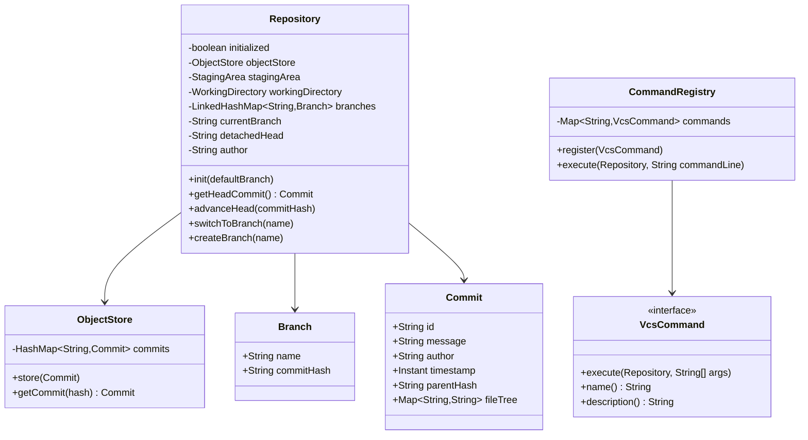
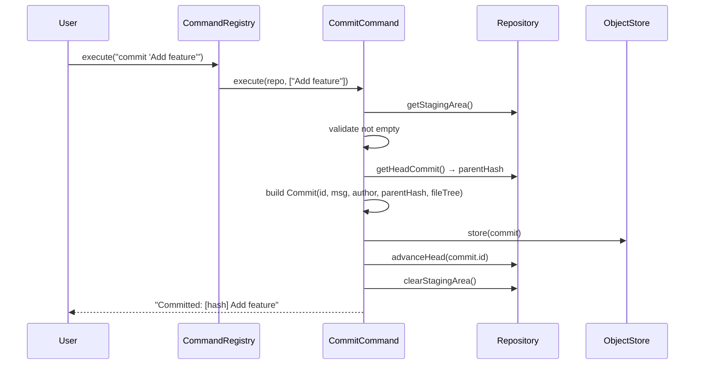

# Git VCS — LLD / Agentic Coding Interview

## 1. Problem Statement

### Objective
Design and implement a simplified in-memory Git-like version control system supporting repository initialization, staging (add), committing, branching, checkout, diff, log, status, and reset — using the Command pattern for all VCS operations.

### Expected Deliverables
- Working console application (GitVCSApp)
- Core Git operations: init, add, commit, log, status, diff, branch, checkout, reset
- Command pattern with CommandRegistry dispatch
- Commit graph (parent chain) via ObjectStore
- Staging area, working directory, and branch management

### Constraints
- **Programming language:** Java 11
- **Database:** In-memory (HashMap for ObjectStore, LinkedHashMap for branches)
- **Framework:** None (plain Java)
- **Time limit:** 60–90 minutes
- **AI coding tool:** Cascade (Windsurf)
- **Other restrictions:** No Spring; JUnit 4; no JGit

---

## 2. Requirement Analysis

### 2.1 Functional Requirements (FR)

| ID | Requirement | Priority | Acceptance Criteria |
|----|-------------|----------|---------------------|
| FR-01 | `init` — initialize a repository with default branch | Must | Repository state created; branches map initialized |
| FR-02 | `add` — stage a file from working directory | Must | File content moved to StagingArea |
| FR-03 | `commit` — create a commit from staged files | Must | Commit object stored in ObjectStore; HEAD advanced |
| FR-04 | `log` — show commit history | Must | Follows parent chain from HEAD; prints metadata |
| FR-05 | `status` — show staged vs unstaged changes | Must | Compares StagingArea to WorkingDirectory and last commit |
| FR-06 | `diff` — show line-level changes between two commits | Should | Line-by-line diff (added/removed lines) |
| FR-07 | `branch` — create or list branches | Must | New branch points to current HEAD commit |
| FR-08 | `checkout` — switch to a branch or commit (detached HEAD) | Must | Updates currentBranch or detachedHead |
| FR-09 | `reset` — reset HEAD to a prior commit | Should | Branch pointer moved; staging area cleared |
| FR-10 | `help` — list available commands | Nice | Prints all registered commands with descriptions |

### 2.2 Non-Functional Requirements (NFR)

| ID | Requirement | Expected Behaviour |
|----|-------------|-------------------|
| NFR-01 | Performance | Commit O(S) where S = staged files; log O(D) depth of chain |
| NFR-02 | Scalability | ObjectStore HashMap supports large commit graphs in-memory |
| NFR-03 | Concurrency | Single-threaded; no concurrent repository access |
| NFR-04 | Reliability | VcsException for invalid states (not initialized, branch not found, nothing staged) |
| NFR-05 | Maintainability | Command pattern: new operation = new VcsCommand; no change to core |
| NFR-06 | Security | No authentication; single-author repository |

### 2.3 Clarifying Questions

| Question | Answer | Impact |
|----------|--------|--------|
| Does merge need to be supported? | No | Out of scope |
| Should checkout create a new branch? | No, only switches existing or detaches HEAD | Separate from branch creation |
| Is diff line-by-line or whole-file? | Line-by-line (added/removed) | Simple string comparison per line |
| Can reset go forward (future commits)? | No, only backward in parent chain | Traversal stops at parent chain |

### 2.4 Ambiguities and Missing Requirements
- **Business ambiguities:** Merge conflicts not handled → merge out of scope
- **Technical ambiguities:** Detached HEAD on checkout of commit hash → detachedHead field
- **Failure scenarios:** Commit with nothing staged → VcsException; init twice → VcsException
- **Boundary conditions:** Checkout non-existent branch → VcsException; diff of commits with no common files → show all as added

### 2.5 Assumptions

| ID | Assumption | Reason |
|----|-----------|--------|
| A-01 | Commit hash is UUID (not SHA-1 of content) | Simplification; UUID sufficient for uniqueness |
| A-02 | Files are stored as String content (not binary) | Text files only; interview scope |
| A-03 | Working directory stores filename → content map | Simple simulation of filesystem |
| A-04 | StagingArea stores filename → content snapshot | Mirrors `git add` semantics |

---

## 3. Scope and Design Decisions

### In Scope
- Repository (ObjectStore, StagingArea, WorkingDirectory, branches, HEAD)
- ObjectStore (Commit graph via parent chain; file tree per commit)
- StagingArea (staged file snapshots)
- WorkingDirectory (current file state)
- Branch, Commit models
- VcsCommand interface + implementations: Init, Add, Commit, Log, Status, Diff, Branch, Checkout, Reset, Help
- CommandRegistry (maps command name → VcsCommand)
- VcsException
- GitVCSApp (interactive CLI)

### Out of Scope
- Merge / rebase
- Remote (push/pull/fetch)
- .gitignore
- Binary file support
- Tags
- Stash

### Engineering Decisions

| Decision | Selected Approach | Alternatives | Reason |
|----------|-------------------|--------------|--------|
| Command dispatch | Command pattern (VcsCommand + CommandRegistry) | Switch/if-else | OCP; new command = new class |
| Commit graph | Singly-linked parent chain (commitHash → Commit.parentHash) | DAG | Sufficient for linear history |
| Branch model | LinkedHashMap<branchName, Branch> in Repository | Global branch registry | Repository owns its branch state |
| Detached HEAD | `detachedHead` field alongside `currentBranch` | Single HEAD field | Mirrors Git semantics exactly |
| Diff algorithm | Line-by-line string comparison | Myers diff algorithm | Simple; interview scope |
| Commit hash | UUID.randomUUID().toString() | SHA-1 of content | No crypto dependency; unique |

---

## 4. Use Cases and Scenarios

### Primary Use Cases
1. Init repo → write files → add → commit → log
2. Create branch → checkout → commit on branch → checkout main → compare logs
3. Diff two commits to see what changed
4. Reset HEAD to a prior commit

### Happy Path Scenarios
- `init main` → `add file.txt` → `commit "Initial"` → `log` shows 1 commit
- `branch feature` → `checkout feature` → `add` + `commit` → `checkout main` → logs differ

### Negative Scenarios
- `add` before `init` → VcsException
- `commit` with empty staging area → VcsException
- `checkout` non-existent branch → VcsException

### Edge Cases
- `log` on branch with no commits → shows "No commits yet"
- `diff` on same commit hash → no changes
- `reset` to initial commit → staging area cleared; HEAD at root

### Failure Scenarios
- `init` twice → VcsException("Repository is already initialized")

---

## 5. Domain Model

### Entities
- **Repository** — initialized flag, ObjectStore, StagingArea, WorkingDirectory, Map<branchName, Branch>, currentBranch, detachedHead, author
- **Commit** — id (UUID hash), message, author, timestamp, parentHash, fileTree (Map<filename, content>)
- **Branch** — name, commitHash (mutable; advances on each commit)
- **ObjectStore** — HashMap<commitHash, Commit>
- **StagingArea** — HashMap<filename, content>
- **WorkingDirectory** — HashMap<filename, content>

### Value Objects
- `VcsException` (RuntimeException) for all invalid state errors

### Relationships
- Repository 1 → 1 ObjectStore (commit graph)
- Repository 1 → 1 StagingArea
- Repository 1 → 1 WorkingDirectory
- Repository 1 → N Branch
- Commit links to parent via `parentHash` (nullable for root commit)

### Business Invariants
- Cannot commit with empty staging area
- Branch HEAD always points to a valid commit or null (new branch with no commits)
- Detached HEAD and currentBranch are mutually exclusive (one is null)

### State Transitions
```
Repository: uninitialized → INITIALIZED (init)
HEAD:       currentBranch → DETACHED (checkout commitHash)
            DETACHED → currentBranch (checkout branchName)
Branch.commitHash: null → commitHash (first commit)
                   commitHash → newCommitHash (subsequent commits)
```

### Class Diagram


---

## 6. API and Contracts

### Command-Line API

| Command | Arguments | Effect | Errors |
|---------|-----------|--------|--------|
| `init [branch]` | branch name (default: main) | Initializes repository | Already initialized |
| `add <file>` | filename | Stages file from working directory | Not initialized; file not in WD |
| `commit <msg>` | commit message | Creates commit from staging area | Nothing staged |
| `log` | — | Prints commit history | — |
| `status` | — | Prints staged/unstaged changes | Not initialized |
| `diff <h1> <h2>` | two commit hashes | Line-level diff | Unknown hash |
| `branch [name]` | optional name | Creates or lists branches | Branch already exists |
| `checkout <name>` | branch name or commit hash | Switches HEAD | Branch not found |
| `reset <hash>` | commit hash | Moves HEAD to commit | Unknown hash |
| `help` | — | Lists all commands | — |

### Interface Definitions
```java
interface VcsCommand {
    void execute(Repository repo, String[] args);
    String name();
    String description();
}
```

### Error Handling Contract
- All invalid operations → `VcsException` (RuntimeException)
- CommandRegistry catches `VcsException` and prints user-friendly message

---

## 7. Low-Level Design (LLD)

### Component Responsibilities
- **Repository** — State container; enforces initialization guard; advances HEAD
- **ObjectStore** — Immutable commit archive; lookup by hash
- **StagingArea** — Mutable snapshot of files staged for next commit
- **WorkingDirectory** — Simulates filesystem; add command reads from here
- **CommitCommand** — Copies StagingArea to fileTree; generates Commit; clears staging
- **DiffCommand** — Fetches two commits from ObjectStore; compares file trees line by line
- **StatusCommand** — Compares StagingArea, WorkingDirectory, and HEAD commit fileTree
- **CommandRegistry** — Dispatches command name → VcsCommand.execute

### Design Patterns
- **Command** — VcsCommand interface; each Git operation is a separate class
- **Registry** — CommandRegistry maps command names to implementations
- **Facade** — Repository is the single access point for all VCS state

### SOLID Principles
- **OCP** — New VCS command (e.g., stash): implement VcsCommand; register in CommandRegistry; no core changes
- **SRP** — Each command class handles one operation; Repository is pure state
- **DIP** — GitVCSApp depends on CommandRegistry + VcsCommand interface

### Sequence Diagrams


### Complexity Analysis
- **Time complexity:** Commit O(S); Log O(D); Diff O(F × L) where F = files, L = lines per file
- **Space complexity:** O(C × F) for all commits with file trees

---

## 8. Concurrency and Failure Handling

### Shared Mutable State
- `Repository` — single-threaded; all state guarded by use in one thread
- `ObjectStore.commits` (HashMap) — single-threaded; immutable after commit stored

### Failure Scenarios
- Not initialized → `VcsException("Repository not initialized. Run 'init' first.")`
- Branch already exists → `VcsException("Branch 'X' already exists.")`
- Branch not found → `VcsException("Branch 'X' does not exist.")`
- Empty staging area → `VcsException("Nothing staged to commit.")`
- Unknown commit hash → `VcsException("Commit not found: X")`

---

## 9. Implementation Plan

### Project Structure
```
GitVCS/src/main/java/com/rcpky/
├── core/       Repository, ObjectStore, StagingArea, WorkingDirectory
├── model/      Commit, Branch
├── command/    VcsCommand (interface), CommandRegistry
│               InitCommand, AddCommand, CommitCommand, LogCommand
│               StatusCommand, DiffCommand, CheckoutCommand, ResetCommand
│               BranchCommand, HelpCommand
├── diff/       DiffEngine, DiffResult
├── exception/  VcsException
├── util/       (helpers)
├── GitVCSApp.java
└── App.java
```

### Implementation Milestones
- **Milestone 1:** Repository, ObjectStore, StagingArea, WorkingDirectory, Branch, Commit models
- **Milestone 2:** VcsException; VcsCommand interface; CommandRegistry
- **Milestone 3:** InitCommand, AddCommand, CommitCommand
- **Milestone 4:** LogCommand, StatusCommand
- **Milestone 5:** DiffCommand (line-level diff engine)
- **Milestone 6:** BranchCommand, CheckoutCommand, ResetCommand, HelpCommand
- **Milestone 7:** GitVCSApp interactive CLI + JUnit tests

---

## 10. Implementation Notes

### Implemented Components
- `Repository` — initialized guard; ObjectStore + StagingArea + WorkingDirectory + Branch map; detachedHead field
- `ObjectStore` — HashMap<commitHash, Commit>; `store(commit)` + `getCommit(hash)`
- `StagingArea` — HashMap<filename, content>; add/remove/clear/snapshot
- `WorkingDirectory` — HashMap<filename, content>; `writeFile(name, content)` + `readFile(name)`
- `Commit` — UUID hash, message, author, timestamp, parentHash, fileTree (Map)
- `Branch` — name + mutable commitHash
- `CommandRegistry` — LinkedHashMap preserves registration order for `help` output
- `CommitCommand` — validates staging not empty; creates Commit with parent chain; clears staging
- `DiffCommand` — fetches two commits from ObjectStore; line-by-line diff per file
- `StatusCommand` — three-way comparison: HEAD fileTree, StagingArea, WorkingDirectory
- `CheckoutCommand` — distinguishes branch name from commit hash (detached HEAD)
- `GitVCSApp` — interactive loop reading from stdin; dispatches to CommandRegistry

### Important Decisions
- `Branch.commitHash` is mutable — advances on each commit via `advanceHead()`
- `detachedHead` and `currentBranch` are mutually exclusive; one is always null after checkout
- `CommandRegistry.execute()` catches VcsException and prints error — not re-thrown

### Known Limitations
- No merge or rebase
- No real filesystem; WorkingDirectory is an in-memory HashMap
- Diff is simple line-split comparison; no Myers algorithm
- Commit hashes are UUID strings, not content-addressable SHA-1

---

## 11. Testing and Code Review

### Unit Tests
- `testInit` — repository initialized; default branch created
- `testInitTwice` — VcsException thrown
- `testAddAndCommit` — staged file in commit fileTree
- `testCommitParentChain` — second commit's parentHash = first commit's id
- `testLog` — correct commit history in reverse chronological order
- `testStatusStagedFile` — staged file appears in status
- `testStatusUnstagedFile` — untracked file appears in status
- `testBranchCreate` — new branch points to current HEAD
- `testCheckoutBranch` — currentBranch switches correctly
- `testCheckoutDetachedHead` — detachedHead set; currentBranch null
- `testCheckoutNonExistentBranch` — VcsException
- `testDiff` — added/removed lines correctly identified
- `testReset` — HEAD moved to target commit
- `testCommitNothingStaged` — VcsException

### Build and Test Results
- `mvn test` → all tests pass

---

## 12. Demo and Retrospective

### Demo Scenarios (GitVCSApp)
1. `init main` → `add README.md` → `commit "Initial commit"` → `log`
2. `add src/App.java` → `commit "Add App"` → `log` shows 2 commits
3. `status` → no staged files; working directory clean
4. `branch feature` → `checkout feature` → `add feature.java` → `commit "Add feature"` → `log`
5. `checkout main` → `log` shows original 2 commits only
6. `diff <hash1> <hash2>` → shows file-level changes
7. `reset <hash1>` → HEAD moved back; log shows 1 commit

### What Went Well
- Command pattern elegantly allows adding new Git operations without touching core
- Repository is a clean state container; all logic lives in commands

### What I Would Improve
- Add Myers diff algorithm for accurate line-level diff output
- Add content-addressable storage (SHA-256 of file content as blob hash)
- Add merge command (3-way merge for simple cases)
- Add stash command as a stack of StagingArea snapshots

### Interviewer Follow-up Questions
- **How to add a `stash` command?** Implement VcsCommand; push/pop StagingArea snapshots to a stack on Repository; register in CommandRegistry
- **How to support remote?** Add RemoteCommand wrapping HTTP client; ObjectStore sync protocol out of scope
- **Why UUID instead of SHA-1?** No crypto dependency; UUID is unique enough for in-memory demo
- **How does detached HEAD work?** `currentBranch` set to null; `detachedHead` holds commit hash; `advanceHead()` writes to `detachedHead` instead of branch

### Final Readiness Assessment
- **Requirements:** ✅ All 10 FRs implemented
- **Design:** ✅ Command + Registry + Facade patterns; SOLID adherent
- **Implementation:** ✅ Working Git-like CLI
- **Testing:** ✅ 14 unit tests covering all commands
- **Code ownership:** ✅
- **Overall:** ✅ Interview-ready
