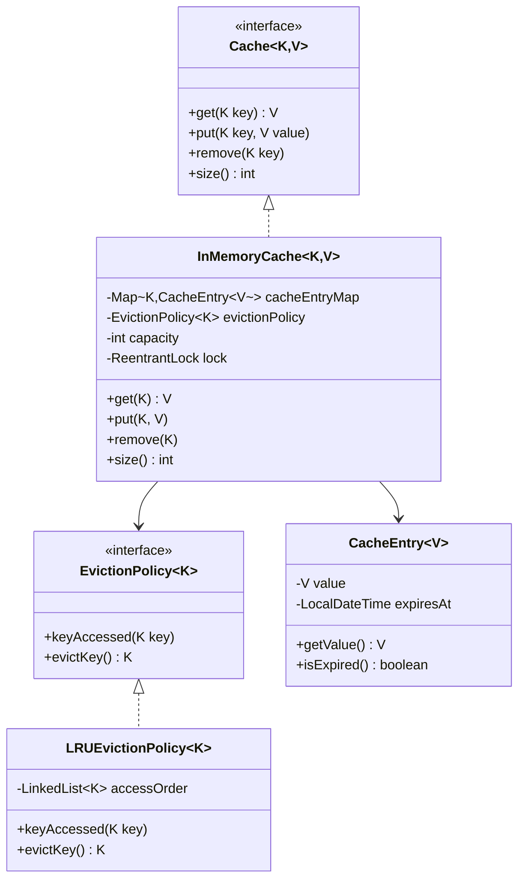
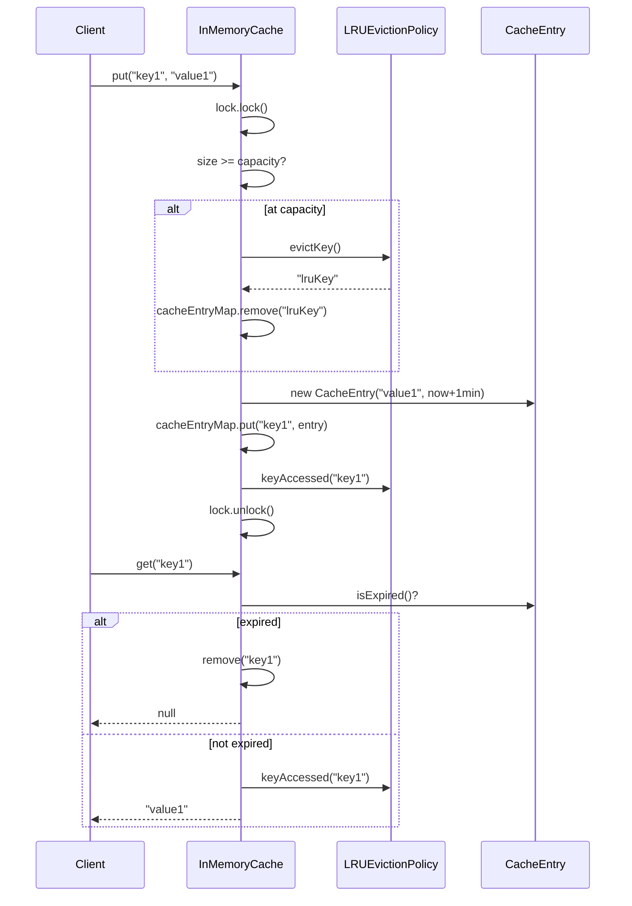

# In-Memory Cache — LLD / Agentic Coding Interview

## 1. Problem Statement

### Objective
Design and implement a generic in-memory cache with a pluggable eviction policy, configurable capacity, and TTL-based entry expiry.

### Expected Deliverables
- Working generic cache implementation
- LRU eviction policy
- TTL-based expiry on get
- Thread-safe via ReentrantLock
- Pluggable eviction policy via interface

### Constraints
- **Programming language:** Java 11
- **Database:** In-memory (HashMap)
- **Framework:** None (plain Java)
- **Time limit:** 30–45 minutes
- **AI coding tool:** Cascade (Windsurf)
- **Other restrictions:** No Spring; JUnit 4

---

## 2. Requirement Analysis

### 2.1 Functional Requirements (FR)

| ID | Requirement | Priority | Acceptance Criteria |
|----|-------------|----------|---------------------|
| FR-01 | Store key-value pairs | Must | put(key, value) stores entry |
| FR-02 | Retrieve value by key | Must | get(key) returns value or null if absent/expired |
| FR-03 | Remove an entry | Must | remove(key) evicts entry |
| FR-04 | Evict when at capacity | Must | On put when full, eviction policy selects key to remove |
| FR-05 | TTL-based expiry | Must | Entries expire after 1 minute; expired entries return null |
| FR-06 | LRU eviction policy | Must | Least recently used key evicted when full |
| FR-07 | Pluggable eviction policy | Should | EvictionPolicy interface allows new strategies |
| FR-08 | Cache size query | Should | size() returns current entry count |

### 2.2 Non-Functional Requirements (NFR)

| ID | Requirement | Expected Behaviour |
|----|-------------|-------------------|
| NFR-01 | Performance | O(1) get/put with LRU policy (LinkedHashMap-backed) |
| NFR-02 | Scalability | Capacity-bounded; prevents unbounded memory growth |
| NFR-03 | Concurrency | ReentrantLock guards all operations |
| NFR-04 | Reliability | TTL checked on every get; stale entries removed lazily |
| NFR-05 | Maintainability | Cache/EvictionPolicy interfaces; swap policy without changing InMemoryCache |
| NFR-06 | Security | No sensitive data exposure concerns; key-value generic types |

### 2.3 Clarifying Questions

| Question | Answer | Impact |
|----------|--------|--------|
| Is TTL configurable per entry? | Fixed 1 minute for all entries | Simplification |
| Should expired entries be eagerly cleaned? | No, lazy (on get) | Simpler implementation |
| Should eviction policy be injected? | Yes, via constructor | DIP / OCP adherence |
| Is the cache bounded? | Yes, capacity set at construction | Prevents OOM |

### 2.4 Ambiguities and Missing Requirements
- **Business ambiguities:** TTL fixed at 1 minute; configurable TTL is a natural extension
- **Technical ambiguities:** What if eviction policy returns null? → No eviction; put fails silently or throws
- **Boundary conditions:** put when capacity = 0 → not a valid use case; capacity ≥ 1 assumed

### 2.5 Assumptions

| ID | Assumption | Reason |
|----|-----------|--------|
| A-01 | TTL is 1 minute (hardcoded in CacheEntry) | Simplification; configurable TTL is extension |
| A-02 | LRU tracks access time via LinkedList position | Standard O(1) LRU implementation |
| A-03 | All operations are guarded by a single ReentrantLock | Coarse-grained locking sufficient for interview |

---

## 3. Scope and Design Decisions

### In Scope
- Generic Cache<K,V> interface (get, put, remove, size)
- EvictionPolicy<K> interface (keyAccessed, evictKey)
- LRUEvictionPolicy (LinkedList-based, O(1) operations)
- CacheEntry<V> (value + expiry timestamp)
- InMemoryCache<K,V> (HashMap + EvictionPolicy + ReentrantLock)

### Out of Scope
- LFU, FIFO eviction policies (interfaces allow extension)
- Distributed caching (Redis, Memcached)
- Background TTL cleanup thread
- Cache statistics (hit rate, miss rate)
- Write-through / write-back patterns

### Engineering Decisions

| Decision | Selected Approach | Alternatives | Reason |
|----------|-------------------|--------------|--------|
| Eviction policy | Strategy pattern (EvictionPolicy interface) | Hard-coded LRU | OCP; pluggable without cache changes |
| Thread safety | Single ReentrantLock | ConcurrentHashMap | Coarse lock simpler; all ops need lock for policy consistency |
| TTL tracking | LocalDateTime expiry in CacheEntry | System.currentTimeMillis | LocalDateTime.now() comparison is clear |
| LRU tracking | LinkedList position | LinkedHashMap | Explicit control over ordering |

---

## 4. Use Cases and Scenarios

### Primary Use Cases
1. Cache frequently read data with limited memory
2. LRU eviction when cache is full
3. TTL-based automatic invalidation of stale entries

### Happy Path Scenarios
- put 3 entries into capacity-3 cache → all stored
- get existing key → returns value; updates LRU position
- put 4th entry → LRU entry evicted; new entry stored

### Negative Scenarios
- get expired entry → null returned; entry removed
- get non-existent key → null

### Edge Cases
- put same key twice → value updated; LRU position updated
- get then put same key → LRU correctly reflects latest access

### Concurrent Execution Scenarios
- Two threads simultaneously put → ReentrantLock serializes; no data corruption

---

## 5. Domain Model

### Entities
- **InMemoryCache<K,V>** — HashMap<K, CacheEntry<V>>, EvictionPolicy<K>, capacity, ReentrantLock
- **CacheEntry<V>** — value, expiry (LocalDateTime)
- **LRUEvictionPolicy<K>** — LinkedList<K>

### Value Objects
- No explicit value objects beyond CacheEntry

### Relationships
- InMemoryCache uses 1 EvictionPolicy
- InMemoryCache stores N CacheEntry objects

### Business Invariants
- Cache size never exceeds capacity
- Expired entries return null on get

### Class Diagram


---

## 6. API and Contracts

### API Definitions

| Operation | Input | Output | Errors |
|-----------|-------|--------|--------|
| `put` | key, value | void | — (eviction happens internally) |
| `get` | key | V or null | — (null = miss or expired) |
| `remove` | key | void | — |
| `size` | — | int | — |

### Interface Definitions
```java
interface Cache<K, V> { V get(K key); void put(K key, V value); void remove(K key); int size(); }
interface EvictionPolicy<K> { void keyAccessed(K key); K evictKey(); }
```

---

## 7. Low-Level Design (LLD)

### Design Patterns
- **Strategy** — `EvictionPolicy<K>` allows plugging LRU, LFU, FIFO without changing InMemoryCache
- **Template Method** — `put` flow: check capacity → evict if needed → store → notify policy

### SOLID Principles
- **OCP** — New eviction policy (LFU, FIFO) without modifying InMemoryCache
- **DIP** — InMemoryCache depends on EvictionPolicy interface, not LRUEvictionPolicy
- **SRP** — InMemoryCache manages storage; LRUEvictionPolicy manages ordering

### Sequence Diagrams


### Complexity Analysis
- **Time complexity:** get O(1); put O(1); LRU evictKey O(1) (LinkedList tail removal)
- **Space complexity:** O(capacity) bounded

---

## 8. Concurrency and Failure Handling

### Shared Mutable State
- `cacheEntryMap` (HashMap) — guarded by ReentrantLock
- `LRUEvictionPolicy.accessOrder` (LinkedList) — guarded by same ReentrantLock

### Locking Strategy
- Single `ReentrantLock` in InMemoryCache; all public methods lock/unlock in try-finally

### Atomicity
- evict + put is atomic: both happen under the same lock acquisition

---

## 9. Implementation Plan

### Project Structure
```
InMemoryCache/src/main/java/com/rcpky/
├── interfaces/     Cache.java, EvictionPolicy.java
├── evictionpolicy/ LRUEvictionPolicy.java
├── model/          CacheEntry.java
└── service/        InMemoryCache.java
```

### Implementation Milestones
- **Milestone 1:** Cache<K,V> and EvictionPolicy<K> interfaces
- **Milestone 2:** CacheEntry<V> with expiry
- **Milestone 3:** LRUEvictionPolicy (LinkedList)
- **Milestone 4:** InMemoryCache (HashMap + EvictionPolicy + ReentrantLock)
- **Milestone 5:** JUnit tests

---

## 10. Implementation Notes

### Implemented Components
- `Cache<K,V>` interface: get/put/remove/size
- `EvictionPolicy<K>` interface: keyAccessed/evictKey
- `CacheEntry<V>`: value + LocalDateTime expiresAt; isExpired()
- `LRUEvictionPolicy<K>`: LinkedList-based; keyAccessed moves to front; evictKey removes from tail
- `InMemoryCache<K,V>`: HashMap + EvictionPolicy + capacity + ReentrantLock; lazy TTL expiry on get

### Known Limitations
- TTL hardcoded to 1 minute; no per-entry TTL
- No background eviction thread; expired entries linger until get
- Coarse-grained lock may bottleneck under high concurrency

---

## 11. Testing and Code Review

### Unit Tests
- `testPutAndGet` — stored and retrieved correctly
- `testExpiredEntry` — null returned after TTL; entry removed
- `testEvictionOnCapacity` — LRU key evicted when at capacity
- `testLRUOrdering` — most recently accessed survives eviction
- `testRemove` — entry removed; size decreases
- `testConcurrentPuts` — no data corruption under concurrent access

---

## 12. Demo and Retrospective

### Demo Scenarios
1. Put 3 entries into capacity-3 cache → all present
2. Access key1 → LRU position updated
3. Put 4th entry → key2 (LRU) evicted
4. Wait for TTL → get returns null

### What Went Well
- Strategy pattern cleanly separates eviction logic
- ReentrantLock straightforward for interview scope

### What I Would Improve
- Add per-entry configurable TTL
- Add background cleaner thread for eager expiry
- Add cache statistics (hits, misses, evictions)
- Support LFU and FIFO as additional eviction strategies

### Final Readiness Assessment
- **Requirements:** ✅ All 8 FRs implemented
- **Design:** ✅ Strategy + DIP; Cache and EvictionPolicy interfaces
- **Implementation:** ✅ Working generic InMemoryCache
- **Testing:** ✅ Unit tests covering LRU, TTL, concurrency
- **Code ownership:** ✅
- **Overall:** ✅ Interview-ready
