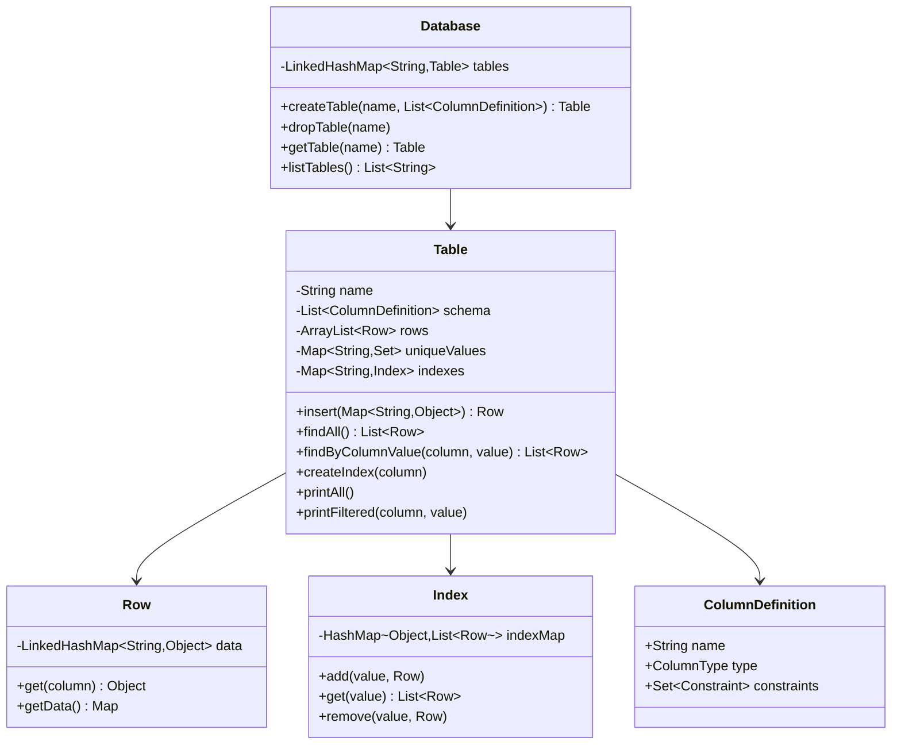
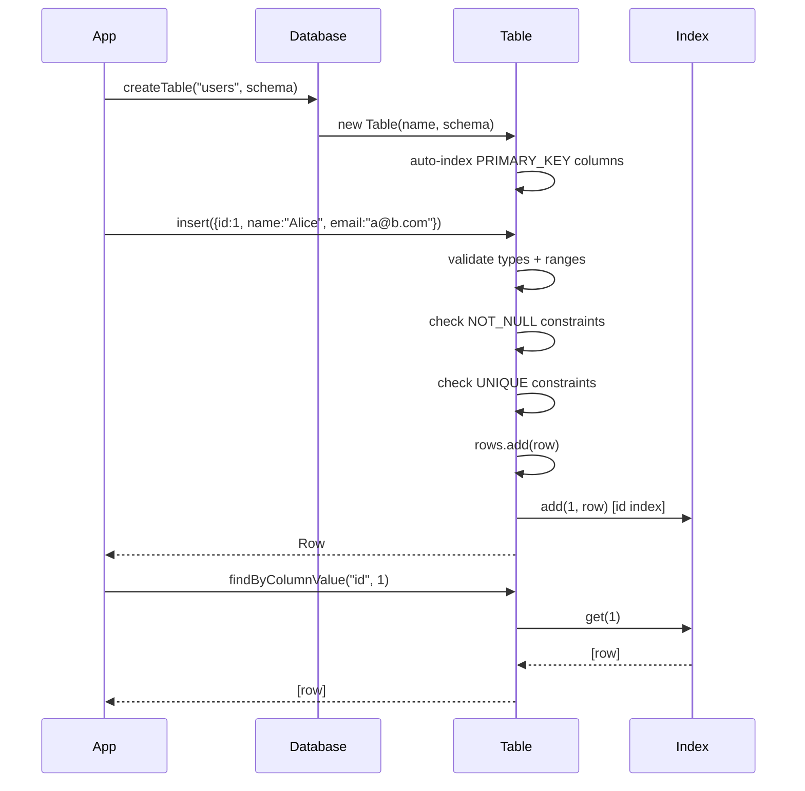

# In-Memory Database — LLD / Agentic Coding Interview

## 1. Problem Statement

### Objective
Design and implement a simplified in-memory relational database supporting table creation, schema definition with column types and constraints, row insertion with validation, secondary index creation, and ASCII table-formatted queries.

### Expected Deliverables
- Working console application with 7 demo scenarios
- Schema-aware table creation (column types, constraints)
- Row insertion with type validation and constraint enforcement
- Secondary index creation and O(1) indexed lookup
- ASCII-formatted output for queries
- 25 passing JUnit 4 tests

### Constraints
- **Programming language:** Java 11
- **Database:** In-memory (ArrayList for rows, HashMap for indexes)
- **Framework:** None (plain Java)
- **Time limit:** 45–60 minutes
- **AI coding tool:** Cascade (Windsurf)
- **Other restrictions:** No SQL parser; no Spring; JUnit 4

---

## 2. Requirement Analysis

### 2.1 Functional Requirements (FR)

| ID | Requirement | Priority | Acceptance Criteria |
|----|-------------|----------|---------------------|
| FR-01 | Create a table with named columns, types, and constraints | Must | Table registered in Database; schema stored |
| FR-02 | Drop a table | Must | Table removed from Database |
| FR-03 | Insert a row with key-value data | Must | Row validated against schema; stored in table |
| FR-04 | Find all rows in a table | Must | Returns all rows (linear scan) |
| FR-05 | Find rows by column value | Must | Linear scan; or O(1) if index exists |
| FR-06 | Create a secondary index on a column | Should | Subsequent lookups on that column use O(1) hash index |
| FR-07 | Print all rows as ASCII table | Should | Formatted table with aligned columns |
| FR-08 | Print filtered rows as ASCII table | Should | Filtered view with same formatting |
| FR-09 | List all tables in the database | Should | Returns table names |

### 2.2 Non-Functional Requirements (NFR)

| ID | Requirement | Expected Behaviour |
|----|-------------|-------------------|
| NFR-01 | Performance | O(1) indexed lookup; O(N) linear scan without index |
| NFR-02 | Scalability | HashMap-based index supports high-cardinality columns |
| NFR-03 | Concurrency | Single-threaded; no concurrent access modelled |
| NFR-04 | Reliability | Type validation and constraint checks at insert time |
| NFR-05 | Maintainability | ColumnType and Constraint enums; schema-first design |
| NFR-06 | Security | Type-range limits: STRING max 20 chars; INT in [-1024, 1024] |

### 2.3 Clarifying Questions

| Question | Answer | Impact |
|----------|--------|--------|
| Support UPDATE or DELETE? | No, insert + query only | Simplification |
| Support multi-column primary keys? | No, single column | Simplification |
| What if schema column missing in row data? | Allowed if NOT_NULL constraint absent | Nullable by default |
| Support joins? | No | Out of scope |

### 2.4 Ambiguities and Missing Requirements
- **Business ambiguities:** No transaction support → each insert is auto-committed
- **Technical ambiguities:** PRIMARY_KEY implies NOT_NULL + UNIQUE + auto-index → compound constraint
- **Failure scenarios:** Insert violates NOT_NULL → DatabaseException; violates UNIQUE → DatabaseException
- **Boundary conditions:** STRING > 20 chars → rejected; INT outside [-1024, 1024] → rejected
- **Index behavior:** createIndex on column with existing rows builds index from current rows

### 2.5 Assumptions

| ID | Assumption | Reason |
|----|-----------|--------|
| A-01 | Row is a Map<String, Object>; named Row (not Record) to avoid Java record keyword clash | Java 11 compatibility |
| A-02 | PRIMARY_KEY auto-creates an index at table creation time | Efficiency; PK lookups should always be O(1) |
| A-03 | Type system is limited: STRING and INT only | Interview scope |
| A-04 | Database uses LinkedHashMap for insertion-ordered table listing | Predictable output for demos |

---

## 3. Scope and Design Decisions

### In Scope
- Database (createTable, dropTable, getTable, listTables)
- Table (schema, insert, findAll, findByColumnValue, createIndex, printAll, printFiltered)
- ColumnDefinition (name, type, constraints)
- Row (immutable LinkedHashMap)
- Index (HashMap<Object, List<Row>> per column)
- ColumnType enum: STRING, INT
- Constraint enum: NOT_NULL, UNIQUE, PRIMARY_KEY
- DatabaseException (RuntimeException)

### Out of Scope
- UPDATE / DELETE
- Multi-column primary keys
- Joins / foreign keys
- Transactions
- Persistent storage
- SQL parsing

### Engineering Decisions

| Decision | Selected Approach | Alternatives | Reason |
|----------|-------------------|--------------|--------|
| Row storage | ArrayList<Row> | LinkedList, TreeMap | O(1) append; O(N) scan sufficient |
| Index | HashMap<Object, List<Row>> per indexed column | B-tree | O(1) lookup; interview scope |
| Row model | Immutable LinkedHashMap | Mutable POJO | Immutability prevents accidental mutation |
| Constraint enforcement | At insert time | At query time | Fail-fast design; data integrity |
| ASCII table | String formatting with max-width per column | Library (PrettyPrint) | No external deps |
| Uniqueness tracking | HashSet<Object> per unique column | Re-scanning on insert | O(1) duplicate check |

---

## 4. Use Cases and Scenarios

### Primary Use Cases
1. DBA creates table with schema → inserts rows → queries all rows
2. Lookup by primary key (indexed) → O(1) response
3. Create secondary index on email column → subsequent lookups use index
4. Insert violating NOT_NULL → exception
5. Insert duplicate UNIQUE value → exception

### Happy Path Scenarios
- Create `users` table with id (PK, INT), name (STRING, NOT_NULL), email (STRING, UNIQUE)
- Insert 3 rows; print all as ASCII table
- Create index on name; find by name → index used

### Negative Scenarios
- Insert row with missing NOT_NULL column → DatabaseException
- Insert row with duplicate UNIQUE value → DatabaseException
- Insert STRING > 20 chars → DatabaseException
- Insert INT outside [-1024, 1024] → DatabaseException

### Edge Cases
- createIndex on already-indexed column → no-op or rebuild
- findByColumnValue on non-existent column → empty list
- Drop table; re-create with same name → succeeds

### Failure Scenarios
- Insert with wrong type (e.g., String value for INT column) → DatabaseException

---

## 5. Domain Model

### Entities
- **Database** — LinkedHashMap<String, Table>; createTable/dropTable/getTable/listTables
- **Table** — schema (List<ColumnDefinition>), rows (ArrayList<Row>), uniqueValues (Map<column, Set>), indexes (Map<column, Index>)
- **Row** — immutable LinkedHashMap<String, Object> data store
- **Index** — HashMap<Object, List<Row>>; O(1) lookup per column value
- **ColumnDefinition** — name, type (ColumnType), constraints (Set<Constraint>)

### Value Objects
- `ColumnType` enum: STRING, INT
- `Constraint` enum: NOT_NULL, UNIQUE, PRIMARY_KEY (implies NOT_NULL + UNIQUE + auto-index)

### Relationships
- Database 1 → N Table
- Table 1 → N Row
- Table 1 → N Index (one per indexed column)
- ColumnDefinition is part of Table schema

### Business Invariants
- PRIMARY_KEY column is automatically NOT_NULL, UNIQUE, and indexed
- Row values must conform to declared ColumnType and ranges
- UNIQUE constraint enforced per column

### Class Diagram


---

## 6. API and Contracts

### API Definitions

| Operation | Input | Output | Errors |
|-----------|-------|--------|--------|
| `createTable` | name, List<ColumnDefinition> | Table | Duplicate table name |
| `dropTable` | name | void | Table not found |
| `insert` | Map<String,Object> rowData | Row | Type violation, constraint violation |
| `findAll` | — | List<Row> | — |
| `findByColumnValue` | column, value | List<Row> | — (empty if no match) |
| `createIndex` | column | void | Column not in schema |
| `printAll` | — | void (stdout) | — |
| `printFiltered` | column, value | void (stdout) | — |

### Validation Rules
- STRING value: non-null, length ≤ 20
- INT value: in range [-1024, 1024]
- NOT_NULL: value must be present and non-null
- UNIQUE: value not already in uniqueValues set for that column
- PRIMARY_KEY: combines NOT_NULL + UNIQUE; auto-indexes column

### Error Handling Contract
- All validation violations → `DatabaseException` (RuntimeException)

---

## 7. Low-Level Design (LLD)

### Component Responsibilities
- **Database** — Registry of tables; enforces unique table names
- **Table** — Insert validation; row storage; index management; ASCII printing
- **Index** — O(1) lookup structure per indexed column
- **Row** — Immutable data record
- **ColumnDefinition** — Schema unit; carries type + constraints

### Design Patterns
- **Repository** — Table acts as a simple repository for Row objects
- **Template Method** — Insert: validate type → validate constraints → store row → update indexes

### SOLID Principles
- **SRP** — Table handles row management; Index handles lookup; Database handles table registry
- **OCP** — New ColumnType can be added without changing Table's validation flow structure

### Sequence Diagrams


### Complexity Analysis
- **Time complexity:** Insert O(C) where C = columns; findByColumnValue O(1) with index, O(N) without
- **Space complexity:** O(N × C) for rows; O(N) per index

---

## 8. Concurrency and Failure Handling

### Shared Mutable State
- `Table.rows` (ArrayList) — single-threaded; not concurrent-safe
- `Table.uniqueValues` (HashMap of HashSet) — single-threaded
- `Database.tables` (LinkedHashMap) — single-threaded

### Failure Scenarios
- Type mismatch on insert → `DatabaseException("Type mismatch for column: ...")`
- NOT_NULL violation → `DatabaseException("NOT_NULL constraint violated")`
- UNIQUE violation → `DatabaseException("UNIQUE constraint violated")`
- Value out of range → `DatabaseException("Value out of range")`

---

## 9. Implementation Plan

### Project Structure
```
InMemoryDB/src/main/java/com/rcpky/
├── ColumnType.java
├── Constraint.java
├── ColumnDefinition.java
├── Row.java
├── Index.java
├── Table.java
├── Database.java
├── DatabaseException.java
└── InMemoryDBApp.java
```

### Implementation Milestones
- **Milestone 1:** ColumnType, Constraint enums; ColumnDefinition
- **Milestone 2:** Row (immutable LinkedHashMap wrapper)
- **Milestone 3:** Index (HashMap<Object, List<Row>>)
- **Milestone 4:** Table — schema validation, insert, findAll, findByColumnValue
- **Milestone 5:** Table — createIndex, auto-index on PRIMARY_KEY, ASCII print
- **Milestone 6:** Database — registry with create/drop/get/list
- **Milestone 7:** InMemoryDBApp — 7 demo scenarios + 25 JUnit 4 tests

---

## 10. Implementation Notes

### Implemented Components
- `ColumnType`: STRING / INT enum
- `Constraint`: NOT_NULL / UNIQUE / PRIMARY_KEY (PRIMARY_KEY implies NOT_NULL + UNIQUE + auto-index)
- `Row`: immutable LinkedHashMap; named Row not Record to avoid java.lang.Record clash
- `Index`: HashMap<Object, List<Row>> per column; O(1) lookup
- `Table`: schema, ArrayList rows, uniqueValues sets, indexes map; insert validates type+range+constraints; createIndex builds from existing rows; findAll / findByColumnValue (linear scan or index); printAll / printFiltered renders ASCII table
- `Database`: LinkedHashMap of Table, createTable/dropTable/getTable/listTables
- `DatabaseException`: RuntimeException

### Important Decisions
- String max 20 chars; INT in [-1024, 1024] — explicit limits for interview clarity
- PRIMARY_KEY auto-index ensures O(1) PK lookups without explicit `createIndex` call
- Row named "Row" not "Record" to avoid conflict with Java 14+ `java.lang.Record`

### Known Limitations
- No UPDATE or DELETE operations
- No transaction support
- Single-threaded; no concurrent access support

---

## 11. Testing and Code Review

### Unit Tests (25 total)
- `testCreateTable` — table created, schema stored
- `testDropTable` — table removed
- `testInsertAndFindAll` — row inserted; findAll returns it
- `testFindByColumnValueLinearScan` — correct row returned without index
- `testFindByColumnValueWithIndex` — O(1) via index
- `testCreateIndexBuildsFromExistingRows` — existing rows indexed correctly
- `testNotNullConstraint` — DatabaseException on null value
- `testUniqueConstraint` — DatabaseException on duplicate
- `testPrimaryKeyConstraint` — NOT_NULL + UNIQUE + auto-index
- `testTypeValidationString` — rejects non-string for STRING column
- `testTypeValidationInt` — rejects non-int for INT column
- `testStringLengthLimit` — rejects STRING > 20 chars
- `testIntRangeLimit` — rejects INT outside [-1024, 1024]
- `testPrintAll` — ASCII table rendered to stdout
- `testPrintFiltered` — filtered ASCII table
- `testDuplicateTableName` — DatabaseException
- (+ 9 additional edge tests)

### Build and Test Results
- `mvn test` → 25 tests pass

---

## 12. Demo and Retrospective

### Demo Scenarios (InMemoryDBApp)
1. Create `users` table with id (PK), name (NOT_NULL), email (UNIQUE)
2. Insert 3 rows; print all as ASCII table
3. Find by primary key (indexed) → O(1)
4. Create index on `name`; find by name
5. Attempt invalid insert (NOT_NULL violation) → exception shown
6. Attempt duplicate UNIQUE → exception shown
7. Drop table; list tables → confirms removal

### What Went Well
- Constraint system naturally composable (PRIMARY_KEY = NOT_NULL + UNIQUE + index)
- ASCII table formatting produces clean interview demo output

### What I Would Improve
- Add UPDATE and DELETE operations
- Add B-tree index for range queries
- Add transaction support with rollback

### Final Readiness Assessment
- **Requirements:** ✅ All 9 FRs implemented
- **Design:** ✅ Clean schema-first; index abstraction solid
- **Implementation:** ✅ Working with 7 demo scenarios
- **Testing:** ✅ 25 JUnit 4 tests pass
- **Code ownership:** ✅
- **Overall:** ✅ Interview-ready
