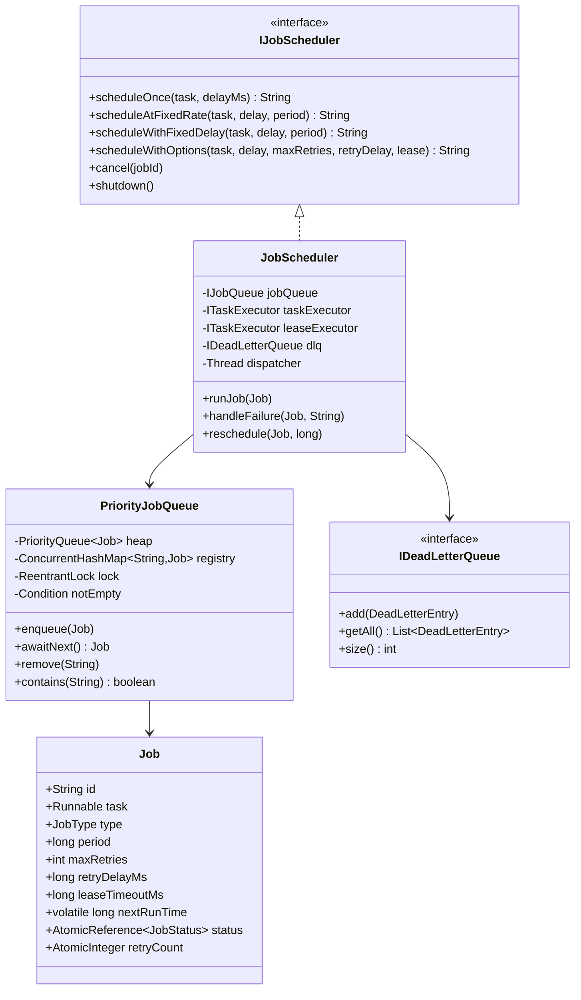
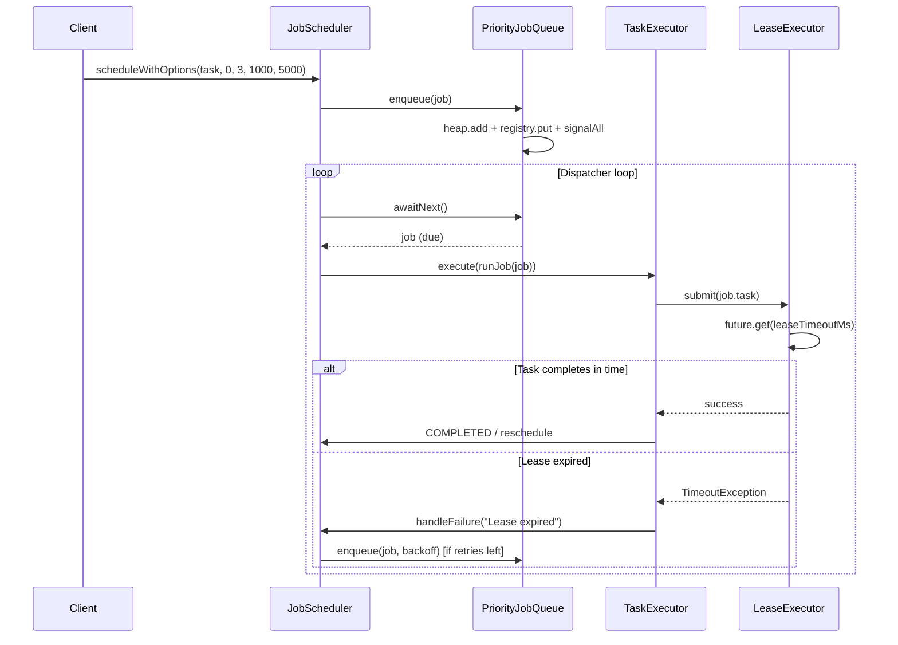

# Job Scheduler — LLD / Agentic Coding Interview

## 1. Problem Statement

### Objective
Design and implement a distributed-ready in-process job scheduler supporting one-time jobs, recurring jobs (fixed-rate and fixed-delay), cancellation, retries with exponential backoff, lease-based timeouts, and a dead-letter queue.

### Expected Deliverables
- Working console application with 7 demo scenarios
- Core scheduling: ONCE, FIXED_RATE, FIXED_DELAY
- Resilience: retries, exponential backoff, lease timeouts, DLQ
- Thread-safe concurrent dispatch
- Extensible via interfaces (IJobQueue, ITaskExecutor, IDeadLetterQueue)
- 16 passing JUnit 4 tests

### Constraints
- **Programming language:** Java 11
- **Database:** In-memory (PriorityQueue + ConcurrentHashMap + CopyOnWriteArrayList)
- **Framework:** None (plain Java)
- **Time limit:** 60–90 minutes
- **AI coding tool:** Cascade (Windsurf)
- **Other restrictions:** No Spring; only JUnit 4; no external scheduling libraries

---

## 2. Requirement Analysis

### 2.1 Functional Requirements (FR)

| ID | Requirement | Priority | Acceptance Criteria |
|----|-------------|----------|---------------------|
| FR-01 | Schedule a job to run once after a delay | Must | Job executes once; status → COMPLETED |
| FR-02 | Schedule a job at a fixed rate | Must | Recurring; next = lastScheduled + period |
| FR-03 | Schedule a job with fixed delay between runs | Must | Recurring; next = completionTime + period |
| FR-04 | Cancel a scheduled job | Must | Job never executes (or stops after current run) |
| FR-05 | Graceful shutdown | Must | In-flight jobs complete; no new jobs accepted |
| FR-06 | Lease timeout enforcement | Should | Job cancelled if task exceeds leaseTimeoutMs |
| FR-07 | Retry with exponential backoff on failure | Should | Re-enqueued up to maxRetries with retryDelayMs × 2^attempt |
| FR-08 | Dead-Letter Queue for exhausted retries | Should | Job added to DLQ after all retries consumed |
| FR-09 | VirtualThread executor support | Nice | I/O-bound jobs run on virtual threads |

### 2.2 Non-Functional Requirements (NFR)

| ID | Requirement | Expected Behaviour |
|----|-------------|-------------------|
| NFR-01 | Performance | O(log N) enqueue; O(1) peek; nanosecond dispatch precision |
| NFR-02 | Scalability | Dispatcher thread separate from worker pool; swap in Redis-backed IJobQueue |
| NFR-03 | Concurrency | Single dispatcher + CAS status transitions prevent double-execution |
| NFR-04 | Reliability | Failing task → retry/DLQ; no scheduler crash; other jobs unaffected |
| NFR-05 | Maintainability | Strategy pattern for rescheduling; DI for all major components |
| NFR-06 | Security | N/A for in-process scheduler; tenant isolation via job metadata extensible |

### 2.3 Clarifying Questions

| Question | Answer | Impact |
|----------|--------|--------|
| Should jobs survive restarts? | No, in-memory only | Scope limitation; IJobQueue interface supports swap |
| Can same job run concurrently? | No, CAS PENDING→RUNNING prevents it | Single-execution guarantee |
| What is lease timeout? | Wallclock time budget per execution | Future.get(leaseTimeoutMs) enforces it |
| Fixed-rate vs fixed-delay difference? | Rate: compensates for exec time; delay: gap after completion | ReschedulingPolicy captures this |

### 2.4 Ambiguities and Missing Requirements
- **Business ambiguities:** Job priority not specified → not implemented (extendable)
- **Technical ambiguities:** `cancel()` on running job → completes current run, not re-enqueued
- **Failure scenarios:** Unchecked exception in task → caught; retry or DLQ applied
- **Concurrency scenarios:** Multiple `cancel()` on same job → CAS safety; idempotent
- **Boundary conditions:** `maxRetries = 0` → immediate failure; `leaseTimeoutMs = 0` → no timeout

### 2.5 Assumptions

| ID | Assumption | Reason |
|----|-----------|--------|
| A-01 | Jobs are Runnable; no result type needed | Simplification; Callable variant is a natural extension |
| A-02 | Single JVM; no distributed coordination | IJobQueue interface enables swap to Redis for distributed use |
| A-03 | DLQ is optional (null → legacy FAILED status) | Backward compatibility |
| A-04 | leaseExecutor is unbounded cached pool | Prevents deadlock with fixed taskExecutor pool |

---

## 3. Scope and Design Decisions

### In Scope
- ONCE, FIXED_RATE, FIXED_DELAY job types
- Cancel, graceful shutdown
- Lease timeouts with Future.get
- Retry with exponential backoff
- Dead-letter queue
- VirtualThreadExecutor (extendable)
- PriorityQueue-based dispatch (min-heap by nextRunTime)

### Out of Scope
- Job persistence across restarts
- Distributed scheduling (multi-node)
- CRON expressions
- Job result/output capture
- Job priority ordering

### Engineering Decisions

| Decision | Selected Approach | Alternatives | Reason |
|----------|-------------------|--------------|--------|
| Storage | PriorityQueue (min-heap) + ConcurrentHashMap registry | DelayQueue, DB | O(log N) dispatch; registry for O(1) cancel |
| Concurrency | Single dispatcher + N worker threads | All-worker polling | Eliminates queue contention |
| Status transitions | AtomicReference CAS | synchronized | Fine-grained; no lock needed for status field |
| Rescheduling | Strategy lambda on JobType | if/else in scheduler | OCP; zero scheduler changes for new types |
| Lease enforcement | Two separate executor pools | Same pool | Prevents deadlock: worker waits on lease-thread |
| Cancel | Lazy deletion (registry only) | PriorityQueue.remove O(n) | O(1) cancel; dispatcher discards on poll |
| DLQ | Optional IDeadLetterQueue injection | Always-on | Null = legacy FAILED path; backward compatible |

---

## 4. Use Cases and Scenarios

### Primary Use Cases
1. Schedule a one-time cleanup job after 5s delay
2. Schedule a heartbeat at fixed rate every 2s
3. Schedule a polling job with 3s gap after each run
4. Cancel a recurring job before next execution
5. Job fails → retry 3x with backoff → DLQ

### Happy Path Scenarios
- ONCE job fires once, status → COMPLETED
- FIXED_RATE job reschedules itself every N ms regardless of execution time
- FIXED_DELAY job waits N ms after completion before next run

### Negative Scenarios
- Job task throws exception → handleFailure → retry or DLQ
- Lease exceeded → TimeoutException → handleFailure

### Edge Cases
- Cancel job that was never scheduled → no-op
- Cancel job that already completed → no-op (CAS fails on COMPLETED)
- Job scheduled with maxRetries=0 → immediate DLQ/FAILED on first failure

### Failure Scenarios
- Task throws RuntimeException → retry with backoff; after maxRetries → DLQ
- Lease expires → future.cancel(true); retry with backoff; after maxRetries → DLQ

### Concurrent Execution Scenarios
- Dispatcher picks up job; CAS PENDING→RUNNING → exactly one worker executes
- Two threads call cancel() simultaneously → CAS idempotent; only one transitions

---

## 5. Domain Model

### Entities
- **Job** — id, task (Runnable), type (JobType), period, maxRetries, retryDelayMs, leaseTimeoutMs, volatile nextRunTime, AtomicReference<JobStatus>, AtomicInteger retryCount
- **DeadLetterEntry** — jobId, jobType, failureReason, totalAttempts, deadLetteredAt (immutable)

### Value Objects
- `JobStatus` enum: PENDING, RUNNING, COMPLETED, FAILED, CANCELLED, DEAD_LETTERED
- `JobType` enum: ONCE, FIXED_RATE, FIXED_DELAY (each carries a `ReschedulingPolicy` lambda)
- `ReschedulingPolicy` @FunctionalInterface: `nextRunTime(lastScheduled, completionTime, period) → long`

### Relationships
- JobScheduler 1 → 1 IJobQueue (PriorityJobQueue)
- JobScheduler 1 → 1 ITaskExecutor (ThreadPoolTaskExecutor)
- JobScheduler 1 → 1 leaseExecutor (CachedThreadPool/VirtualThreadExecutor)
- JobScheduler 1 → 0..1 IDeadLetterQueue

### Business Invariants
- A job in RUNNING state cannot be re-dispatched (CAS guard)
- A CANCELLED job is never re-enqueued after the current run
- retryCount only increments (never resets)

### State Transitions
```
PENDING → RUNNING (dispatcher CAS)
RUNNING → COMPLETED (success, ONCE)
RUNNING → PENDING (success, recurring — reschedule)
RUNNING → PENDING (failure, retries remaining — backoff)
RUNNING → DEAD_LETTERED (failure, retries exhausted, DLQ wired)
RUNNING → FAILED (failure, retries exhausted, no DLQ)
PENDING → CANCELLED (cancel() CAS)
```

### Class Diagram


---

## 6. API and Contracts

### API Definitions

| Operation | Input | Output | Errors |
|-----------|-------|--------|--------|
| `scheduleOnce` | task, delayMs | jobId | IllegalStateException (shutdown) |
| `scheduleAtFixedRate` | task, initialDelay, period | jobId | — |
| `scheduleWithFixedDelay` | task, initialDelay, period | jobId | — |
| `scheduleWithOptions` | task, delay, maxRetries, retryDelay, lease | jobId | — |
| `cancel` | jobId | void | — (no-op if not found) |
| `shutdown` | — | void | — |

### Interface Definitions
```java
interface IJobQueue { void enqueue(Job job); Job awaitNext() throws InterruptedException; void remove(String jobId); boolean contains(String jobId); void shutdown(); }
interface ITaskExecutor { void execute(Runnable r); Future<?> submit(Runnable r); void shutdown(); boolean awaitTermination(long timeout, TimeUnit unit); }
interface IDeadLetterQueue { void add(DeadLetterEntry entry); List<DeadLetterEntry> getAll(); int size(); }
interface ReschedulingPolicy { long nextRunTime(long lastScheduled, long completionTime, long period); }
```

---

## 7. Low-Level Design (LLD)

### Component Responsibilities
- **JobScheduler** — Orchestrates dispatch; submits to executors; handles retry/DLQ logic
- **PriorityJobQueue** — Min-heap ordered by nextRunTime; registry for O(1) operations
- **ThreadPoolTaskExecutor** — Fixed thread pool for running `runJob()` wrappers
- **CachedThreadPool (leaseExecutor)** — Runs actual task when lease enforcement enabled
- **InMemoryDeadLetterQueue** — CopyOnWriteArrayList; append-only DLQ audit store
- **Job** — Immutable config + mutable runtime state (AtomicReference status, AtomicInteger retryCount)

### Design Patterns
- **Strategy** — `ReschedulingPolicy` on `JobType` (FIXED_RATE vs FIXED_DELAY formulas)
- **Command** — `Runnable task` in Job (scheduler knows nothing about task logic)
- **Producer-Consumer** — Dispatcher produces work; worker pool consumes
- **Dependency Inversion** — Scheduler depends on IJobQueue, ITaskExecutor, IDeadLetterQueue
- **Monitor Object** — `ReentrantLock + Condition` in PriorityJobQueue for timed wait
- **Lazy Deletion** — Cancel removes from registry; PriorityQueue cleared on natural poll

### SOLID Principles
- **OCP** — New job type → new ReschedulingPolicy lambda; JobScheduler unchanged
- **DIP** — JobScheduler depends on interfaces, not ConcurrentHashMap or ThreadPoolExecutor
- **SRP** — PriorityJobQueue manages ordering; JobScheduler manages lifecycle

### Sequence Diagrams


### Complexity Analysis
- **Time complexity:** Enqueue O(log N); Peek/Poll O(log N); Cancel O(1) registry; Dispatch O(1) per cycle
- **Space complexity:** O(N) for heap + registry; O(D) for DLQ (D = dead-lettered jobs)

---

## 8. Concurrency and Failure Handling

### Shared Mutable State
- `PriorityQueue<Job>` in PriorityJobQueue — guarded by ReentrantLock
- `ConcurrentHashMap` registry — lock-free ConcurrentHashMap operations
- `Job.status` — AtomicReference; CAS transitions
- `Job.retryCount` — AtomicInteger; `getAndIncrement()`
- `Job.nextRunTime` — volatile; single writer (worker), single reader (dispatcher)

### Race Conditions
- Dispatcher and cancel() both mutating job status → CAS prevents inconsistency
- Two dispatchers (impossible by design; single dispatcher thread)

### Locking Strategy
- `ReentrantLock` in PriorityJobQueue covers `peek → awaitNanos → poll` atomically
- `Condition.awaitNanos(delay)` releases lock during sleep; re-acquires on wake
- No lock held during task execution (workers run unlocked)

### Atomicity
- CAS `PENDING→RUNNING` ensures single-execution guarantee
- `ConcurrentHashMap.putIfAbsent` for registry — atomic insert

### Deadlock Prevention
- Two separate executor pools (taskExecutor + leaseExecutor)
- Worker on taskExecutor blocks on `Future.get()`; task runs on leaseExecutor
- No circular dependency between pools

### Idempotency
- `cancel()` CAS `PENDING→CANCELLED` — safe to call multiple times; fails gracefully if already RUNNING/COMPLETED

### Retry and Recovery
- `handleFailure()`: `retryCount.getAndIncrement()` → if `retriesUsed < maxRetries` → backoff re-enqueue
- Backoff: `retryDelayMs × 2^retriesUsed` (1×, 2×, 4×, 8×, …)

### Failure Scenarios
- Task throws RuntimeException → caught in `runJob()` → `handleFailure(job, e.getMessage())`
- Lease expired → `TimeoutException` → `future.cancel(true)` → `handleFailure(job, "Lease expired")`
- All retries exhausted + DLQ wired → `DEAD_LETTERED`; `dlq.add(DeadLetterEntry)`
- All retries exhausted + no DLQ → `FAILED`

---

## 9. Implementation Plan

### Project Structure
```
JobScheduler/src/main/java/com/rcpky/
├── models/         Job, JobStatus, JobType, ReschedulingPolicy
├── store/          IJobQueue, PriorityJobQueue
├── executors/      ITaskExecutor, ThreadPoolTaskExecutor, VirtualThreadExecutor
├── dlq/            IDeadLetterQueue, InMemoryDeadLetterQueue, DeadLetterEntry
├── scheduler/      IJobScheduler, JobScheduler
└── App.java        7 demo scenarios
```

### Implementation Milestones
- **Milestone 1:** Domain models — Job, JobStatus, JobType, ReschedulingPolicy
- **Milestone 2:** IJobQueue + PriorityJobQueue (heap + registry + lock)
- **Milestone 3:** ITaskExecutor + ThreadPoolTaskExecutor + VirtualThreadExecutor
- **Milestone 4:** IDeadLetterQueue + InMemoryDeadLetterQueue + DeadLetterEntry
- **Milestone 5:** IJobScheduler + JobScheduler (dispatcher + runJob + handleFailure + reschedule)
- **Milestone 6:** Lease enforcement (leaseExecutor + Future.get)
- **Milestone 7:** App.java demo + 16 JUnit 4 tests

### Dependencies
- Java 11
- JUnit 4.13.2

---

## 10. Implementation Notes

### Implemented Components
- `Job` — two constructors: 4-arg legacy (maxRetries=0, retryDelay=1000, lease=0) and full 7-arg
- `PriorityJobQueue` — PriorityQueue min-heap + ConcurrentHashMap + ReentrantLock+Condition
- `JobScheduler` — three constructors: (workers), (workers, DLQ), (IJobQueue, ITaskExecutor, IDeadLetterQueue)
- Three thread pools: dispatcher (single daemon), taskExecutor (fixed), leaseExecutor (unbounded cached daemon)
- `runJob()` — CAS PENDING→RUNNING; lease via leaseExecutor + Future.get; success → reschedule/COMPLETED; failure → handleFailure
- `handleFailure()` — exponential backoff re-enqueue or DEAD_LETTERED/FAILED
- `reschedule()` — registry presence check guards against cancelled recurring jobs
- `App.java` — 7 scenarios: once, fixed-rate, fixed-delay, cancel, retries+backoff, lease→DLQ, lease+retry→success

### Important Decisions
- `volatile nextRunTime` — single writer (worker), single reader (dispatcher); cheaper than AtomicLong
- Lazy deletion for cancel — O(1) vs O(N) PriorityQueue.remove
- Separate leaseExecutor prevents deadlock with fixed taskExecutor pool
- DLQ injected as Optional dependency — null → legacy FAILED path

### Known Limitations
- No job persistence; lost on JVM shutdown
- No CRON expression support
- No job priority ordering (extendable via comparator change)

---

## 11. Testing and Code Review

### Unit Tests (16 total)
- `testScheduleOnce` — fires once, COMPLETED
- `testScheduleAtFixedRate` — fires multiple times at rate
- `testScheduleWithFixedDelay` — gap measured after completion
- `testCancelPendingJob` — job never fires
- `testCancelRunningJob` — completes current run; not rescheduled
- `testRetryOnFailure` — retries up to maxRetries; correct backoff delays
- `testDeadLetterAfterRetries` — job appears in DLQ after exhausting retries
- `testLeaseExpiry` — task exceeding lease → handleFailure
- `testLeaseWithRetrySuccess` — eventual success within lease
- `testShutdownDrainsInFlight` — in-flight job completes; no new dispatch
- `testConcurrentCancels` — idempotent cancel under race
- `testPriorityOrdering` — earlier nextRunTime dispatched first
- (+ 4 additional edge/concurrency tests)

### Build and Test Results
- `mvn test` → 16 tests pass

---

## 12. Demo and Retrospective

### Demo Scenarios (App.java)
1. `scheduleOnce` — fires after 500ms delay
2. `scheduleAtFixedRate` — fires every 1s for 3 iterations
3. `scheduleWithFixedDelay` — 500ms gap between executions
4. `cancel` — job scheduled but cancelled before firing
5. Retries + backoff — fails 2x, succeeds on 3rd attempt
6. Lease → DLQ — task always exceeds lease; exhausts retries → DLQ
7. Lease + retry → success — task slow first time; succeeds within lease on 2nd attempt

### Verified Functionality
- FIXED_RATE vs FIXED_DELAY timing difference observable in output
- DLQ populated with correct failure reason and attempt count
- Graceful shutdown waits for in-flight tasks

### What Went Well
- Strategy pattern for rescheduling elegantly handles FIXED_RATE vs FIXED_DELAY
- Two-pool approach for lease enforcement is clean and deadlock-free

### What I Would Improve
- Add Builder pattern for Job (7-arg constructor is unwieldy)
- Add job lifecycle Observer for metrics/alerting hooks
- Implement DLQ replay API
- Support CRON via additional ReschedulingPolicy

### Interviewer Follow-up Questions
- **Why two executor pools?** Fixed pool deadlock if worker blocks on Future.get of task on same pool
- **How to make distributed?** Replace PriorityJobQueue with Redis Sorted Set; leases → Redis TTLs
- **Why lazy deletion?** PriorityQueue.remove is O(N); registry remove is O(1) ConcurrentHashMap
- **How does FIXED_RATE differ from FIXED_DELAY?** Rate compensates for execution time; delay guarantees gap

### Final Readiness Assessment
- **Requirements:** ✅ All 9 FRs implemented (FR-09 VirtualThreadExecutor present)
- **Design:** ✅ Strategy, Command, Producer-Consumer, DI patterns applied
- **Implementation:** ✅ Working with 7 demo scenarios
- **Testing:** ✅ 16 JUnit 4 tests pass
- **Code ownership:** ✅
- **Overall:** ✅ Interview-ready

---

## Original Design Reference

### Core Scheduling
1. Schedule a job to run **once** after a given delay.
2. Schedule a job to run **repeatedly at a fixed rate** (consistent wall-clock cadence).
3. Schedule a job to run **repeatedly with a fixed delay** (guaranteed gap between end of one run and start of next).
4. **Cancel** a scheduled job by its ID at any time.
5. **Graceful shutdown** — in-flight jobs finish; no new jobs accepted.

### Resilience
6. **Leases** — each job execution has an optional time-bound ownership window (`leaseTimeoutMs`). If the task does not finish within the window, it is forcibly cancelled and treated as failed.
7. **Retries** — on failure (exception or lease expiry), automatically re-attempt the job up to `maxRetries` times using **exponential backoff** (`retryDelayMs × 2^attempt`).
8. **Dead-Letter Queue (DLQ)** — jobs that exhaust all retry attempts are routed to a DLQ for inspection and optional replay, rather than silently discarded.

### Resilience (Job Processing Service)
6. **Leases** — each job execution has an optional time-bound ownership window (`leaseTimeoutMs`). If the task does not finish within the window, it is forcibly cancelled and treated as failed.
7. **Retries** — on failure (exception or lease expiry), automatically re-attempt the job up to `maxRetries` times using **exponential backoff** (`retryDelayMs × 2^attempt`).
8. **Dead-Letter Queue (DLQ)** — jobs that exhaust all retry attempts are routed to a DLQ for inspection and optional replay, rather than silently discarded.

---

## Non-Functional Requirements
1. **Thread-safe** — concurrent `schedule()`, `cancel()`, and `shutdown()` calls must be safe.
2. **Low-latency dispatch** — jobs must fire at (or very close to) their scheduled time.
3. **Fault-tolerant** — a failing or timed-out task must not crash the scheduler or affect other jobs.
4. **Extensible** — adding new job types, execution backends, or DLQ implementations must not require changes to core scheduling logic.
5. **Deadlock-free** — lease enforcement must not starve the worker thread pool.

---

## Class Diagram

```
com.rcpky
│
├── models/
│   ├── JobStatus          (PENDING → RUNNING → COMPLETED / FAILED / DEAD_LETTERED
│   │                       PENDING → CANCELLED; RUNNING → PENDING on retry)
│   ├── ReschedulingPolicy (@FunctionalInterface — Strategy for next run time)
│   ├── JobType            (ONCE, FIXED_RATE, FIXED_DELAY — carries ReschedulingPolicy)
│   └── Job                (id, task, type, period, maxRetries, retryDelayMs,
│                           leaseTimeoutMs, volatile nextRunTime,
│                           AtomicReference<JobStatus>, AtomicInteger retryCount)
│
├── store/
│   ├── IJobQueue          (enqueue, awaitNext, remove, contains, shutdown)
│   └── PriorityJobQueue   (PriorityQueue<Job> + ConcurrentHashMap registry + ReentrantLock)
│
├── executors/
│   ├── ITaskExecutor              (execute, submit→Future<?>, shutdown, awaitTermination)
│   ├── ThreadPoolTaskExecutor     (fixed OS thread pool — CPU-bound jobs, backpressure)
│   ├── CachedThreadPoolTaskExecutor (unbounded cached pool — default lease executor)
│   └── VirtualThreadExecutor      (one virtual thread per task — I/O-bound jobs)
│
├── dlq/
│   ├── IDeadLetterQueue   (add, getAll, size)
│   ├── InMemoryDeadLetterQueue (CopyOnWriteArrayList — read-heavy, write-rare)
│   └── DeadLetterEntry    (immutable: jobId, jobType, failureReason,
│                           totalAttempts, deadLetteredAt)
│
└── scheduler/
    ├── IJobScheduler      (scheduleOnce, scheduleAtFixedRate, scheduleWithFixedDelay,
    │                       scheduleWithOptions, cancel, shutdown)
    └── JobScheduler       (dispatcher thread + IJobQueue + taskExecutor
                            + leaseExecutor + IDeadLetterQueue)
```

---

## Job Lifecycle State Machine

```
                    ┌─────────────────────────────────────────┐
                    │              PENDING                     │
                    └──────┬──────────────────────────────────┘
                           │  dispatcher picks up (CAS)
                           ▼
                    ┌─────────────────────────────────────────┐
                    │              RUNNING                     │
                    └──────┬────────────┬─────────────────────┘
           success         │            │  failure / lease expiry
          ┌────────────────┘            └──────────────────────┐
          │                                                      │
   isRecurring?                                          retriesUsed < maxRetries?
    YES       NO                                          YES            NO
     │         │                                           │              │
     ▼         ▼                                           ▼              ▼
  PENDING   COMPLETED                                   PENDING      DLQ wired?
 (reschedule)  (remove)                              (re-enqueue     YES      NO
                                                    with backoff)    │        │
                                                                      ▼        ▼
                                             PENDING → CANCELLED  DEAD_   FAILED
                                              (cancel() called)  LETTERED
```

---

## Core Design Decisions

### 1. Producer-Consumer with a Single Dispatcher Thread
- **One dispatcher thread** calls `jobQueue.awaitNext()` in a loop — it only decides WHAT to dispatch and WHEN.
- **N worker threads** (or virtual threads) execute the actual task logic via `taskExecutor`.
- Slow or failing tasks never delay dispatch of other jobs.

### 2. PriorityQueue (min-heap) for Ordering
- Jobs are ordered by `nextRunTime`. The dispatcher always peeks the earliest-due job.
- `O(log n)` insert and poll; `O(1)` peek.
- `awaitNanos(delay)` sleeps exactly until the head job is due. A new earlier job wakes the dispatcher via `signalAll()`.

### 3. Single ReentrantLock Covers peek → wait → poll
- `PriorityQueue` is not thread-safe.
- `peek()` + `awaitNanos()` + `poll()` must be **atomic** — releasing the lock between them would allow another thread to insert an earlier job undetected.

### 4. ConcurrentHashMap as Job Registry
- O(1) lookup/remove by job ID for `cancel()`, retry re-enqueue, and DLQ routing.
- Does not need the main lock — `put/remove/containsKey` are independently thread-safe.

### 5. Lazy Deletion for Cancellation
- `cancel()` removes the job from the **registry only** (O(1)).
- The entry stays in the `PriorityQueue` until it naturally reaches the head.
- When dispatched, the status check (`CANCELLED`) drops it silently.
- Avoids `PriorityQueue.remove()` which is O(n) and requires holding the lock.

### 6. Strategy Pattern — ReschedulingPolicy
- `FIXED_RATE`: `nextRunTime = lastScheduled + period` — compensates for execution time, keeps wall-clock cadence.
- `FIXED_DELAY`: `nextRunTime = now + period` — guarantees a minimum rest gap after each execution.
- `JobScheduler.reschedule()` delegates to `job.getType().nextRunTime(...)` — zero knowledge of which policy applies.

### 7. Dependency Inversion — IJobQueue, ITaskExecutor, IDeadLetterQueue
- `JobScheduler` depends only on interfaces — never on concrete classes.
- Swap storage (e.g. Redis Sorted Set), execution (e.g. virtual threads), or DLQ (e.g. Kafka topic) without touching the scheduler.

### 8. CAS for Status Transitions (AtomicReference)
- `compareAndSet(PENDING, RUNNING)` in `runJob()` prevents double-execution.
- `compareAndSet(PENDING, CANCELLED)` in `cancel()` is race-free with dispatch.
- `compareAndSet(RUNNING, PENDING)` on retry re-enqueue resets the job for the next attempt.
- Chosen over `synchronized` because only single-field atomic transitions are needed.

### 9. volatile Fields
- `nextRunTime` — written by worker (reschedule/retry), read by dispatcher; `volatile` ensures visibility without a full lock.
- `running` — written by `shutdown()`, read by `dispatch()`; same reasoning.

### 10. Lease Enforcement via Two Separate ITaskExecutor Instances
- `taskExecutor` (fixed pool, N threads): runs `runJob()` — the orchestration wrapper.
- `leaseExecutor` (unbounded cached pool): runs `job.getTask()` when `leaseTimeoutMs > 0`.
- The worker thread (on `taskExecutor`) submits to `leaseExecutor` and blocks on `Future.get(leaseTimeoutMs)`.
- **Why two?** If the task ran on the same fixed pool, all N threads could block on `Future.get()` with no thread left to execute the tasks → deadlock. Separate pools eliminate this entirely.
- `leaseExecutor` defaults to `CachedThreadPoolTaskExecutor` but can be swapped for `VirtualThreadExecutor` for I/O-heavy leased jobs.

### 11. Retry with Exponential Backoff
- `handleFailure()` reads `retryCount.getAndIncrement()` (0-based).
- If `retriesUsed < maxRetries`: re-enqueue with `backoff = retryDelayMs × 2^retriesUsed` (1×, 2×, 4×, …).
- Otherwise: route to DLQ (if wired) or mark `FAILED` (legacy path, no DLQ).
- `AtomicInteger retryCount` is on `Job` — thread-safe, no external lock needed.

### 12. Dead-Letter Queue (DLQ) — Optional Dependency
- `IDeadLetterQueue` is injected into `JobScheduler`. When `null`, failed jobs fall back to `FAILED` (backward-compatible).
- `InMemoryDeadLetterQueue` uses `CopyOnWriteArrayList` — DLQ reads (monitoring) are frequent and lock-free; DLQ writes (retries exhausted) are rare.
- `DeadLetterEntry` is immutable — a historical audit record, not a live scheduling object.

---

## Thread Interaction Diagram

```
schedule()              cancel()             shutdown()
    │                       │                     │
    ▼                       ▼                     ▼
jobQueue.enqueue()    registry.remove()      running=false
signalAll() ─────►    CAS PENDING→CANCELLED  jobQueue.shutdown()
                                             leaseExecutor.shutdown()
                                             taskExecutor.shutdown()
                                             signalAll() ──────────►
                                                                     │
        ┌────────────────────────────────────────────────────────────┘
        ▼
  dispatcher thread (single)
  jobQueue.awaitNext()  ← blocks until job is due or shutdown
        │
        ▼  (if not CANCELLED)
  taskExecutor.execute(runJob)
        │
        ├── leaseTimeoutMs == 0 ──► job.getTask().run()  (direct)
        │
        └── leaseTimeoutMs  > 0 ──► leaseExecutor.submit(job.getTask())
                                         └─ Future.get(leaseTimeoutMs)
                                               ├── ok          → success path
                                               ├── TimeoutEx   → handleFailure("Lease expired")
                                               └── ExecutionEx → handleFailure(cause)
        │
        ├── success + ONCE     → COMPLETED, registry.remove()
        ├── success + recurring → reschedule() → PENDING, jobQueue.enqueue()
        └── failure             → handleFailure()
                                      ├── retriesUsed < maxRetries
                                      │       → PENDING, re-enqueue (backoff)
                                      └── retries exhausted
                                              ├── DLQ wired → DEAD_LETTERED, dlq.add()
                                              └── no DLQ    → FAILED
```

---

## Interview Questions & Answers

### Core Design

**Q: Why use a PriorityQueue instead of a simple list or delay queue?**
> PriorityQueue (min-heap) guarantees `O(log n)` insert and `O(1)` peek. The dispatcher always knows the next due job without scanning all jobs. A list would require `O(n)` scan. `DelayQueue` from JDK does the same internally but couples storage to blocking — we separated them behind `IJobQueue`.

**Q: Why a single dispatcher thread instead of letting workers pick jobs directly?**
> Single dispatcher eliminates contention on the PriorityQueue. If multiple threads polled the queue, they'd all need the lock simultaneously. With one dispatcher, the lock is held by one thread at a time. Workers get work handed to them — they never touch the queue.

**Q: How does cancel() handle a job that is currently RUNNING?**
> It removes the job from the registry immediately (O(1)). The CAS `PENDING→CANCELLED` fails because the status is `RUNNING` — intentional. The running task completes, but `reschedule()` / `handleFailure()` check `jobQueue.contains()` and find it gone, so the job is not re-enqueued. It stops after the current execution.

**Q: What happens if a job's task throws an exception?**
> `runJob()` catches the exception and calls `handleFailure()`. If `maxRetries > 0`, the job is re-enqueued with exponential backoff. After all retries are exhausted it is dead-lettered (if DLQ is wired) or marked `FAILED`. The scheduler continues normally for all other jobs.

**Q: How do you ensure a job isn't executed twice (double-execution)?**
> CAS `compareAndSet(PENDING, RUNNING)` at the start of `runJob()`. Only one thread wins the CAS. The other bails out immediately. The single dispatcher makes this impossible in practice, but the CAS is a defensive guard for future changes.

**Q: Why is nextRunTime volatile instead of AtomicLong?**
> Only one thread writes it (worker thread in `reschedule()` or `handleFailure()`), and one reads it (dispatcher). No compound read-modify-write is needed. `volatile` provides visibility at lower overhead than `AtomicLong`.

**Q: How does FIXED_RATE differ from FIXED_DELAY?**
> `FIXED_RATE`: next = `lastScheduled + period`. Job takes 200ms, period 1000ms → next fires in 800ms. Wall-clock cadence is consistent.
> `FIXED_DELAY`: next = `now + period`. Same numbers → next fires 1000ms after the job finishes. Guarantees a rest gap regardless of execution time. Use FIXED_RATE for heartbeats/metrics; FIXED_DELAY for polling where pile-up is dangerous.

**Q: What is lazy deletion and why use it here?**
> `cancel()` removes the job from the registry but leaves it in the PriorityQueue. `PriorityQueue.remove(element)` is O(n) and requires the lock, blocking the dispatcher. Lazy deletion is O(1): when the job reaches the heap head and is polled, the dispatcher checks `CANCELLED` and discards it.

**Q: Why ReentrantLock + Condition instead of synchronized + wait/notify?**
> `Condition.awaitNanos(delay)` — nanosecond-precision timed waiting. `Object.wait(timeout)` only takes milliseconds. `ReentrantLock` also gives explicit lock control and supports multiple conditions if needed.

**Q: Why do you need two separate ITaskExecutor instances (taskExecutor + leaseExecutor)?**
> `runJob()` runs on a `taskExecutor` worker thread. For lease enforcement it submits the actual task to `leaseExecutor` and **blocks** on `Future.get(timeout)`. If both used the same fixed pool, all N threads could be blocked waiting for tasks that are also waiting for a free thread → deadlock. The `leaseExecutor` (unbounded cached pool) breaks this dependency: it always has a thread available.

**Q: How does lease enforcement work?**
> When `leaseTimeoutMs > 0`, `runJob()` submits `job.getTask()` to `leaseExecutor` and calls `Future.get(leaseTimeoutMs, MILLISECONDS)`. On `TimeoutException` it calls `future.cancel(true)` (sends interrupt to the lease thread) and routes the job to `handleFailure("Lease expired")`. This is deterministic — no interrupt-flag race conditions.

**Q: How does retry work with exponential backoff?**
> `handleFailure()` reads `retryCount.getAndIncrement()` (returns the value before increment). If `retriesUsed < maxRetries`, it computes `backoff = retryDelayMs × 2^retriesUsed` (1×, 2×, 4×, …), sets `job.nextRunTime = now + backoff`, and re-enqueues. The job's status goes back to `PENDING`, ready for the next dispatcher pick-up.

**Q: What is the DLQ and when does a job land there?**
> A Dead-Letter Queue is a sink for permanently failed jobs. A job lands there when it exhausts all retries (`retriesUsed >= maxRetries`) and a `IDeadLetterQueue` is wired into the scheduler. The job's status becomes `DEAD_LETTERED` and a `DeadLetterEntry` (immutable snapshot with failure reason and attempt count) is appended. If no DLQ is wired, the job simply becomes `FAILED` — backward-compatible with the original design.

**Q: Why is InMemoryDeadLetterQueue backed by CopyOnWriteArrayList?**
> DLQ writes are rare (only when retries are exhausted). DLQ reads are frequent (monitoring dashboards, admin tooling). `CopyOnWriteArrayList` is optimised for read-heavy access: reads are lock-free on a stable snapshot. The O(n) copy on write is acceptable given the low DLQ write frequency.

---

### Design & Extensibility

**Q: How would you add a new job type, say CRON?**
> 1. Add a cron-computing lambda to `ReschedulingPolicy`.
> 2. Add `CRON(ReschedulingPolicy.CRON)` to `JobType`.
> `JobScheduler.reschedule()` needs zero changes. Open/Closed Principle.

**Q: How would you make this distributed (multi-node)?**
> Replace `PriorityJobQueue` with a distributed `IJobQueue` backed by Redis Sorted Sets (score = nextRunTime) or Kafka. `JobScheduler` doesn't change. Each node competes for jobs using distributed locking (Redlock) or Kafka consumer groups. Leases become distributed ownership tokens with TTL.

**Q: How would you persist jobs across restarts?**
> Implement `PersistentJobQueue` wrapping a DB. On startup, reload `PENDING` jobs into the in-memory heap. On `enqueue()` write to DB first, then heap. On `remove()`, update DB status. The `IJobQueue` interface makes this swap transparent.

---

## Possible Extensions

### 1. Builder Pattern for Job
As job config grows (priority, tags, name, custom backoff), the 7-arg constructor becomes unwieldy.
```java
Job job = new Job.Builder(() -> doWork())
    .delay(500).period(1000).type(JobType.FIXED_RATE)
    .maxRetries(3).retryDelay(1000).leaseTimeout(5000)
    .build();
```

### 2. Observer / Listener for Job Lifecycle Events
Hook metrics, alerting, and audit logs without touching `JobScheduler`.
```java
scheduler.addListener(new JobLifecycleListener() {
    void onStarted(Job job)             { metrics.increment("job.started"); }
    void onCompleted(Job job)           { metrics.record("job.latency", ...); }
    void onFailed(Job job, Exception e) { alerting.fire(job, e); }
    void onDeadLettered(Job job)        { auditLog.write(job); }
});
```

### 3. Job Priority
Add a `priority` field to `Job`. `PriorityJobQueue` orders by `(nextRunTime, priority)` — high-priority jobs scheduled at the same time run first.

### 4. CRON Expression Support
Add `JobType.CRON` with a `ReschedulingPolicy` that parses a cron expression and computes the next fire time (e.g. via `cron-utils` or a hand-rolled parser).

### 5. DLQ Replay
Add `IDeadLetterQueue.replay(jobId, IJobScheduler)` — re-submits a dead-lettered job with a fresh retry count, enabling operator-driven recovery without code changes.

### 6. Metrics & Monitoring
- Queue depth gauge
- Job execution latency histogram (p50/p99)
- Retry rate counter
- DLQ depth gauge
- Lease expiry rate
- Thread pool utilisation

### 7. Persistent / Distributed Queue
Replace `PriorityJobQueue` with a Redis Sorted Set backed implementation. Score = `nextRunTime`. Multiple nodes compete with `SETNX` (distributed lock) for job ownership. Leases map to Redis key TTLs.

### 8. Virtual Thread Executor for Leased Jobs *(partially implemented)*
Swap `leaseExecutor` to `VirtualThreadExecutor` — virtual threads park cheaply when blocking on I/O, so 10,000 concurrent I/O-bound leased jobs use only a handful of OS threads.

---

## Design Patterns Used

| Pattern | Where | Why |
|---|---|---|
| **Command** | `Runnable` in `Job` | Scheduler knows nothing about what the task does |
| **Strategy** | `ReschedulingPolicy` on `JobType` | Swap scheduling algorithm without changing scheduler |
| **Dependency Inversion** | `IJobQueue`, `ITaskExecutor`, `IDeadLetterQueue` | Swap storage/execution/DLQ backend without touching `JobScheduler` |
| **Producer-Consumer** | Dispatcher + worker pool | Decouple job detection (dispatcher) from job execution (workers) |
| **Monitor Object** | `ReentrantLock + Condition` in `PriorityJobQueue` | Safe shared-state access with nanosecond-precision timed waiting |
| **Lazy Deletion** | `cancel()` — registry only, not heap | O(1) cancel instead of O(n) heap removal |
| **CAS / Lock-Free** | `AtomicReference<JobStatus>`, `AtomicInteger retryCount` | Race-free status transitions and retry counting without `synchronized` |
| **Null Object** | `dlq == null` path in `handleFailure()` | Backward-compatible: no DLQ wired → `FAILED` (legacy behaviour) |
