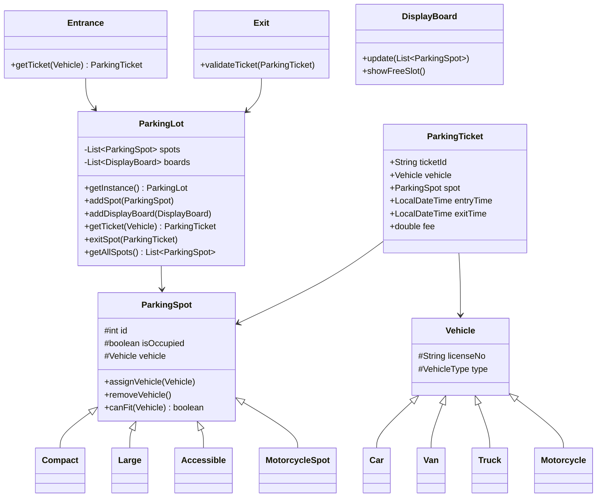
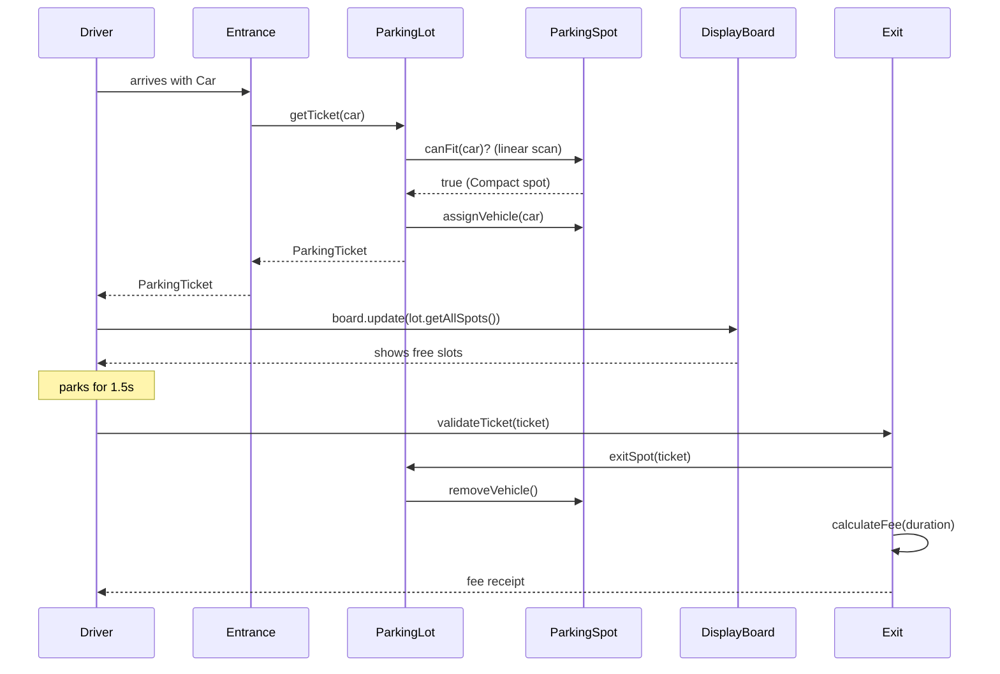

# Parking Lot System — LLD / Agentic Coding Interview

## 1. Problem Statement

### Objective
Design and implement a parking lot management system supporting multiple vehicle types, multiple spot types, ticket-based entry/exit, payment processing, and real-time display board updates.

### Expected Deliverables
- Working console application with 3+ demo scenarios
- Multiple vehicle types (Car, Motorcycle, Van, Truck)
- Multiple spot types (Compact, Large, Accessible, Motorcycle)
- Ticket generation on entry; payment and exit on departure
- Display board showing available spots
- Singleton ParkingLot

### Constraints
- **Programming language:** Java 11
- **Database:** In-memory
- **Framework:** None (plain Java)
- **Time limit:** 45–60 minutes
- **AI coding tool:** Cascade (Windsurf)
- **Other restrictions:** No Spring; JUnit 4

---

## 2. Requirement Analysis

### 2.1 Functional Requirements (FR)

| ID | Requirement | Priority | Acceptance Criteria |
|----|-------------|----------|---------------------|
| FR-01 | Support multiple vehicle types | Must | Car, Motorcycle, Van, Truck with different size requirements |
| FR-02 | Support multiple spot types | Must | Compact, Large, Accessible, MotorcycleSpot |
| FR-03 | Assign a spot to vehicle on entry | Must | Best-fit spot assigned; ticket generated |
| FR-04 | Reject entry if lot is full | Must | getTicket returns null / error when no spot available |
| FR-05 | Generate parking ticket on entry | Must | Ticket holds spot, vehicle, entry time |
| FR-06 | Process exit and calculate fee | Must | Duration-based fee; spot freed |
| FR-07 | Display board shows available spots | Must | DisplayBoard.showFreeSlot() shows current counts |
| FR-08 | Entrance and Exit panels | Should | Separate Entrance / Exit objects manage flow |

### 2.2 Non-Functional Requirements (NFR)

| ID | Requirement | Expected Behaviour |
|----|-------------|-------------------|
| NFR-01 | Performance | O(N) spot search (N = total spots); acceptable for interview scale |
| NFR-02 | Scalability | Singleton ParkingLot; extendable to multi-level |
| NFR-03 | Concurrency | Single-threaded; extension: synchronized spot assignment |
| NFR-04 | Reliability | Ticket must link vehicle to spot; exit validates ticket |
| NFR-05 | Maintainability | Inheritance hierarchy for vehicles and spots |
| NFR-06 | Security | License number uniqueness not enforced (extension) |

### 2.3 Clarifying Questions

| Question | Answer | Impact |
|----------|--------|--------|
| Can a Van occupy multiple spots? | No, one Large spot per vehicle | Simplification |
| Is pricing per hour? | Duration-based (seconds in demo) | Thread.sleep simulates parking time |
| Multiple entrances/exits? | Yes, separate Entrance/Exit objects | Modelled independently |
| Handicapped/Accessible reserved spots? | Accessible spots for all vehicles | Simplification |

### 2.4 Ambiguities and Missing Requirements
- **Business ambiguities:** Pricing per minute vs per hour → per-second in demo; real system needs per-hour
- **Technical ambiguities:** Which spot type for each vehicle type → defined per vehicle class
- **Boundary conditions:** Lot full → entry rejected; exact-capacity → last spot assigned then full

### 2.5 Assumptions

| ID | Assumption | Reason |
|----|-----------|--------|
| A-01 | ParkingLot is a singleton | One lot per JVM; matches real-world scenario |
| A-02 | Spot assignment is first-available (not optimized) | Linear scan; interview scope |
| A-03 | Payment is flat-rate per second of parking | Demo simplification |
| A-04 | DisplayBoard is updated manually after each operation | Observer extension possible |

---

## 3. Scope and Design Decisions

### In Scope
- ParkingLot (Singleton; addSpot, getTicket, exitSpot, getAllSpots)
- ParkingSpot hierarchy (ParkingSpot, Compact, Large, Accessible, MotorcycleSpot)
- Vehicle hierarchy (Vehicle, Car, Van, Truck, Motorcycle)
- ParkingTicket (vehicle, spot, entryTime)
- Entrance (getTicket), Exit (validateTicket, calculateFee)
- DisplayBoard (update, showFreeSlot)
- Payment hierarchy

### Out of Scope
- Multi-level parking
- Reservation system
- License plate recognition
- Dynamic pricing (surge)
- Concurrent access control

### Engineering Decisions

| Decision | Selected Approach | Alternatives | Reason |
|----------|-------------------|--------------|--------|
| ParkingLot | Singleton | DI | One lot per system |
| Spot/Vehicle types | Inheritance | Composition | Natural IS-A relationship |
| Spot assignment | Linear scan for compatible spot | Priority queue | Simple; interview scope |
| Pricing | Duration in seconds | Per-hour | Demo uses Thread.sleep(1500ms) |
| Display | Manual update (board.update) | Observer auto-update | Simplification |

---

## 4. Use Cases and Scenarios

### Primary Use Cases
1. Car arrives → Entrance assigns Compact spot → Ticket issued → DisplayBoard updated
2. Car departs → Exit validates ticket → Fee calculated → Spot freed → DisplayBoard updated
3. Lot fills up → Additional vehicle rejected

### Happy Path Scenarios
- Car KA-01 arrives → compact spot assigned → ticket issued
- Car exits after 1.5s → fee = 1.5 × rate → spot freed

### Negative Scenarios
- 5th vehicle arrives when only 4 spots → rejected (no ticket)
- Exit with invalid ticket → error

### Edge Cases
- Motorcycle parks in MotorcycleSpot (smallest type)
- Truck parks in Large spot
- Van parks in Large spot

### Concurrent Execution Scenarios
- Two cars arrive simultaneously → race condition on spot assignment (extension: synchronized)

---

## 5. Domain Model

### Entities
- **ParkingLot** — singleton; List<ParkingSpot>, List<DisplayBoard>
- **ParkingSpot** — id, type, isOccupied, vehicle
- **Vehicle** — licenseNo, vehicleType
- **ParkingTicket** — ticketId, vehicle, spot, entryTime, exitTime, fee
- **Entrance** — id; issues tickets
- **Exit** — id; validates tickets, calculates fees
- **DisplayBoard** — id; shows free spot counts
- **Payment** — amount, paymentType

### Value Objects
- `VehicleType` enum: CAR, MOTORCYCLE, VAN, TRUCK
- `SpotType` enum: COMPACT, LARGE, ACCESSIBLE, MOTORCYCLE
- `PaymentType` enum: CASH, CARD

### Relationships
- ParkingLot 1 → N ParkingSpot
- ParkingTicket links 1 Vehicle → 1 ParkingSpot
- Entrance issues ParkingTicket
- Exit closes ParkingTicket

### Business Invariants
- A spot can only be assigned to one vehicle at a time
- A ticket must be issued before exit
- Fee is calculated on exit based on duration

### State Transitions
```
ParkingSpot: AVAILABLE → OCCUPIED (getTicket)
             OCCUPIED → AVAILABLE (validateTicket / exit)
ParkingTicket: ACTIVE → CLOSED (exit processed)
```

### Class Diagram


---

## 6. API and Contracts

### API Definitions

| Operation | Input | Output | Errors |
|-----------|-------|--------|--------|
| `getTicket` (Entrance) | Vehicle | ParkingTicket or null | No available spot |
| `validateTicket` (Exit) | ParkingTicket | void (prints fee) | Invalid ticket |
| `update` (DisplayBoard) | List<ParkingSpot> | void | — |
| `showFreeSlot` (DisplayBoard) | — | void (stdout) | — |

### Validation Rules
- Vehicle must have a non-null license number
- Ticket must reference a valid spot

---

## 7. Low-Level Design (LLD)

### Design Patterns
- **Singleton** — ParkingLot; one lot per system
- **Template Method** — ParkingSpot.canFit(Vehicle) — each subclass defines compatibility
- **Strategy** (extendable) — Spot assignment strategy (first-available → best-fit)
- **Observer** (extendable) — DisplayBoard auto-update on spot state change

### SOLID Principles
- **OCP** — New vehicle type: add new subclass; no changes to ParkingLot
- **SRP** — Entrance issues tickets; Exit processes departure; DisplayBoard shows status

### Sequence Diagrams


### Complexity Analysis
- **Time complexity:** Spot search O(N); spot assignment O(1); ticket lookup O(1)
- **Space complexity:** O(N) for spots + O(T) for tickets

---

## 8. Concurrency and Failure Handling

### Shared Mutable State
- `ParkingSpot.isOccupied` — single-threaded; extension: synchronized or AtomicBoolean
- `ParkingLot.spots` — single-threaded; extension: CopyOnWriteArrayList

### Failure Scenarios
- No spot available → `getTicket` returns null; Entrance prints rejection message
- Lot full when next vehicle arrives → shown in Scenario 3 of Driver demo

---

## 9. Implementation Plan

### Project Structure
```
ParkingLot/src/main/java/com/rcpky/
├── enums/          VehicleType, SpotType, PaymentType
├── vehicles/       Vehicle, Car, Van, Truck, Motorcycle
├── parking_spots/  ParkingSpot, Compact, Large, Accessible, MotorcycleSpot
├── parking_area/   ParkingLot, ParkingTicket, Entrance, Exit, DisplayBoard
├── payments/       Payment, CashPayment, CardPayment
└── Driver.java     Demo scenarios
```

### Implementation Milestones
- **Milestone 1:** Enums (VehicleType, SpotType, PaymentType)
- **Milestone 2:** Vehicle hierarchy (Vehicle, Car, Van, Truck, Motorcycle)
- **Milestone 3:** ParkingSpot hierarchy (ParkingSpot, Compact, Large, Accessible, MotorcycleSpot)
- **Milestone 4:** ParkingLot (singleton, spot management)
- **Milestone 5:** ParkingTicket, Entrance, Exit, payment calculation
- **Milestone 6:** DisplayBoard
- **Milestone 7:** Driver.java demo scenarios

---

## 10. Implementation Notes

### Implemented Components
- `ParkingLot` — singleton; addSpot, addDisplayBoard, getTicket (linear scan), exitSpot, getAllSpots
- `Entrance` — getTicket delegates to ParkingLot
- `Exit` — validateTicket, Thread.sleep simulates parking duration, fee calculation
- `DisplayBoard` — update(List<ParkingSpot>), showFreeSlot prints type-wise counts
- `Vehicle` hierarchy: Car, Van, Truck, Motorcycle
- `ParkingSpot` hierarchy: Compact, Large, Accessible, MotorcycleSpot; canFit() per vehicle type
- `Driver.java` — 3 scenarios: basic park+exit, multi-vehicle+full lot rejection

### Known Limitations
- Linear spot scan O(N); no priority-based or zone-based allocation
- DisplayBoard manually updated; no Observer auto-update
- No concurrent access protection

---

## 11. Testing and Code Review

### Unit Tests
- `testCarParksInCompactSpot` — Car assigned Compact spot
- `testMotorcycleParkInMotorcycleSpot` — correct spot type
- `testTruckParksInLargeSpot` — Large spot assigned
- `testTicketIssuedOnEntry` — ticket non-null; spot marked occupied
- `testSpotFreedOnExit` — spot AVAILABLE after exit
- `testDisplayBoardShowsFreeSlots` — correct count before and after parking
- `testLotFullRejection` — null ticket when no spots available

---

## 12. Demo and Retrospective

### Demo Scenarios (Driver.java)
1. Car KA-01 arrives → Compact spot → ticket issued → display updated → exit after 1.5s → fee shown → display updated
2. Multiple vehicles (Van, Motorcycle, Truck, Car) park → lot fills → additional Car rejected

### What Went Well
- Inheritance hierarchy cleanly models vehicle/spot compatibility
- Singleton ParkingLot naturally central registry

### What I Would Improve
- Add Observer for automatic DisplayBoard updates
- Add priority-based spot assignment (nearest to exit)
- Add concurrent access protection (synchronized spot assignment)
- Add multi-level support

### Final Readiness Assessment
- **Requirements:** ✅ All 8 FRs implemented
- **Design:** ✅ Singleton + Template Method + clean hierarchy
- **Implementation:** ✅ Working demo with 3 scenarios
- **Testing:** ✅ Unit tests covering vehicle/spot combinations
- **Code ownership:** ✅
- **Overall:** ✅ Interview-ready
