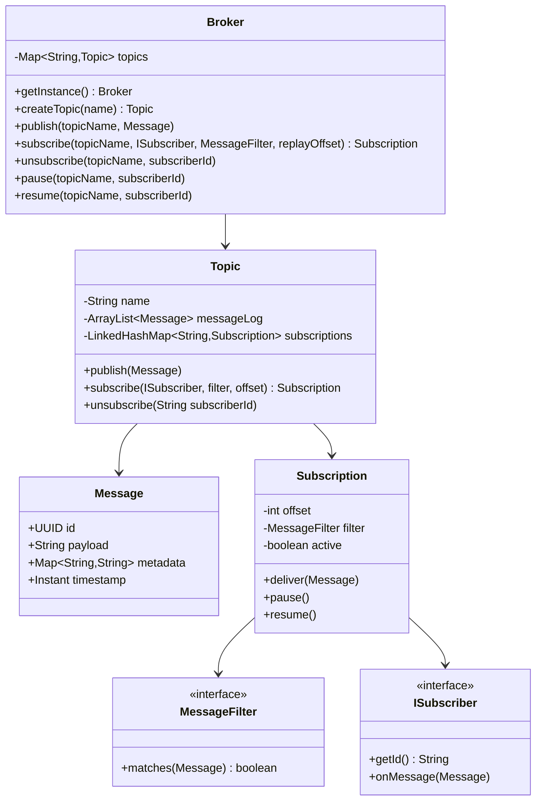
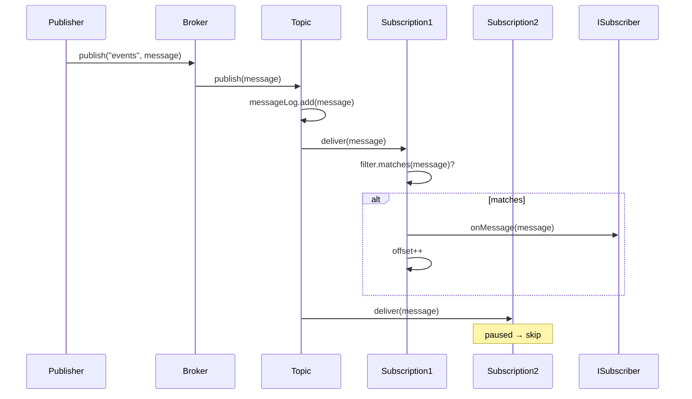

# Pub/Sub Messaging System — LLD / Agentic Coding Interview

## 1. Problem Statement

### Objective
Design and implement an in-memory Publish-Subscribe (Pub/Sub) messaging broker supporting topics, subscriptions with message filtering, offset-based replay, and pause/resume controls.

### Expected Deliverables
- Working console application with 5 demo scenarios
- Topic creation, message publishing, fan-out to subscribers
- Offset-based replay for late subscribers
- Message filtering (key-value AND match)
- Pause/resume subscriptions
- 7 passing JUnit 4 tests

### Constraints
- **Programming language:** Java 11
- **Database:** In-memory (ArrayList message log, LinkedHashMap subscriptions)
- **Framework:** None (plain Java)
- **Time limit:** 45–60 minutes
- **AI coding tool:** Cascade (Windsurf)
- **Other restrictions:** No Spring; JUnit 4; no Kafka/RabbitMQ

---

## 2. Requirement Analysis

### 2.1 Functional Requirements (FR)

| ID | Requirement | Priority | Acceptance Criteria |
|----|-------------|----------|---------------------|
| FR-01 | Create named topics | Must | Topics registered in broker; duplicate topic → error |
| FR-02 | Publish messages to a topic | Must | Message fan-out to all active subscribers |
| FR-03 | Subscribe to a topic | Must | Subscriber receives all messages published after subscription |
| FR-04 | Unsubscribe from a topic | Must | Subscriber stops receiving messages |
| FR-05 | Replay messages from a given offset | Should | Late subscriber receives messages from offset onward |
| FR-06 | Filter messages by key-value metadata | Should | Subscriber only receives messages matching filter |
| FR-07 | Pause and resume a subscription | Should | Paused subscription does not deliver messages; resumes from paused offset |
| FR-08 | Message metadata support | Nice | Messages carry arbitrary key-value metadata for filtering |

### 2.2 Non-Functional Requirements (NFR)

| ID | Requirement | Expected Behaviour |
|----|-------------|-------------------|
| NFR-01 | Performance | Fan-out O(S) per publish (S = subscriber count); replay O(N-offset) |
| NFR-02 | Scalability | Extension points: ConcurrentHashMap, ReadWriteLock, AtomicInteger offset |
| NFR-03 | Concurrency | Single-threaded; extension points documented in comments |
| NFR-04 | Reliability | Message log is append-only; replay always possible |
| NFR-05 | Maintainability | MessageFilter is a @FunctionalInterface; pluggable filtering strategies |
| NFR-06 | Security | No authentication; scoped to named topics |

### 2.3 Clarifying Questions

| Question | Answer | Impact |
|----------|--------|--------|
| Does a late subscriber get all messages? | Only from their subscription offset | Offset initialized to message log size at subscribe time |
| Can a subscriber filter by multiple keys? | Yes, KeyValueFilter ANDs all conditions | All keys must match |
| Is delivery guaranteed? | Best-effort in-process only | No persistence, no retry |
| Can the same subscriber subscribe twice? | No; overwrite by ID | LinkedHashMap keyed by subscriber ID |

### 2.4 Ambiguities and Missing Requirements
- **Business ambiguities:** Message TTL / retention not specified → full log retained
- **Technical ambiguities:** Order of delivery among paused/active subscribers → active subscribers receive synchronously
- **Failure scenarios:** Subscriber `onMessage` throws → not caught in this impl; extension point
- **Concurrency scenarios:** Concurrent publish + subscribe → extension point (ReadWriteLock noted)
- **Boundary conditions:** Replay with offset > log size → no messages delivered

### 2.5 Assumptions

| ID | Assumption | Reason |
|----|-----------|--------|
| A-01 | All operations are synchronous and single-threaded | Simplification; extension points for async noted |
| A-02 | Messages are immutable after creation | Immutable record ensures replay fidelity |
| A-03 | Broker is a singleton | One broker manages all topics |
| A-04 | Offset tracks messages received, not consumed | Offset = index into ArrayList message log |

---

## 3. Scope and Design Decisions

### In Scope
- Broker singleton (createTopic, publish, subscribe, unsubscribe, pause, resume)
- Topic (message log, subscriber map, fan-out)
- Message (immutable, UUID, payload, metadata map, timestamp)
- Subscription (offset, filter, active flag)
- MessageFilter @FunctionalInterface
- KeyValueFilter (AND-based key-value matching)

### Out of Scope
- Async/multi-threaded delivery
- Persistent message log
- Message acknowledgement / at-least-once guarantees
- Dead-letter queue
- Consumer groups / partition semantics

### Engineering Decisions

| Decision | Selected Approach | Alternatives | Reason |
|----------|-------------------|--------------|--------|
| Storage | ArrayList (message log) + LinkedHashMap (subscriptions) | ConcurrentHashMap, Kafka | Simplest; interview scope |
| Replay | Integer offset per Subscription | Timestamps, Kafka offsets | Simpler; O(1) position tracking |
| Filtering | @FunctionalInterface MessageFilter | Class hierarchy | Flexible; lambda-compatible |
| Fan-out | Synchronous iteration over subscriptions | Thread pool, async | Single-threaded scope |
| Broker | Singleton | DI container | Simple global registry |

---

## 4. Use Cases and Scenarios

### Primary Use Cases
1. Publisher sends messages; all subscribers receive them
2. Late subscriber joins after 3 messages; replays from offset 0
3. Subscriber with key-value filter only receives matching messages
4. Subscriber paused; misses messages; resumes; receives subsequent messages
5. Subscriber unsubscribes; publisher continues; unsubscribed party gets nothing

### Happy Path Scenarios
- Create topic → publish 5 messages → 3 subscribers each receive 5 messages
- Late subscriber with replay offset=0 receives all historical messages

### Negative Scenarios
- Publish to non-existent topic → TopicNotFoundException
- Subscribe to non-existent topic → error

### Edge Cases
- Pause then publish; resume; publish again → only post-resume messages delivered
- Filter with no matching messages → subscriber receives nothing
- Replay offset == message log size → no historical messages delivered

### Concurrent Execution Scenarios
- (Extension) Two publishers simultaneously → ReadWriteLock on message log prevents corruption

---

## 5. Domain Model

### Entities
- **Message** — id (UUID), payload (String), metadata (Map<String,String>), timestamp (Instant); immutable
- **Topic** — name, messageLog (ArrayList), subscriptions (LinkedHashMap<subscriberId, Subscription>)
- **Subscription** — offset (int), filter (MessageFilter), active (boolean)
- **Broker** — singleton; Map<topicName, Topic>

### Value Objects
- `MessageFilter` @FunctionalInterface: `boolean matches(Message)`
- `KeyValueFilter` — all-key AND match on message metadata

### Relationships
- Broker 1 → N Topic
- Topic 1 → N Subscription
- Subscription uses 1 MessageFilter

### Business Invariants
- Messages are never modified after creation
- Offset never decreases; only advances on delivery
- A paused subscription does not advance its offset

### State Transitions
```
Subscription: ACTIVE → PAUSED (pause())
              PAUSED → ACTIVE (resume())
              ACTIVE → REMOVED (unsubscribe())
```

### Class Diagram


---

## 6. API and Contracts

### API Definitions

| Operation | Input | Output | Errors |
|-----------|-------|--------|--------|
| `createTopic` | name | Topic | Duplicate topic name |
| `publish` | topicName, Message | void | Topic not found |
| `subscribe` | topicName, ISubscriber, filter, offset | Subscription | Topic not found |
| `unsubscribe` | topicName, subscriberId | void | — |
| `pause` | topicName, subscriberId | void | Subscription not found |
| `resume` | topicName, subscriberId | void | Subscription not found |

### Interface Definitions
```java
@FunctionalInterface interface MessageFilter { boolean matches(Message message); }
interface ISubscriber { String getId(); void onMessage(Message message); }
```

---

## 7. Low-Level Design (LLD)

### Design Patterns
- **Observer** — Topic fans out to all Subscriptions (ISubscriber.onMessage)
- **Singleton** — Broker manages all topics globally
- **Strategy** — MessageFilter is pluggable; KeyValueFilter is one implementation
- **Null Object** — No-filter subscription (always returns true) handled as lambda

### SOLID Principles
- **OCP** — New filter implementations without changing Topic or Subscription
- **SRP** — Subscription handles delivery logic; Topic handles fan-out and log; Broker handles registry
- **DIP** — Topic depends on ISubscriber, not concrete subscriber classes

### Sequence Diagrams


### Complexity Analysis
- **Time complexity:** Publish O(S) fan-out; Replay O(N) where N = messages since offset
- **Space complexity:** O(M) for message log (M = total messages); O(S) per topic for subscriptions

---

## 8. Concurrency and Failure Handling

### Shared Mutable State
- `Topic.messageLog` (ArrayList) — single-threaded; extension: ReadWriteLock
- `Topic.subscriptions` (LinkedHashMap) — single-threaded; extension: ConcurrentHashMap
- `Subscription.offset` (int) — single-threaded; extension: AtomicInteger

### Extension Points for Concurrency
- Replace ArrayList with CopyOnWriteArrayList for concurrent publish+read
- Replace LinkedHashMap with ConcurrentHashMap for concurrent subscribe/unsubscribe
- Use AtomicInteger for offset for concurrent delivery tracking

### Failure Scenarios
- Subscriber `onMessage` throws → propagates to publisher (single-threaded); extension: try/catch per subscriber

---

## 9. Implementation Plan

### Project Structure
```
PubSub/src/main/java/com/rcpky/
├── Message.java
├── MessageFilter.java (FunctionalInterface)
├── KeyValueFilter.java
├── ISubscriber.java
├── Subscription.java
├── Topic.java
├── Broker.java
└── PubSubApp.java
```

### Implementation Milestones
- **Milestone 1:** Message (immutable record), ISubscriber interface
- **Milestone 2:** MessageFilter @FunctionalInterface + KeyValueFilter
- **Milestone 3:** Subscription (offset, filter, active, deliver/pause/resume)
- **Milestone 4:** Topic (messageLog, subscriptions, publish fan-out, subscribe with replay)
- **Milestone 5:** Broker singleton (createTopic, publish, subscribe, unsubscribe, pause, resume)
- **Milestone 6:** PubSubApp — 5 demo scenarios
- **Milestone 7:** 7 JUnit 4 tests

---

## 10. Implementation Notes

### Implemented Components
- `Message` — immutable, UUID id, payload, Map<String,String> metadata, Instant timestamp
- `MessageFilter` — @FunctionalInterface; lambda-compatible
- `KeyValueFilter` — all-key AND match on message metadata
- `ISubscriber` — getId() + onMessage(Message)
- `Subscription` — offset int, filter, active boolean, deliver/pause/resume
- `Topic` — ArrayList messageLog, LinkedHashMap subscriptions, fan-out on publish, late-subscribe replay
- `Broker` — singleton, createTopic/publish/subscribe/unsubscribe/pause/resume
- `PubSubApp` — 5 demo scenarios

### Known Limitations
- Single-threaded; concurrent publish not safe without ReadWriteLock
- No message acknowledgement or at-least-once guarantee
- No DLQ for failed deliveries

---

## 11. Testing and Code Review

### Unit Tests (7 total)
- `testPublishAndReceive` — subscriber receives published message
- `testLateSubscribeReplay` — replay from offset 0 delivers historical messages
- `testFilteredSubscription` — only matching messages delivered
- `testPauseResume` — paused subscriber misses messages; receives after resume
- `testUnsubscribe` — unsubscribed party receives nothing
- `testMultipleSubscribers` — fan-out to 3 subscribers
- `testNonMatchingFilter` — zero messages delivered when filter never matches

### Build and Test Results
- `mvn test` → 7 tests pass

---

## 12. Demo and Retrospective

### Demo Scenarios (PubSubApp)
1. Basic publish/subscribe — 3 subscribers receive 5 messages
2. Replay — late subscriber joins; replays from offset 0
3. Key-value filter — only "category=sports" messages delivered
4. Pause/resume — subscriber pauses; misses 2 messages; resumes; receives next
5. Unsubscribe — publisher continues; unsubscribed subscriber receives nothing

### What Went Well
- @FunctionalInterface for MessageFilter allows clean lambda usage
- Offset-based replay naturally fits ArrayList index

### What I Would Improve
- Add thread safety (ConcurrentHashMap + ReadWriteLock)
- Add DLQ for failed deliveries
- Support consumer groups (shared offset across subscribers)

### Final Readiness Assessment
- **Requirements:** ✅ All 8 FRs implemented
- **Design:** ✅ Observer + Strategy + Singleton patterns
- **Implementation:** ✅ Working with 5 demo scenarios
- **Testing:** ✅ 7 JUnit 4 tests pass
- **Code ownership:** ✅
- **Overall:** ✅ Interview-ready
