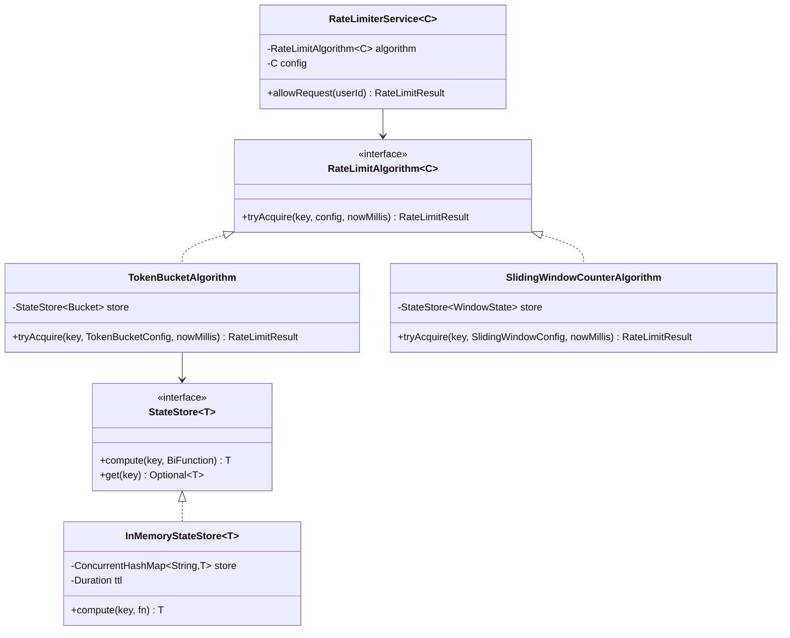

# Rate Limiter — LLD / Agentic Coding Interview

## 1. Problem Statement

### Objective
Design and implement a rate limiter service supporting multiple algorithms (Token Bucket, Sliding Window Counter, Sliding Window Log) with configurable limits per user, HTTP header reporting, and pluggable state storage.

### Expected Deliverables
- Working console application demoing rate limiting
- Token Bucket algorithm with burst support
- Sliding Window Counter and Log algorithms
- HTTP rate-limit header generation
- Pluggable algorithm via interface
- Extensible to multiple timeframes and distributed backends

### Constraints
- **Programming language:** Java 11
- **Database:** In-memory (ConcurrentHashMap with TTL-based StateStore)
- **Framework:** None (plain Java)
- **Time limit:** 45–60 minutes
- **AI coding tool:** Cascade (Windsurf)
- **Other restrictions:** No Spring; JUnit 4

---

## 2. Requirement Analysis

### 2.1 Functional Requirements (FR)

| ID | Requirement | Priority | Acceptance Criteria |
|----|-------------|----------|---------------------|
| FR-01 | Limit requests per user | Must | allowRequest(userId) returns RateLimitResult |
| FR-02 | Token Bucket algorithm | Must | Burst allowed; refill at configured rate |
| FR-03 | Sliding Window Counter algorithm | Should | Approximate count over sliding window |
| FR-04 | Sliding Window Log algorithm | Should | Exact count using timestamped request log |
| FR-05 | Return remaining quota | Must | RateLimitResult.remaining |
| FR-06 | Return retry-after time | Must | RateLimitResult.retryAfterMs when denied |
| FR-07 | HTTP header generation | Should | X-RateLimit-Limit, X-RateLimit-Remaining, Retry-After |
| FR-08 | Pluggable algorithm | Must | RateLimiterService<C> accepts any RateLimitAlgorithm<C> |
| FR-09 | Configurable per-user limits | Should | Config carries capacity, refill rate, window size |

### 2.2 Non-Functional Requirements (NFR)

| ID | Requirement | Expected Behaviour |
|----|-------------|-------------------|
| NFR-01 | Performance | Token Bucket: O(1) per request; Log: O(W) where W = requests in window |
| NFR-02 | Scalability | StateStore interface supports Redis-backed distributed implementation |
| NFR-03 | Concurrency | StateStore.compute() is atomic; AtomicReference-based result capture |
| NFR-04 | Reliability | Refill computation handles elapsed time correctly; no double-counting |
| NFR-05 | Maintainability | Algorithm and Config are separate; new algorithm = new class |
| NFR-06 | Security | Per-user limits prevent one user starving others |

### 2.3 Clarifying Questions

| Question | Answer | Impact |
|----------|--------|--------|
| Global vs per-user limit? | Per-user (keyed by userId) | StateStore keyed by userId |
| Should limits be configurable per user? | Single shared config in demo | Extension: per-user config map |
| Distributed support required? | Extension point only | StateStore interface swap |
| Is clock manipulation needed for tests? | Yes, nowMillis parameter | Allows deterministic tests |

### 2.4 Ambiguities and Missing Requirements
- **Business ambiguities:** Per-endpoint limits not specified → per-user global limit
- **Technical ambiguities:** Token Bucket burst = capacity (full bucket at start) → stated in config
- **Failure scenarios:** StateStore evicts stale entries after TTL (Duration.ofHours(1))
- **Boundary conditions:** Empty bucket (tokens = 0) → denied with exact retryAfter time

### 2.5 Assumptions

| ID | Assumption | Reason |
|----|-----------|--------|
| A-01 | Algorithms are stateless; state lives in StateStore | Enables horizontal scaling |
| A-02 | Token Bucket: refill is continuous (not discrete intervals) | Smooths token accumulation |
| A-03 | StateStore.compute() is atomic (ConcurrentHashMap.compute) | Thread-safe per-user state updates |
| A-04 | nowMillis is injected for testability | Allows time-travel in tests |

---

## 3. Scope and Design Decisions

### In Scope
- RateLimiterService<C> — generic service wrapping any RateLimitAlgorithm<C>
- RateLimitAlgorithm<C> interface — tryAcquire(key, config, nowMillis)
- TokenBucketAlgorithm — continuous refill, burst support
- SlidingWindowCounterAlgorithm — approximate window, O(1)
- SlidingWindowLogAlgorithm — exact window, O(W)
- RateLimitResult (allowed, remaining, retryAfterMs)
- StateStore<T> — InMemoryStateStore with TTL eviction
- RateLimitHeaders — HTTP header generation
- Configs: TokenBucketConfig, SlidingWindowConfig

### Out of Scope
- Per-endpoint limits
- Per-user custom limits
- Distributed Redis-backed StateStore
- API gateway integration

### Engineering Decisions

| Decision | Selected Approach | Alternatives | Reason |
|----------|-------------------|--------------|--------|
| Algorithm | Strategy pattern (RateLimitAlgorithm<C>) | Hard-coded | OCP; pluggable algorithms |
| Config | Generic type parameter C | Single Config class | Type-safe per-algorithm config |
| State | StateStore<T> interface | ConcurrentHashMap directly | Swappable for Redis |
| Atomicity | StateStore.compute() (ConcurrentHashMap.compute) | ReentrantLock | Atomic per-key update |
| Result capture | AtomicReference in lambda | Array trick | Cleaner; avoids effectively-final constraint |

---

## 4. Use Cases and Scenarios

### Primary Use Cases
1. User makes 5 requests within limit → all allowed; remaining decrements
2. User makes 6th request (over limit) → denied; retryAfterMs computed
3. Wait for token refill → subsequent request allowed
4. Different users have independent rate limit state

### Happy Path Scenarios (Token Bucket)
- capacity=5, refill=1 token/sec; 5 requests → all allowed; 6th denied
- After 1 sec pause → 1 token refilled; next request allowed

### Negative Scenarios
- Empty bucket → denied; Retry-After = ceil((1-tokens)/refillRate) ms

### Edge Cases
- Request exactly at capacity → allowed; next denied
- Burst: all tokens consumed in one batch → no issue

### Concurrent Execution Scenarios
- Two concurrent requests for same user → `compute()` serializes; correct final count

---

## 5. Domain Model

### Entities
- **RateLimiterService<C>** — wraps algorithm + config; exposes `allowRequest(userId)`
- **Bucket** — tokens (double), lastRefillMillis (long); immutable per update
- **RateLimitResult** — allowed (boolean), remaining (int), retryAfterMs (long)
- **StateStore<T>** — compute(key, BiFunction); get; evicts stale by TTL
- **InMemoryStateStore<T>** — ConcurrentHashMap with eviction

### Value Objects
- `TokenBucketConfig` — capacity (int), refillTokens (int), refillPeriodMillis (long)
- `SlidingWindowConfig` — maxRequests (int), windowMillis (long)

### Relationships
- RateLimiterService uses 1 RateLimitAlgorithm + 1 Config
- RateLimitAlgorithm uses 1 StateStore
- StateStore holds 1 state object per user key

### Class Diagram


---

## 6. API and Contracts

### API Definitions

| Operation | Input | Output | Errors |
|-----------|-------|--------|--------|
| `allowRequest` | userId | RateLimitResult | — |
| `tryAcquire` | key, config, nowMillis | RateLimitResult | — |

### Interface Definitions
```java
interface RateLimitAlgorithm<C> { RateLimitResult tryAcquire(String key, C config, long nowMillis); }
interface StateStore<T> { T compute(String key, BiFunction<String, T, T> fn); Optional<T> get(String key); }
```

### HTTP Headers
```
X-RateLimit-Limit: <capacity>
X-RateLimit-Remaining: <remaining>
Retry-After: <retryAfterMs>ms
```

---

## 7. Low-Level Design (LLD)

### Token Bucket Algorithm (detailed)
1. Fetch current Bucket from StateStore (null → full bucket with capacity tokens)
2. Compute `elapsed = nowMillis - lastRefillMillis`
3. Compute `refillRate = refillTokens / refillPeriodMillis`
4. `tokens = min(capacity, tokens + elapsed × refillRate)`
5. If `tokens >= 1.0`: consume → `tokens -= 1.0`; allowed=true; remaining=floor(tokens)
6. Else: `retryAfter = ceil((1.0 - tokens) / refillRate)`; allowed=false
7. Save updated Bucket via `store.compute()`

### Design Patterns
- **Strategy** — `RateLimitAlgorithm<C>` for pluggable algorithms
- **Template Method** — RateLimiterService.allowRequest delegates to algorithm

### SOLID Principles
- **OCP** — New algorithm without touching RateLimiterService
- **DIP** — RateLimiterService and algorithms depend on interfaces

### Sequence Diagrams
```mermaid
sequenceDiagram
    participant Client
    participant RateLimiterService
    participant TokenBucketAlgorithm
    participant StateStore

    Client->>RateLimiterService: allowRequest("user-101")
    RateLimiterService->>TokenBucketAlgorithm: tryAcquire("user-101", config, now)
    TokenBucketAlgorithm->>StateStore: compute("user-101", fn)
    StateStore->>StateStore: fetch old Bucket; apply fn; store new Bucket
    StateStore-->>TokenBucketAlgorithm: new Bucket
    TokenBucketAlgorithm-->>RateLimiterService: RateLimitResult(allowed=true, remaining=4, retryAfter=0)
    RateLimiterService-->>Client: RateLimitResult
```

### Complexity Analysis
- **Time complexity:** Token Bucket O(1); Sliding Window Counter O(1); Sliding Window Log O(W)
- **Space complexity:** O(U) per algorithm where U = number of active users

---

## 8. Concurrency and Failure Handling

### Shared Mutable State
- `StateStore<Bucket>` — ConcurrentHashMap; `compute()` is atomic per-key

### Race Conditions
- Two concurrent requests for same user → `ConcurrentHashMap.compute()` serializes per key

### Atomicity
- `store.compute()` ensures read + update + write is atomic per user key

### Idempotency
- Not applicable; each request is a new consumption

---

## 9. Implementation Plan

### Project Structure
```
RateLimiter/src/main/java/com/rcpky/
├── algo/           RateLimitAlgorithm, TokenBucketAlgorithm, SlidingWindowCounterAlgorithm, SlidingWindowLogAlgorithm
├── configs/        TokenBucketConfig, SlidingWindowConfig
├── models/         Bucket, RateLimitResult, WindowState
├── store/          StateStore, InMemoryStateStore
├── http/           RateLimitHeaders
├── RateLimiterService.java
└── App.java
```

### Implementation Milestones
- **Milestone 1:** RateLimitResult, Bucket, configs
- **Milestone 2:** StateStore interface + InMemoryStateStore (ConcurrentHashMap + TTL)
- **Milestone 3:** RateLimitAlgorithm interface + TokenBucketAlgorithm
- **Milestone 4:** SlidingWindowCounterAlgorithm + SlidingWindowLogAlgorithm
- **Milestone 5:** RateLimiterService<C>
- **Milestone 6:** RateLimitHeaders (HTTP header generation)
- **Milestone 7:** App.java demo + JUnit tests

---

## 10. Implementation Notes

### Implemented Components
- `TokenBucketAlgorithm` — continuous refill; AtomicReference result capture in lambda
- `SlidingWindowCounterAlgorithm` — approximate window; divides window into sub-buckets
- `SlidingWindowLogAlgorithm` — exact window; per-user request timestamp log
- `InMemoryStateStore<T>` — ConcurrentHashMap + Duration TTL eviction
- `RateLimitHeaders.from(result, config)` — generates HTTP header string
- `App.java` — Token Bucket demo: capacity=5, refill=1/sec; 7 request loop

### Important Decisions
- `AtomicReference<RateLimitResult>` in lambda captures result from `compute()` callback (avoids effectively-final array trick)
- `store.compute()` delegates to `ConcurrentHashMap.compute()` — inherently atomic per key

### Known Limitations
- StateStore not distributed; extend with Redis for multi-node
- Per-user config not supported; all users share same config
- InMemoryStateStore TTL eviction runs on `compute()` call only (lazy)

---

## 11. Testing and Code Review

### Unit Tests
- `testTokenBucketAllowed` — first 5 requests allowed
- `testTokenBucketDenied` — 6th request denied; retryAfter > 0
- `testTokenBucketRefill` — after refill time, request allowed again
- `testSlidingWindowCounter` — correct allow/deny behavior
- `testSlidingWindowLog` — exact window enforcement
- `testConcurrentRequests` — correct final count under concurrent access
- `testHttpHeaders` — correct header string generated

---

## 12. Demo and Retrospective

### Demo Scenarios (App.java)
1. Token Bucket: 5 requests allowed; 6th and 7th denied with Retry-After header
2. Token Bucket: wait for refill; next request allowed
3. Sliding Window Counter: show approximate limiting
4. Two users: independent rate limit states

### What Went Well
- Generic type parameter C for config makes service truly algorithm-agnostic
- `ConcurrentHashMap.compute()` elegantly handles atomicity

### What I Would Improve
- Add per-user configurable limits (Map<userId, Config>)
- Add distributed Redis-backed StateStore
- Add metrics: total requests, denied rate, average remaining

### Final Readiness Assessment
- **Requirements:** ✅ All 9 FRs implemented
- **Design:** ✅ Strategy pattern; DIP via interfaces
- **Implementation:** ✅ 3 algorithms + HTTP headers + demo
- **Testing:** ✅ Unit tests covering all algorithms
- **Code ownership:** ✅
- **Overall:** ✅ Interview-ready
