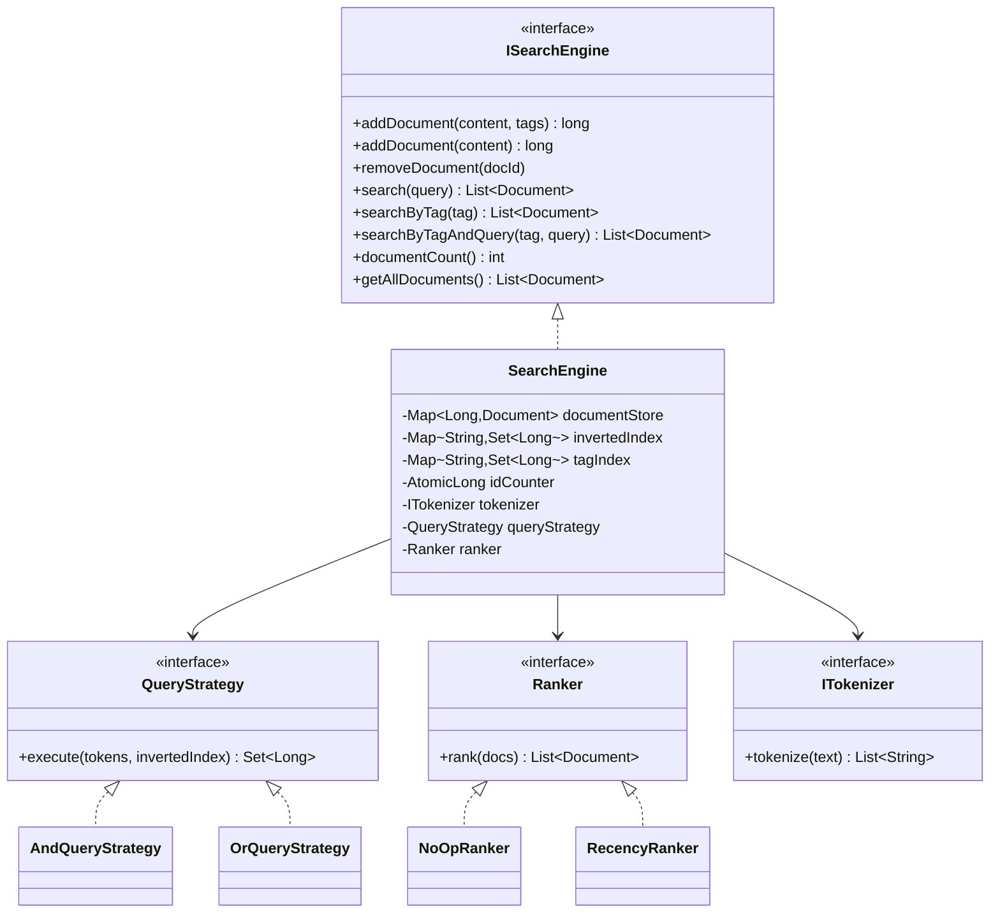
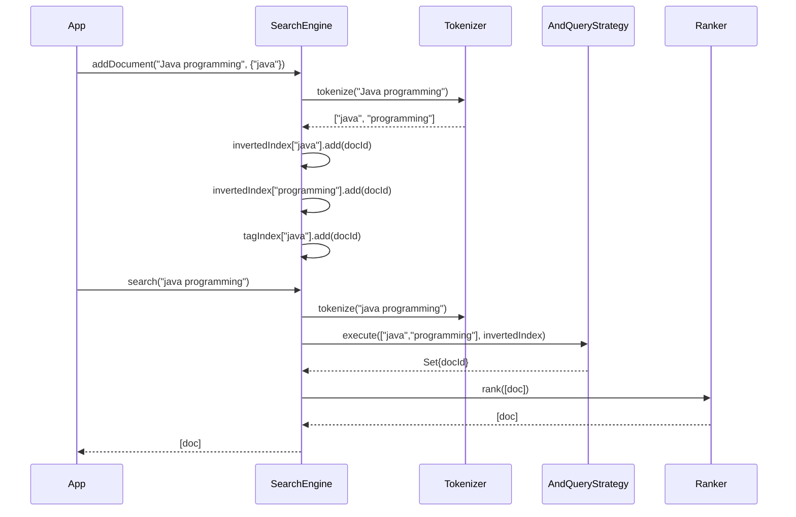

# Search Engine — LLD / Agentic Coding Interview

## 1. Problem Statement

### Objective
Design and implement an in-memory full-text search engine supporting document indexing, AND/OR query strategies, tag-based search, result ranking, and document removal.

### Expected Deliverables
- Working console application with 9 demo scenarios
- Document indexing with inverted index
- Pluggable query strategies (AND, OR)
- Tag-based search with tag index
- Pluggable ranking (NoOp, Recency)
- Builder pattern for engine configuration
- Demonstrable output via SearchEngineApp

### Constraints
- **Programming language:** Java 11
- **Database:** In-memory (HashMap for inverted index and tag index)
- **Framework:** None (plain Java)
- **Time limit:** 45–60 minutes
- **AI coding tool:** Cascade (Windsurf)
- **Other restrictions:** No Elasticsearch/Lucene; JUnit 4

---

## 2. Requirement Analysis

### 2.1 Functional Requirements (FR)

| ID | Requirement | Priority | Acceptance Criteria |
|----|-------------|----------|---------------------|
| FR-01 | Index a document by content and optional tags | Must | Document stored; inverted index updated |
| FR-02 | Remove a document by ID | Must | Document and all index entries removed |
| FR-03 | Full-text AND search | Must | Returns documents containing ALL query tokens |
| FR-04 | Full-text OR search | Should | Returns documents containing ANY query token |
| FR-05 | Search by tag | Must | Returns documents with matching tag |
| FR-06 | Combined tag + query search | Should | Intersection of tag results and query results |
| FR-07 | Result ranking | Should | Pluggable ranker (NoOp, Recency) |
| FR-08 | Document count and listing | Should | documentCount() and getAllDocuments() |
| FR-09 | Builder pattern for engine configuration | Should | SearchEngine.Builder().queryStrategy().ranker().build() |

### 2.2 Non-Functional Requirements (NFR)

| ID | Requirement | Expected Behaviour |
|----|-------------|-------------------|
| NFR-01 | Performance | Inverted index lookup O(1) per token; AND = intersection of posting lists |
| NFR-02 | Scalability | In-memory; ISearchEngine interface enables swap to distributed search |
| NFR-03 | Concurrency | Single-threaded; ISearchEngine interface supports concurrent implementations |
| NFR-04 | Reliability | SearchException on invalid inputs (null content, unknown docId) |
| NFR-05 | Maintainability | Tokenizer, QueryStrategy, Ranker all independently pluggable |
| NFR-06 | Security | Input validation (null/blank content rejected) |

### 2.3 Clarifying Questions

| Question | Answer | Impact |
|----------|--------|--------|
| Case-sensitive search? | No, lowercased during tokenization | SimpleTokenizer lowercases all tokens |
| Stop words filtered? | No | Extension point; SimpleTokenizer splits on whitespace only |
| Stemming/lemmatization? | No | Extension point |
| Ranking criteria? | Pluggable; NoOp and Recency provided | Ranker interface |
| Pagination? | No, return all results | Simplification |

### 2.4 Ambiguities and Missing Requirements
- **Business ambiguities:** Relevance ranking (TF-IDF) not implemented → Recency as alternative
- **Technical ambiguities:** Intersection order for AND → determined by smallest posting list first
- **Failure scenarios:** Remove non-existent docId → SearchException
- **Boundary conditions:** Empty query → return empty list; query with all stop words → empty list

### 2.5 Assumptions

| ID | Assumption | Reason |
|----|-----------|--------|
| A-01 | Document IDs are auto-generated (monotonically increasing long) | Simplicity; no caller-supplied IDs |
| A-02 | Tags are case-insensitive | Lowercase normalized at index time |
| A-03 | AND is the default query strategy | More precise; OR opt-in via Builder |
| A-04 | Content is plain text; no HTML stripping | Interview scope |

---

## 3. Scope and Design Decisions

### In Scope
- ISearchEngine interface (addDocument, removeDocument, search, searchByTag, searchByTagAndQuery, documentCount, getAllDocuments)
- SearchEngine (inverted index, tag index, document store)
- SimpleTokenizer (whitespace split, lowercase)
- AndQueryStrategy (intersection of posting lists)
- OrQueryStrategy (union of posting lists)
- NoOpRanker (insertion order)
- RecencyRanker (newest docId first)
- SearchEngine.Builder (compose tokenizer, strategy, ranker)

### Out of Scope
- TF-IDF ranking
- Stop word filtering / stemming
- Persistent index
- Distributed search
- Phrase queries (exact multi-word)
- Fuzzy matching

### Engineering Decisions

| Decision | Selected Approach | Alternatives | Reason |
|----------|-------------------|--------------|--------|
| Index | HashMap<String, Set<Long>> (inverted index) | Trie, B-tree | O(1) token lookup; interview scope |
| Tag index | HashMap<String, Set<Long>> | Separate store | Same structure; unified pattern |
| Query strategy | Strategy pattern (QueryStrategy) | if/else | OCP; new strategy = new class |
| Ranking | Strategy pattern (Ranker) | Comparator inline | Pluggable; separate from query |
| Builder | Builder pattern for SearchEngine | Multiple constructors | Clean API; avoids constructor explosion |

---

## 4. Use Cases and Scenarios

### Primary Use Cases
1. Index 5 documents with content and tags
2. AND search — documents containing ALL query tokens
3. Tag search — documents with specific tag
4. Combined tag + query search
5. Remove document; verify it no longer appears in results

### Happy Path Scenarios
- Add "Java programming" doc with tag "java" → search("java") returns it
- AND search "java programming" → only docs with both words returned
- searchByTagAndQuery("ai", "learning") → intersection of AI-tagged docs and "learning" docs

### Negative Scenarios
- removeDocument(9999L) → SearchException("Document not found")
- addDocument(null) → SearchException("Content must not be null or blank")
- Empty query → empty result list

### Edge Cases
- Tag search case-insensitive: searchByTag("JAVA") matches tag "java"
- Query with unknown word → empty list
- Remove then re-add document → new ID assigned; fresh index

### Concurrent Execution Scenarios
- (Extension) Two concurrent addDocument calls → ConcurrentHashMap for index safety

---

## 5. Domain Model

### Entities
- **Document** — id (long), content (String), tags (Set<String>), indexedAt (Instant)
- **SearchEngine** — documentStore (Map<Long,Document>), invertedIndex, tagIndex, tokenizer, queryStrategy, ranker

### Value Objects
- No explicit value objects; Document is the primary entity

### Relationships
- SearchEngine 1 → 1 ITokenizer
- SearchEngine 1 → 1 QueryStrategy
- SearchEngine 1 → 1 Ranker
- SearchEngine 1 → N Document (via documentStore)

### Business Invariants
- Document content must be non-null and non-blank
- Document ID is auto-assigned and never reused after removal
- Tag comparison is case-insensitive

### Class Diagram


---

## 6. API and Contracts

### API Definitions

| Operation | Input | Output | Errors |
|-----------|-------|--------|--------|
| `addDocument` | content, tags | docId (long) | SearchException (null/blank content) |
| `addDocument` | content | docId (long) | SearchException |
| `removeDocument` | docId | void | SearchException (not found) |
| `search` | query | List<Document> | — (empty if no match) |
| `searchByTag` | tag | List<Document> | — |
| `searchByTagAndQuery` | tag, query | List<Document> | — |
| `documentCount` | — | int | — |
| `getAllDocuments` | — | List<Document> | — |

### Builder API
```java
ISearchEngine engine = new SearchEngine.Builder()
    .queryStrategy(new OrQueryStrategy())
    .ranker(new RecencyRanker())
    .build();
```

---

## 7. Low-Level Design (LLD)

### Component Responsibilities
- **SearchEngine** — Manages document store, inverted index, tag index; delegates tokenization, querying, ranking
- **SimpleTokenizer** — Splits on whitespace; lowercases; returns token list
- **AndQueryStrategy** — Intersects posting lists for all query tokens
- **OrQueryStrategy** — Unions posting lists for any query token
- **NoOpRanker** — Returns results in insertion order (no re-ordering)
- **RecencyRanker** — Sorts by docId descending (larger ID = newer)

### Design Patterns
- **Strategy** — QueryStrategy (AND/OR) and Ranker (NoOp/Recency) are independently pluggable
- **Builder** — `SearchEngine.Builder` for clean engine construction
- **Interface segregation** — ISearchEngine, ITokenizer, QueryStrategy, Ranker are separate interfaces

### SOLID Principles
- **OCP** — New query strategy or ranker without changing SearchEngine
- **DIP** — SearchEngineApp depends on ISearchEngine, not SearchEngine
- **SRP** — SearchEngine manages indexing; strategies manage query logic; ranker manages ordering

### Sequence Diagrams


### Complexity Analysis
- **Time complexity:** addDocument O(T) where T = tokens; search O(T × P) where P = avg posting list size for AND; O(T) lookup per token
- **Space complexity:** O(D × T) for inverted index; O(D × G) for tag index

---

## 8. Concurrency and Failure Handling

### Shared Mutable State
- `documentStore`, `invertedIndex`, `tagIndex` — HashMap; single-threaded safe; extension: ConcurrentHashMap
- `idCounter` (AtomicLong) — thread-safe ID generation

### Failure Scenarios
- Null/blank content → `SearchException("Content must not be null or blank")`
- Non-existent docId on remove → `SearchException("Document not found: " + docId)`

---

## 9. Implementation Plan

### Project Structure
```
SearchEngine/src/main/java/com/rcpky/
├── core/       ISearchEngine.java, SearchEngine.java (with nested Builder)
├── model/      Document.java
├── index/      InvertedIndex.java, TagIndex.java
├── tokenizer/  ITokenizer.java, SimpleTokenizer.java
├── query/      QueryStrategy.java, AndQueryStrategy.java, OrQueryStrategy.java
├── rank/       Ranker.java, NoOpRanker.java, RecencyRanker.java
├── SearchException.java
└── SearchEngineApp.java
```

### Implementation Milestones
- **Milestone 1:** Document model; ISearchEngine interface
- **Milestone 2:** SimpleTokenizer; ITokenizer interface
- **Milestone 3:** InvertedIndex + TagIndex data structures
- **Milestone 4:** AndQueryStrategy; QueryStrategy interface
- **Milestone 5:** SearchEngine (addDocument, removeDocument, search, searchByTag)
- **Milestone 6:** OrQueryStrategy; NoOpRanker; RecencyRanker; Builder pattern
- **Milestone 7:** SearchEngineApp — 9 demo scenarios + JUnit tests

---

## 10. Implementation Notes

### Implemented Components
- `ISearchEngine` — full interface with Javadoc explaining DIP rationale
- `SearchEngine` — HashMap-based inverted index + tag index + document store; AtomicLong ID counter
- `SearchEngine.Builder` — wires SimpleTokenizer, AndQueryStrategy, NoOpRanker by default; overrides via builder methods
- `SimpleTokenizer` — split on whitespace + lowercase
- `AndQueryStrategy` — intersection of posting sets (smallest-first optimization possible)
- `OrQueryStrategy` — union of posting sets
- `NoOpRanker` — identity; insertion order
- `RecencyRanker` — sorted by docId descending
- `SearchEngineApp` — 9 scenarios including edge cases (empty query, unknown word, case-insensitive tag)

### Known Limitations
- No TF-IDF relevance ranking
- No stemming or stop word filtering
- Single-threaded; HashMap not concurrent-safe without external sync

---

## 11. Testing and Code Review

### Unit Tests
- `testAddDocumentAndSearch` — single token search
- `testAndSearch` — multi-token AND intersection
- `testOrSearch` — multi-token OR union
- `testSearchByTag` — tag lookup
- `testSearchByTagAndQuery` — intersection of tag + query results
- `testRemoveDocument` — document removed from all indexes
- `testRemoveNonExistent` — SearchException thrown
- `testEmptyQuery` — empty result
- `testCaseInsensitiveTag` — JAVA matches java
- `testRecencyRanker` — newest doc first
- `testDocumentCount` — correct count maintained

### Build and Test Results
- `mvn test` → all tests pass

---

## 12. Demo and Retrospective

### Demo Scenarios (SearchEngineApp)
1. Add 5 documents with content and tags
2. Single-word AND search: "java"
3. Multi-word AND search: "java programming"
4. Search by tag: "data-science"
5. Combined tag + query: tag="ai" AND query="learning"
6. Remove doc; verify absent in search
7. OR search engine (Builder): "java python" returns either
8. RecencyRanker: "programming" results newest-first
9. Edge cases: empty query, unknown word, case-insensitive tag, remove non-existent

### What Went Well
- Builder pattern makes engine configuration clean and readable
- ISearchEngine DIP allows SearchEngineApp to depend on interface only

### What I Would Improve
- Add TF-IDF ranking
- Add stop word filtering and stemming in tokenizer
- Add concurrent index access (ConcurrentHashMap)

### Final Readiness Assessment
- **Requirements:** ✅ All 9 FRs implemented
- **Design:** ✅ Strategy + Builder + DIP; clean interface
- **Implementation:** ✅ Working with 9 demo scenarios
- **Testing:** ✅ Tests covering all strategies and edge cases
- **Code ownership:** ✅
- **Overall:** ✅ Interview-ready
