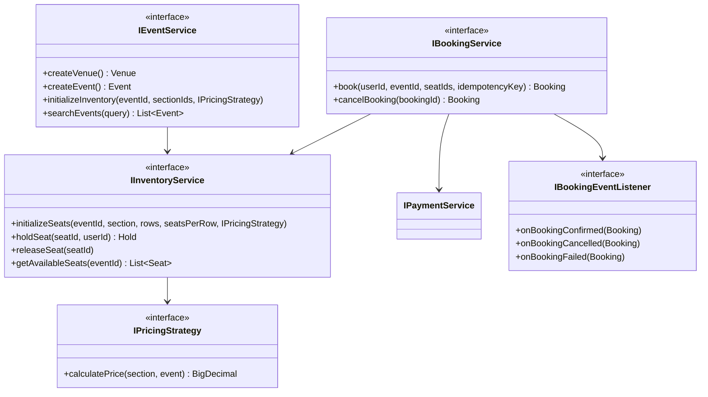
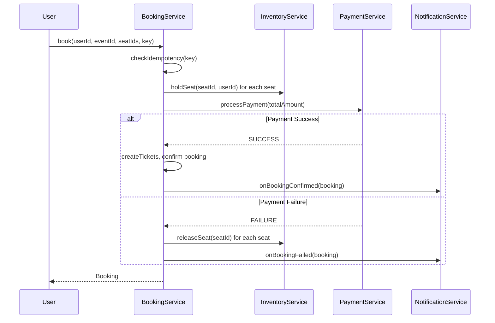

# Ticket Booking System — LLD / Agentic Coding Interview

## 1. Problem Statement

### Objective
Design and implement a concert/event ticket booking system with seat inventory management, pricing strategies, idempotent booking, payment processing, and observer-based notifications.

### Expected Deliverables
- Working console application
- Event and venue management
- Seat inventory with hold/release lifecycle
- Idempotent booking with payment integration
- Observer-based notifications
- Pluggable pricing strategies
- 15 passing JUnit 4 tests

### Constraints
- **Programming language:** Java 11
- **Database:** In-memory repositories
- **Framework:** None (plain Java)
- **Time limit:** 60–90 minutes
- **AI coding tool:** Cascade (Windsurf)
- **Other restrictions:** No Spring; only JUnit 4

---

## 2. Requirement Analysis

### 2.1 Functional Requirements (FR)

| ID | Requirement | Priority | Acceptance Criteria |
|----|-------------|----------|---------------------|
| FR-01 | Create venues with sections | Must | Venue and sections stored; sections have capacity |
| FR-02 | Create events at venues | Must | Event associated with venue; has date, artist, status |
| FR-03 | Initialize seat inventory for event sections | Must | Seats created per section with pricing strategy applied |
| FR-04 | Search events by keyword | Should | Returns matching events by name/artist |
| FR-05 | Hold seats temporarily before booking | Must | Seat held for a user; prevents others from booking same seat |
| FR-06 | Book seats with idempotency key | Must | Same key returns same booking; duplicate requests safe |
| FR-07 | Process payment during booking | Must | Payment success → booking confirmed; failure → seats released |
| FR-08 | Cancel a booking | Must | Seats released back to available; refund triggered |
| FR-09 | Notify users on booking lifecycle events | Should | Observer fires on confirmed/cancelled/failed |
| FR-10 | Pluggable pricing strategies | Should | FlatPricing and SurgePricing interchangeable |

### 2.2 Non-Functional Requirements (NFR)

| ID | Requirement | Expected Behaviour |
|----|-------------|-------------------|
| NFR-01 | Performance | Seat lookup O(1) by ID; hold/release O(1) |
| NFR-02 | Scalability | ConcurrentHashMap for seat registry; CopyOnWriteArrayList for listeners |
| NFR-03 | Concurrency | ConcurrentHashMap.putIfAbsent for idempotency; holds managed atomically |
| NFR-04 | Reliability | Payment failure triggers automatic seat release and booking failure notification |
| NFR-05 | Maintainability | Strategy pattern for pricing; Observer for notifications; Factory for seat/ticket creation |
| NFR-06 | Security | Idempotency key prevents double-booking; holds expire conceptually (not time-based in this impl) |

### 2.3 Clarifying Questions

| Question | Answer | Impact |
|----------|--------|--------|
| Can holds expire automatically? | Not in this implementation | Simplification; real system uses TTL |
| Is payment synchronous? | Yes, in-process with configurable failure rate | Simulates real payment gateway |
| Multi-seat booking in one request? | Yes, list of seatIds | BookingService accepts List<String> |
| Can cancelled tickets be rebooked? | Yes, seats return to available | IHoldRepository.delete called |

### 2.4 Ambiguities and Missing Requirements
- **Business ambiguities:** Partial booking (some seats unavailable) → all-or-nothing not enforced; each seat booked individually
- **Technical ambiguities:** Hold timeout not implemented; staleness risk in high-load
- **Failure scenarios:** Payment failure → seats released; observer notified of failure
- **Concurrency scenarios:** Two users trying to hold same seat → first wins (ConcurrentHashMap.putIfAbsent)
- **Boundary conditions:** Booking with empty seat list → reject; booking after cancellation with same idempotency key → return original

### 2.5 Assumptions

| ID | Assumption | Reason |
|----|-----------|--------|
| A-01 | Seats are pre-created at event setup time via `initializeSeats` | Inventory must exist before holds |
| A-02 | Payment has a configurable failure rate for testing | Simulates unreliable external service |
| A-03 | Idempotency key is caller-supplied (e.g., UUID) | Caller responsible for uniqueness per booking attempt |
| A-04 | One section can span multiple rows of seats | SeatFactory generates row+number combos |

---

## 3. Scope and Design Decisions

### In Scope
- Venue, section, event creation
- Seat inventory initialization with pricing
- Hold / release seats
- Idempotent booking
- Payment processing with failure simulation
- Booking cancellation
- Observer notifications (confirmation, cancellation, failure)
- FlatPricingStrategy and SurgePricingStrategy
- SeatFactory, TicketFactory

### Out of Scope
- Hold expiry / TTL
- Waitlist management
- Multi-currency
- Refund processing (only notified, not implemented)
- Persistent storage

### Engineering Decisions

| Decision | Selected Approach | Alternatives | Reason |
|----------|-------------------|--------------|--------|
| Storage | InMemory repositories per entity | Database | In-memory; interview scope |
| Idempotency | `ConcurrentHashMap.putIfAbsent(key, booking)` | DB unique constraint | Single JVM; atomic |
| Pricing | Strategy pattern (`IPricingStrategy`) | Hard-coded | OCP; pluggable at event setup |
| Notifications | Observer pattern (`IBookingEventListener`) | Direct calls | Decoupled; multiple listeners |
| Object creation | Factory pattern (SeatFactory, TicketFactory) | `new` everywhere | Encapsulated creation logic |
| Hold management | `IHoldRepository` with `putIfAbsent` semantic | Synchronized map | Thread-safe single-winner semantics |

---

## 4. Use Cases and Scenarios

### Primary Use Cases
1. Admin creates venue → adds sections → creates event → initializes inventory
2. User searches for event → holds seats → books with payment → receives confirmation
3. User cancels booking → seats released → refund notification sent
4. Duplicate booking request with same idempotency key → same result returned

### Happy Path Scenarios
- Create event with flat pricing → hold 2 seats → book with successful payment → get 2 tickets
- Surge pricing applied for high-demand event

### Negative Scenarios
- Hold already-held seat → rejected (seat not available)
- Book with failing payment → seats released, booking marked FAILED

### Edge Cases
- Booking with same idempotency key twice → second call returns first booking unchanged
- Cancel already-cancelled booking → idempotent

### Failure Scenarios
- Payment gateway returns failure → `BookingService` releases all held seats and fires `onBookingFailed`

### Concurrent Execution Scenarios
- Two users concurrently hold same seat → ConcurrentHashMap.putIfAbsent → only one succeeds

---

## 5. Domain Model

### Entities
- **Venue** — id, name, location, List<Section>
- **Section** — id, venueId, name, capacity
- **Event** — id, name, artist, venueId, dateTime, status
- **Seat** — id, eventId, sectionId, row, number, price, status (AVAILABLE/HELD/BOOKED)
- **Hold** — id, seatId, userId, expiresAt
- **Booking** — id, userId, eventId, List<Ticket>, totalAmount, status, idempotencyKey
- **Ticket** — id, bookingId, eventId, seatId, userId
- **Payment** — id, bookingId, amount, status

### Value Objects
- `SeatStatus` enum: AVAILABLE, HELD, BOOKED
- `BookingStatus` enum: PENDING, CONFIRMED, CANCELLED, FAILED

### Relationships
- Venue 1 → N Section
- Event N → 1 Venue
- Event 1 → N Seat (via inventory initialization)
- Booking 1 → N Ticket
- Booking 1 → 1 Payment

### Business Invariants
- A seat can only be held by one user at a time
- Payment must succeed for booking to be confirmed
- A booking's idempotency key is unique

### State Transitions
```
Seat: AVAILABLE → HELD (holdSeat) → BOOKED (confirmBooking)
                 HELD → AVAILABLE (releaseSeat / payment failure / cancellation)
Booking: PENDING → CONFIRMED (payment success)
         PENDING → FAILED (payment failure)
         CONFIRMED → CANCELLED (cancelBooking)
```

### Class Diagram


---

## 6. API and Contracts

### API Definitions (Service layer — no HTTP)

| Operation | Input | Output | Errors |
|-----------|-------|--------|--------|
| `createVenue` | name, location | Venue | — |
| `createEvent` | name, artist, venueId, dateTime | Event | Venue not found |
| `initializeInventory` | eventId, sectionIds, IPricingStrategy | void | Event not found |
| `holdSeat` | seatId, userId | Hold | Seat not available |
| `book` | userId, eventId, seatIds, idempotencyKey | Booking | Hold failure, payment failure |
| `cancelBooking` | bookingId | Booking | Booking not found |
| `searchEvents` | query | List<Event> | — |

### Interface Definitions
```java
interface IPricingStrategy { BigDecimal calculatePrice(Section section, Event event); }
interface IBookingEventListener { void onBookingConfirmed(Booking b); void onBookingCancelled(Booking b); void onBookingFailed(Booking b); }
```

---

## 7. Low-Level Design (LLD)

### Design Patterns
- **Strategy** — `IPricingStrategy` (FlatPricingStrategy, SurgePricingStrategy)
- **Observer** — `IBookingEventListener` (NotificationService)
- **Factory** — `SeatFactory`, `TicketFactory`
- **Repository** — Separate interface + in-memory implementation per entity

### SOLID Principles
- **OCP** — New pricing strategy without modifying BookingService or InventoryService
- **DIP** — BookingService depends on IInventoryService, IPaymentService, not concretes
- **ISP** — IEventService, IInventoryService, IBookingService separated by concern

### Sequence Diagrams


### Complexity Analysis
- **Time complexity:** Hold O(1); book O(S) where S = number of seats; search O(N) where N = events
- **Space complexity:** O(V + E + S + B) — venues, events, seats, bookings

---

## 8. Concurrency and Failure Handling

### Shared Mutable State
- `IHoldRepository` — ConcurrentHashMap; seat holds
- `IBookingRepository` — `putIfAbsentByIdempotencyKey` for atomic idempotency

### Locking Strategy
- `ConcurrentHashMap.putIfAbsent` for hold assignment (atomic single-winner)
- No explicit `ReentrantLock`; relies on ConcurrentHashMap atomicity

### Idempotency
- `IBookingRepository.putIfAbsentByIdempotencyKey(key, booking)` — returns existing if present

### Failure Scenarios
- Payment failure: seats released via `releaseSeat`, booking status → FAILED, `onBookingFailed` fired

---

## 9. Implementation Plan

### Project Structure
```
TicketBooking/src/main/java/com/rcpky/
├── model/          Venue, Section, Event, Seat, Hold, Booking, Ticket, Payment, enums
├── repository/     I*Repository interfaces
│   └── impl/       InMemory* implementations
├── strategy/       IPricingStrategy, FlatPricingStrategy, SurgePricingStrategy
├── observer/       IBookingEventListener, NotificationService
├── factory/        SeatFactory, TicketFactory
├── service/        I*Service interfaces + implementations
└── TicketingApp.java
```

### Implementation Milestones
- **Milestone 1:** Domain models (Venue, Section, Event, Seat, Hold, Booking, Ticket, Payment)
- **Milestone 2:** Repository interfaces + in-memory implementations
- **Milestone 3:** Strategy layer (IPricingStrategy, Flat, Surge)
- **Milestone 4:** Factory layer (SeatFactory, TicketFactory)
- **Milestone 5:** Observer layer (IBookingEventListener, NotificationService)
- **Milestone 6:** Service implementations (InventoryService, PaymentService, BookingService, EventService, SearchService)
- **Milestone 7:** TicketingApp demo + 15 JUnit 4 tests

---

## 10. Implementation Notes

### Implemented Components
- All 7 repository interfaces + InMemory implementations
- FlatPricingStrategy: Map<sectionId, price>; SurgePricingStrategy: basePrices × surgeMultiplier
- SeatFactory.create(eventId, section, row, num, price) → Seat
- TicketFactory.create(bookingId, eventId, seatId, userId) → Ticket
- NotificationService implements IBookingEventListener (3 methods)
- All service implementations wired via constructor injection

### Known Limitations
- No hold TTL expiry; stale holds must be cleaned up manually
- PaymentService uses in-process failure rate simulation only

---

## 11. Testing and Code Review

### Unit Tests (15 total)
- Venue/event creation
- Seat inventory initialization with flat and surge pricing
- Hold success and duplicate hold rejection
- Booking happy path with payment success
- Booking with payment failure → seats released
- Idempotent booking (same key, same result)
- Booking cancellation → seats released
- Observer notifications fired correctly
- Search by keyword
- Edge cases (empty seat list, non-existent event)

### Build and Test Results
- `mvn test` → 15 tests pass

---

## 12. Demo and Retrospective

### Demo Scenarios
1. Create venue + 3 sections + event
2. Initialize inventory with flat pricing (₹500 floor, ₹1000 VIP)
3. User A holds 2 floor seats → books → confirmation sent
4. User B tries to hold same seat → rejected
5. User C holds and books; payment fails → seats released; failure notification sent
6. Same booking key submitted twice → identical response
7. User A cancels booking → seats back to available

### What Went Well
- Observer pattern cleanly decouples notifications from booking logic
- Strategy pattern makes pricing trivially swappable

### What I Would Improve
- Add hold TTL with ScheduledExecutorService
- Add partial-hold rollback if one seat in a multi-seat hold fails
- Implement real idempotency store with TTL expiry

### Final Readiness Assessment
- **Requirements:** ✅ All 10 FRs implemented
- **Design:** ✅ Strategy + Observer + Factory + Repository patterns
- **Implementation:** ✅ Working with TicketingApp demo
- **Testing:** ✅ 15 JUnit 4 tests pass
- **Code ownership:** ✅
- **Overall:** ✅ Interview-ready
