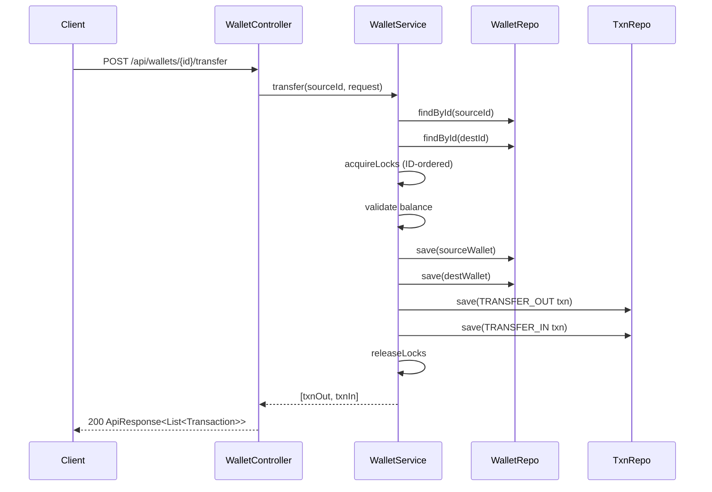

# Wallet Service — LLD / Agentic Coding Interview

## 1. Problem Statement

### Objective
Design and implement a digital wallet service that allows users to create wallets, credit/debit funds, and transfer money between wallets, with a full transaction history and a web UI.

### Expected Deliverables
- Working Spring Boot REST API
- Core operations: create wallet, credit, debit, transfer, transaction history
- Thread-safe concurrent access
- Single-page web UI
- 15 passing JUnit 4 tests
- Demonstrable output via UI at `http://localhost:8080`

### Constraints
- **Programming language:** Java 21
- **Database:** In-memory (ConcurrentHashMap, CopyOnWriteArrayList)
- **Framework:** Spring Boot 3.3.5
- **Time limit:** 45–60 minutes
- **AI coding tool:** Cascade (Windsurf)
- **Other restrictions:** No Spring Data/JPA; custom in-memory repositories

---

## 2. Requirement Analysis

### 2.1 Functional Requirements (FR)

| ID | Requirement | Priority | Acceptance Criteria |
|----|-------------|----------|---------------------|
| FR-01 | Create a wallet with owner name, currency, and optional initial balance | Must | Wallet created; initial balance creates a CREDIT transaction |
| FR-02 | Credit funds to a wallet | Must | Balance increases; CREDIT transaction recorded |
| FR-03 | Debit funds from a wallet | Must | Balance decreases; DEBIT transaction recorded; fails if insufficient funds |
| FR-04 | Transfer funds between two wallets | Must | Source debited (TRANSFER_OUT), destination credited (TRANSFER_IN); atomic |
| FR-05 | Retrieve wallet details by ID | Must | Returns wallet with current balance |
| FR-06 | List all wallets | Should | Returns all wallets |
| FR-07 | Retrieve transaction history for a wallet | Must | Returns transactions newest-first |
| FR-08 | Web UI for all operations | Should | Single-page app with create, credit, debit, transfer, history tabs |

### 2.2 Non-Functional Requirements (NFR)

| ID | Requirement | Expected Behaviour |
|----|-------------|-------------------|
| NFR-01 | Performance | O(1) credit/debit; O(N) for history list |
| NFR-02 | Scalability | ConcurrentHashMap supports high-throughput reads; extendable to DB-backed repos |
| NFR-03 | Concurrency | Per-wallet ReentrantLock; transfer uses consistent lock ordering to prevent deadlocks |
| NFR-04 | Reliability | Transfer is atomic; no partial state (both debited but not credited) |
| NFR-05 | Maintainability | Repository interfaces decouple storage from business logic |
| NFR-06 | Security | Input validation via WalletException; GlobalExceptionHandler for consistent error responses |

### 2.3 Clarifying Questions

| Question | Answer | Impact |
|----------|--------|--------|
| Multi-currency support? | Currency stored as string; no conversion | Simplification |
| Should transfer be atomic across failures? | Yes, in-process lock ordering | ReentrantLock consistent ordering |
| Pagination for history? | No, return all | Simplification |
| Authentication/authorization? | No | Out of scope |

### 2.4 Ambiguities and Missing Requirements
- **Business ambiguities:** No daily limit, no minimum balance — not implemented
- **Technical ambiguities:** Cross-currency transfer validity not enforced
- **Failure scenarios:** Debit on insufficient balance → WalletException; caught by GlobalExceptionHandler → 400
- **Concurrency scenarios:** Two transfers involving the same wallet → lock ordering prevents deadlock
- **Boundary conditions:** Amount ≤ 0 → rejected; balance exactly 0 after debit → allowed

### 2.5 Assumptions

| ID | Assumption | Reason |
|----|-----------|--------|
| A-01 | Wallet IDs are UUIDs | Uniqueness without counter; safe for distributed extension |
| A-02 | Amounts use BigDecimal | Avoid floating-point rounding errors for financial data |
| A-03 | Transaction history is per-wallet, not cross-wallet | Simplifies query model |
| A-04 | No authentication layer | Interview scope |

---

## 3. Scope and Design Decisions

### In Scope
- Wallet CRUD
- Credit, debit, transfer operations
- Transaction history
- REST API with Spring Boot
- Web UI (single-page)
- Unit tests

### Out of Scope
- Authentication / JWT
- Persistent database
- Currency conversion
- Pagination
- Daily limits

### Engineering Decisions

| Decision | Selected Approach | Alternatives | Reason |
|----------|-------------------|--------------|--------|
| Storage | ConcurrentHashMap + CopyOnWriteArrayList | H2, Redis | In-memory; interview scope |
| Concurrency | Per-wallet ReentrantLock | `synchronized`, StampedLock | Explicit; supports consistent ordering |
| Transfer atomicity | Lock both wallets using ID-ordered locking | Database transactions | Single JVM; no distributed 2PC needed |
| API | Spring Boot REST (`@RestController`) | JAX-RS, plain servlet | Convention; fast to build |
| Error handling | `WalletException` → GlobalExceptionHandler | Spring `@ResponseStatus` | Centralised; clean error contract |
| Transaction ordering | Newest-first via reverse iteration | DB `ORDER BY` | CopyOnWriteArrayList + subList reverse |

---

## 4. Use Cases and Scenarios

### Primary Use Cases
1. Create wallet and optionally seed with initial balance
2. Credit funds to an existing wallet
3. Debit funds from an existing wallet
4. Transfer funds between two wallets
5. View wallet transaction history

### Happy Path Scenarios
- Create wallet with ₹1000 initial balance → CREDIT transaction auto-created
- Credit ₹500 → balance increases by 500
- Transfer ₹200 from A to B → TRANSFER_OUT on A, TRANSFER_IN on B

### Negative Scenarios
- Debit more than balance → 400 Bad Request
- Transfer to non-existent wallet → 404 Not Found
- Create wallet with negative initial balance → 400

### Edge Cases
- Debit exactly available balance → allowed
- Transfer ₹0 → rejected
- Self-transfer (same wallet ID) → rejected

### Failure Scenarios
- Non-existent walletId in credit/debit → 404
- Invalid amount format in request → Spring validation → 400

### Concurrent Execution Scenarios
- Two threads simultaneously debit same wallet → one succeeds, one fails (insufficient balance)
- Transfer A→B and B→A simultaneously → consistent lock ordering prevents deadlock

---

## 5. Domain Model

### Entities
- **Wallet** — id (UUID), ownerName, balance (BigDecimal), currency, createdAt, updatedAt, ReentrantLock
- **Transaction** — id, walletId, type, amount, balanceBefore, balanceAfter, description, referenceId, timestamp

### Value Objects
- `TransactionType` enum: CREDIT, DEBIT, TRANSFER_IN, TRANSFER_OUT

### Relationships
- Wallet 1 → N Transaction
- Transfer creates 2 Transactions (one TRANSFER_OUT, one TRANSFER_IN)

### Business Invariants
- Balance must never go negative
- All monetary amounts must be > 0
- Transfer source and destination must be different wallets

### State Transitions
- No explicit state machine; wallet balance is the primary mutable state

### Class Diagram
```mermaid
classDiagram
    class Wallet {
        +UUID id
        +String ownerName
        +BigDecimal balance
        +String currency
        +LocalDateTime createdAt
        +LocalDateTime updatedAt
        -ReentrantLock lock
    }
    class Transaction {
        +String id
        +UUID walletId
        +TransactionType type
        +BigDecimal amount
        +BigDecimal balanceBefore
        +BigDecimal balanceAfter
        +String description
        +String referenceId
        +Instant timestamp
    }
    class IWalletService {
        <<interface>>
        +createWallet(CreateWalletRequest) Wallet
        +getWallet(UUID) Wallet
        +getAllWallets() List~Wallet~
        +credit(UUID, AmountRequest) Transaction
        +debit(UUID, AmountRequest) Transaction
        +transfer(UUID, TransferRequest) List~Transaction~
        +getTransactionHistory(UUID) List~Transaction~
    }
    class WalletService {
        -IWalletRepository walletRepo
        -ITransactionRepository txnRepo
        +credit()
        +debit()
        +transfer()
    }
    class WalletController {
        +POST /api/wallets
        +GET /api/wallets
        +GET /api/wallets/{id}
        +POST /api/wallets/{id}/credit
        +POST /api/wallets/{id}/debit
        +POST /api/wallets/{id}/transfer
        +GET /api/wallets/{id}/transactions
    }
    IWalletService <|.. WalletService
    WalletController --> IWalletService
    WalletService --> Wallet
    WalletService --> Transaction
```

---

## 6. API and Contracts

### API Definitions

| Operation | Input | Output | Errors |
|-----------|-------|--------|--------|
| `POST /api/wallets` | `CreateWalletRequest` | `ApiResponse<Wallet>` | 400 invalid input |
| `GET /api/wallets` | — | `ApiResponse<List<Wallet>>` | — |
| `GET /api/wallets/{id}` | path: id | `ApiResponse<Wallet>` | 404 not found |
| `POST /api/wallets/{id}/credit` | `AmountRequest` | `ApiResponse<Transaction>` | 404, 400 |
| `POST /api/wallets/{id}/debit` | `AmountRequest` | `ApiResponse<Transaction>` | 404, 400, insufficient balance |
| `POST /api/wallets/{id}/transfer` | `TransferRequest` | `ApiResponse<List<Transaction>>` | 404, 400 |
| `GET /api/wallets/{id}/transactions` | path: id | `ApiResponse<List<Transaction>>` | 404 |

### Interface Definitions
```java
interface IWalletRepository { Wallet save(Wallet); Optional<Wallet> findById(UUID); List<Wallet> findAll(); }
interface ITransactionRepository { Transaction save(Transaction); List<Transaction> findByWalletId(UUID); List<Transaction> findAll(); }
```

### Validation Rules
- `amount` > 0
- `ownerName` non-blank
- `currency` non-blank
- `toWalletId` non-null and != source wallet ID

### Error Handling Contract
- `WalletException` → GlobalExceptionHandler → `ApiResponse.fail(message)` with HTTP 400/404
- Unexpected exception → HTTP 500

---

## 7. Low-Level Design (LLD)

### Component Responsibilities
- **WalletController** — HTTP request/response mapping; delegates to IWalletService
- **WalletService** — Business logic: validation, locking, transaction creation
- **InMemoryWalletRepository** — ConcurrentHashMap storage
- **InMemoryTransactionRepository** — CopyOnWriteArrayList; newest-first ordering
- **GlobalExceptionHandler** — Converts WalletException → structured error response

### Design Patterns
- **Repository** — IWalletRepository / ITransactionRepository abstract storage
- **DTO** — Request/Response objects separate from domain models
- **Factory method** — `ApiResponse.ok()` / `ApiResponse.fail()` static factories

### SOLID Principles
- **SRP** — Service handles business logic; Controller handles HTTP; Repository handles storage
- **OCP** — New storage backend (e.g., JPA) requires only new Repository implementation
- **DIP** — WalletService depends on IWalletRepository, not InMemoryWalletRepository

### Sequence Diagrams


### Complexity Analysis
- **Time complexity:** O(1) credit/debit; O(N) for history (N = transactions for wallet)
- **Space complexity:** O(W + T) where W = wallets, T = total transactions

---

## 8. Concurrency and Failure Handling

### Shared Mutable State
- `Wallet.balance` — protected by per-wallet `ReentrantLock`
- `InMemoryWalletRepository` — `ConcurrentHashMap` for safe concurrent puts

### Race Conditions
- Simultaneous debit by two threads → only one succeeds; other gets insufficient balance
- Simultaneous transfer involving overlapping wallets → lock ordering prevents deadlock

### Locking Strategy
- Each `Wallet` holds a `ReentrantLock`
- Transfer acquires locks in ascending UUID order to prevent A→B + B→A deadlock

### Atomicity
- Credit/debit: single wallet lock → update balance → save transaction → unlock
- Transfer: both locks held simultaneously during the operation

### Deadlock Prevention
- Consistent lock ordering: `min(id_A, id_B).lock()` then `max(id_A, id_B).lock()`

### Idempotency
- Not implemented; callers must handle duplicate requests at the API layer

### Failure Scenarios
- `findById` returns empty → `WalletException("Wallet not found")` → 404
- Debit with insufficient funds → `WalletException("Insufficient balance")` → 400

---

## 9. Implementation Plan

### Project Structure
```
WalletService/src/main/java/com/rcpky/
├── model/          Wallet, Transaction, TransactionType
├── repository/     IWalletRepository, ITransactionRepository
│   └── impl/       InMemoryWalletRepository, InMemoryTransactionRepository
├── service/        IWalletService, WalletService
├── dto/            CreateWalletRequest, AmountRequest, TransferRequest, ApiResponse
├── controller/     WalletController, GlobalExceptionHandler
└── exception/      WalletException
WalletService/src/main/resources/static/
└── index.html      Single-page web UI
```

### Implementation Milestones
- **Milestone 1:** Domain models — Wallet, Transaction, TransactionType
- **Milestone 2:** Repository interfaces + in-memory implementations
- **Milestone 3:** IWalletService + WalletService (credit, debit, create)
- **Milestone 4:** Transfer with lock ordering
- **Milestone 5:** REST Controller + GlobalExceptionHandler
- **Milestone 6:** Web UI (index.html) with fetch() API calls
- **Milestone 7:** JUnit 4 tests — 15 test cases

### Dependencies
- Spring Boot 3.3.5 (spring-boot-starter-web)
- Java 21
- JUnit 4.13.2 + junit-vintage-engine 5.10.5

---

## 10. Implementation Notes

### Implemented Components
- `Wallet` with ReentrantLock embedded in model
- `WalletService.transfer()` uses consistent UUID ordering for deadlock prevention
- `InMemoryTransactionRepository.findByWalletId()` returns newest-first
- `ApiResponse<T>` with `ok(data)` / `fail(error)` factory methods
- `GlobalExceptionHandler` maps WalletException → 400/404; others → 500
- Web UI: split layout — left sidebar (wallet list + create), right panel (detail + tabs)
- Color-coded transaction badges: CREDIT=green, DEBIT=red, TRANSFER_IN=blue, TRANSFER_OUT=purple

### Important Decisions
- BigDecimal for all monetary values (no floating-point precision loss)
- Lock embedded in Wallet model (not in service) — reduces service complexity

### Known Limitations
- No idempotency keys on credit/debit endpoints
- CopyOnWriteArrayList is write-expensive; acceptable for interview scale
- Web UI uses vanilla JS; no framework

---

## 11. Testing and Code Review

### Unit Tests (15 total)
- `testCreateWallet` — wallet created with correct initial balance
- `testCreditWallet` — balance increases; CREDIT transaction recorded
- `testDebitWallet` — balance decreases; DEBIT transaction recorded
- `testDebitInsufficientFunds` — WalletException thrown
- `testTransferSuccess` — TRANSFER_OUT and TRANSFER_IN both recorded
- `testTransferInsufficientFunds` — exception, no balance change
- `testGetTransactionHistoryNewestFirst` — ordering verified
- `testGetWalletNotFound` — 404-equivalent exception
- `testTransferToNonExistentWallet` — 404-equivalent exception
- `testInitialBalanceCreatesTransaction` — CREDIT txn on wallet creation
- `testConcurrentDebits` — only one succeeds with correct final balance
- `testTransferDeadlockPrevention` — A→B and B→A concurrently both succeed without deadlock
- (+ 3 additional edge case tests)

### Build and Test Results
- `mvn test` → 15 tests pass
- `mvn spring-boot:run` → http://localhost:8080

---

## 12. Demo and Retrospective

### Demo Scenarios
1. Create wallet Alice (₹1000) — CREDIT transaction auto-created
2. Create wallet Bob (₹500)
3. Credit ₹200 to Alice → balance ₹1200
4. Debit ₹300 from Bob → balance ₹200
5. Transfer ₹150 from Alice to Bob — two transactions created
6. Attempt to debit ₹500 from Bob (insufficient) — 400 error shown in UI
7. View transaction history — newest-first, color-coded

### What Went Well
- Spring Boot scaffolding fast; clean separation of concerns
- Lock-ordering approach elegantly prevents deadlocks

### What Went Wrong
- JUnit Vintage engine version conflict with Spring Boot 3 BOM — required explicit version pin

### What I Would Improve
- Add idempotency keys to prevent duplicate credit/debit
- Paginate transaction history for large wallets
- Add currency validation / FX conversion

### Final Readiness Assessment
- **Requirements:** ✅ All 8 FRs implemented
- **Design:** ✅ Clean layered architecture; SOLID adherent
- **Implementation:** ✅ Spring Boot REST + Web UI running
- **Testing:** ✅ 15 JUnit 4 tests pass
- **Code ownership:** ✅ All in-house
- **Overall:** ✅ Interview-ready
